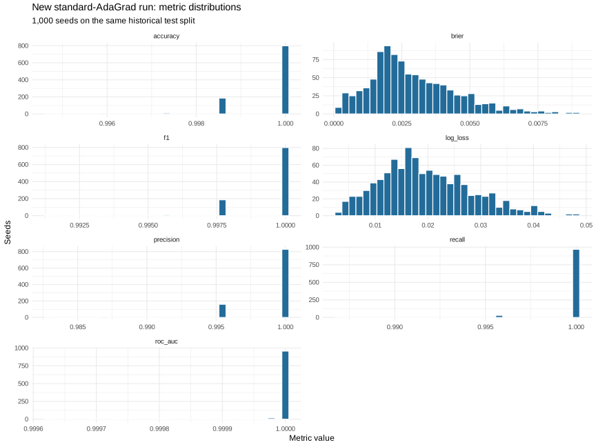
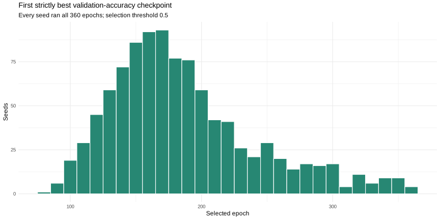
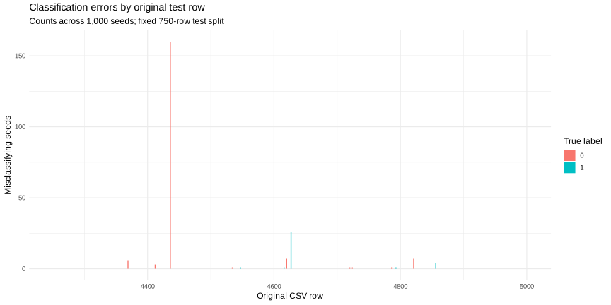
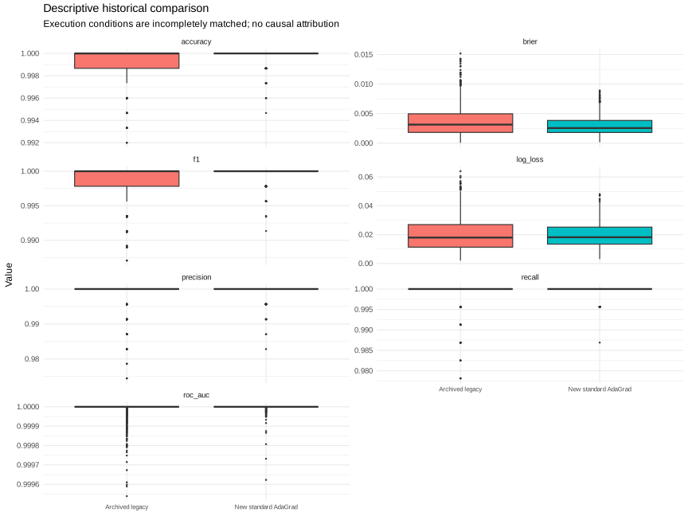

# New reconstructed DDESONN standard-AdaGrad heart-failure benchmark: 1,000 seeds

All **1,000 new production seeds (1–1,000)** completed 360 epochs and passed artifact checks. This is a new reconstructed experiment, not a verified continuation of the original 100-seed study. The pilot and all earlier records are separate and never count toward production.

## Results on the fixed historical test split

Mean accuracy: **99.97053333%**; sample SD across seeds: **0.06315883 percentage points**. Total errors across 750,000 repeated seed-by-row predictions: **221**, comprising **188 false positives and 33 false negatives**. **15 of the fixed 750 test rows** were misclassified at least once.

Aggregate confusion counts over those repeated predictions: **TP 228967, TN 520812, FP 188, FN 33**. Every seed's counts are in the full table and CSV.

| metric | n | missing | mean | sample_sd | median | minimum | q01 | q05 | q25 | q75 | q95 | q99 | maximum |
| --- | --- | --- | --- | --- | --- | --- | --- | --- | --- | --- | --- | --- | --- |
| accuracy | 1000 | 0 | 0.999705333333 | 0.000631588309488 | 1 | 0.994666666667 | 0.997333333333 | 0.998666666667 | 1 | 1 | 1 | 1 | 1 |
| precision | 1000 | 0 | 0.999183358325 | 0.0019145390445 | 1 | 0.982832618026 | 0.991341991342 | 0.995652173913 | 1 | 1 | 1 | 1 | 1 |
| recall | 1000 | 0 | 0.999855895197 | 0.000850676417924 | 1 | 0.986899563319 | 0.995633187773 | 1 | 1 | 1 | 1 | 1 | 1 |
| f1 | 1000 | 0 | 0.999518373615 | 0.00103175565633 | 1 | 0.991341991342 | 0.995652173913 | 0.997821350763 | 1 | 1 | 1 | 1 | 1 |
| roc_auc | 1000 | 0 | 0.99999779564 | 1.79812778671e-05 | 1 | 0.999622828119 | 0.999949710416 | 1 | 1 | 1 | 1 | 1 | 1 |
| log_loss | 1000 | 0 | 0.0195290555375 | 0.00861872593884 | 0.0182035942331 | 0.00305461130516 | 0.00424532382374 | 0.0068252319467 | 0.0133990551782 | 0.0252186939194 | 0.0349856011762 | 0.0413817175896 | 0.0480891294053 |
| brier | 1000 | 0 | 0.0029222402564 | 0.00160942267848 | 0.00255815018685 | 0.000174089107358 | 0.000332370463076 | 0.000690447698727 | 0.00181002462605 | 0.00384755821056 | 0.00595708904072 | 0.00768816977607 | 0.00890531832851 |

Full-precision results: [every seed](per-seed-test-metrics.csv), [all split metrics](all-split-metrics.csv), [all summary statistics](metric-summary.csv), [every test row](test-row-errors.csv), [each error event](test-error-events.csv), all 360 validation accuracies for every seed (in the standalone bundle).

## Checkpoint selection and timing

Selected epoch mean 186.824000, median 175.000000, sample SD 56.053537, range 79.0–360.0. Every seed runs all 360 epochs. Per-seed elapsed wall time mean 33.391s, median 33.193s, sample SD 1.247s, range 30.060–38.642s. This status clock begins after package loading and ends before status writing; it excludes process startup, the separate reload process, checksum sealing and supervisor overhead. Elapsed seed times are measured under concurrent execution, not independent end-to-end experiment runtime. See [checkpoint and timing statistics](checkpoint-timing-summary.csv) and [seed audit](seed-audit.csv).

## Frozen protocol and validation

Source revision `a95bc8dda84c4eb35633ee5a5bb456169c1c54b8`, package 7.3.0. All 20 archived source/dataset SHA256 fingerprints matched. Freeze SHA256: `09199bb31be1388778afe5de3609cd52e731a7b7a5afeedf6148d23eb86a3553`. The freeze covers configuration, protocol, training/reload/supervisor/pilot harnesses and extracted source before the two validated pilots.

All 12 predictors in CSV column order; rows 1–3500 training, 3501–4250 validation and 4251–5000 test. Training means and sample SDs standardize every split; all standardized splits share the maximum absolute standardized training value divisor. One 12→64→32→1 ReLU/ReLU/sigmoid network, He initialization with custom_scale 1.04349, native standard AdaGrad, fixed lr .125 and decay multiplier 1, L1 .00028, dropout list(.1,NULL,NULL), epsilon 1e-7, native positive/negative weights 2/1. No self-organization, batch normalization, extra normalization, sequence encoding, tuning, early stopping or seed selection.

The fit wrapper replaces empty numeric_columns with numeric predictors, enabling unwanted normalization. The harness calls the unchanged member train_network directly. Exit tracing only reads native validation history; optimizer and package source are unchanged. Native loss spelling CrossEntropy and other inert AdaGrad arguments are frozen and documented in PROTOCOL.md. Both selected weights and biases are restored. Classification is probability >= .5. First strictly higher native validation accuracy at .5 selects the checkpoint; each selected epoch is verified against the first maximum of the full 360-epoch history.

Seed 1 ran twice in fresh processes after the final harness freeze. Initial weights/biases, RNG states, all validation accuracies, final/selected checkpoints and all split predictions matched exactly. Restored validation predictions exactly matched native best-validation probabilities. Both weights and biases were deliberately perturbed, reloaded and verified; saved models reproduced all split predictions in fresh processes. These checks also run for every production seed, with a separate reload process. Pilot acceptance used no test-accuracy target.

The frozen-source arithmetic/reference tests passed **12,162 assertions**, with zero failures, errors, warnings or skips. The supervisor accepted checksum-valid copied pilot artifacts and rejected deliberately tampered predictions. Production completion markers bind per-seed SHA256 manifests to the freeze hash; resumption preserves valid outputs, quarantines invalid ones, and records failures. All 1,000 markers/manifests and per-seed outputs were independently rechecked before this report. Full evidence resides in evidence/ and both pilot directories.

Metrics use positive class 1, ROC levels (0,1) with fixed direction <, clipping only for log loss to [1e-15,1−1e-15], and unclipped probabilities for Brier/AUC. Precision, recall and F1 with zero denominators are NA; AUC with a single class is undefined. This test split has both classes. Missing counts are explicit in the table. Quantiles use linear interpolation (R type 7); SD uses n−1. Native internal loss values are retained separately from these externally recomputed report metrics. CSV probabilities use 17 significant digits; exact RDS values are also retained.

## Historical comparison and standard AdaGrad

All ten files in the archived inventory at 0d1b557098b56b39ed2357b30716dcddc25871b3 matched their SHA256 hashes. Recovered run1 probabilities from 4bc994462612ce868b90bc70885eb1635eddcdee matched the recorded SHA256. Both 500-seed prediction batches contain 750 ordered observations per seed, labels match the fixed CSV test rows, archived classifications match >= .5, and recomputed classification metrics match the stored six-decimal values within rounding precision. Historical metrics below are recomputed from archived probabilities with the same fixed metric definitions as this experiment.

| metric | new_mean | legacy_mean | new_sample_sd | legacy_sample_sd | difference_new_minus_legacy |
| --- | --- | --- | --- | --- | --- |
| accuracy | 0.999705333333 | 0.999218666667 | 0.000631588309488 | 0.00125609022428 | 0.000486666666667 |
| precision | 0.999183358325 | 0.998432322601 | 0.0019145390445 | 0.00335004100139 | 0.000751035723775 |
| recall | 0.999855895197 | 0.999021834061 | 0.000850676417924 | 0.00265692514731 | 0.000834061135371 |
| f1 | 0.999518373615 | 0.998721988685 | 0.00103175565633 | 0.00205314212428 | 0.000796384929834 |
| roc_auc | 0.99999779564 | 0.999986132647 | 1.79812778671e-05 | 4.44283780089e-05 | 1.16629927333e-05 |
| log_loss | 0.0195290555375 | 0.0199935893136 | 0.00861872593884 | 0.0112824817258 | -0.000464533776064 |
| brier | 0.0029222402564 | 0.00367692564965 | 0.00160942267848 | 0.00251797839174 | -0.00075468539325 |

Historical mean accuracy 0.999218666666667, sample SD 0.00125609022428344; new-minus-historical mean accuracy difference 0.04866667 percentage points. Historical error rate 0.000781333333333333, new error rate 0.000294666666666667; observed change -0.000486666666666667, or 365 fewer repeated seed-by-row errors. Accuracy SD changed by -0.000624501914795722. Stored rounded historical summaries give mean 0.999218731 and SD 0.0012560877935814; the small discrepancy from probability-recomputed values is rounding, not another run.

Verified legacy multilayer code applied a direct gradient/regularization weight subtraction followed by an additional adaptive optimizer subtraction from the same weights. Standard AdaGrad removes that double weight-update behavior and applies the accumulated-squared-gradient recurrence once per parameter tensor per step. Archived source is included for inspection. This establishes the code-path difference, not that it alone caused the observed score differences. Historical initialization tensors, RNG states, software and complete execution conditions are not fully verified; matching seed numbers does not prove matched initializations. These are descriptive comparisons, not causal attribution or clinical generalization claims.

The inspected archived Keras Sheet2 summary reports count 1000, mean test accuracy 0.9968085574425587 and sample SD 0.0035694928120038462. **Sheet1 contains 1001 rows and 1000 unique seed labels, with seed 100 duplicated.** The Sheet1 mean and sample SD reproduce the stored Sheet2 values, but the reported count is inconsistent with its 1,001 rows. No rows were removed or silently corrected. These are workbook statistics, not a verified set of 1,000 distinct executions. The archived Python loop is literally range(1, 1), so it cannot regenerate the workbook as written. This experiment does not rerun Keras or establish a fully matched Keras comparison. Workbook evidence, summary and count audit are included without treating them as new results.

## Separate prior reconstruction: descriptive check only

| metric | new_mean | prior_separate_reconstruction_mean | difference |
| --- | --- | --- | --- |
| accuracy | 0.999705333333 | 0.999705333333 | 3.33066907388e-16 |
| precision | 0.999183358325 | 0.999183358325 | -1.11022302463e-16 |
| recall | 0.999855895197 | 0.999855895197 | -4.4408920985e-16 |
| f1 | 0.999518373615 | 0.999518373615 | 1.11022302463e-16 |
| roc_auc | 0.99999779564 | 0.99999779564 | 1.11022302463e-16 |
| log_loss | 0.0195290555375 | 0.0195549172765 | -2.5861739034e-05 |
| brier | 0.0029222402564 | 0.00292584047992 | -3.60022351966e-06 |

The user-supplied prior reconstruction recorded accuracy SD 0.000631588309487631, 221 total errors (188 FP/33 FN) and 15 affected test rows. New values are reported above regardless of agreement. Neither that reconstruction nor archived seed outputs were reused or used as tuning targets. Numerical differences may reflect software, initialization or other historical execution details that remain incompletely verified; the frozen protocol is never silently adjusted to match them.

## Overlap and interpretation limits

Recomputed: 5,000 rows, **1,319 distinct feature vectors**; **734/750 validation** and **738/750 test** feature vectors match training inputs. Only **12 test rows** have feature vectors absent from training. The cause of overlap has not been established; no patient identity or cause of duplication is inferred. The specified historical split was retained. The same 750 rows recur across all seeds: 750,000 predictions are not independent clinical cases. Seed SD is not a patient-population confidence interval. These near-perfect fixed-split scores provide limited evidence about unseen patients.

“We identified substantial overlap between training and test inputs, but its cause has not been established. After this iteration, we will rerun the 1,000-seed benchmark for both Keras and DDESONN using new splits that prevent identical feature vectors from appearing across training, validation, and testing. Both methods will use the same splits for a fair comparison.”

That matched no-overlap Keras/DDESONN study is **future work** and was not launched here.

## Reproduce, resume and retrieve

See [REPRODUCE.md](REPRODUCE.md). Configuration, frozen source/dataset, harness, software inventory, pilots, all per-seed native artifacts, reports, graphs and checksum manifests are included in the standalone bundle. Earlier research records remain preserved in Git history and the standalone archive; the superseded standalone guides were retired from the current tree in 7.3.19. No release was published and no optimizer code was changed.

The bundle is prepared on the cloud filesystem; ARTIFACTS.json records its actual absolute retrieval path, bytes, SHA256 and archive-member verification after creation. The final completion record is written only after archive verification. No external upload/hosting connector is available in this session, so local paths do not establish durable external storage or an externally hosted download. Download/copy the bundle from the workspace using the client’s available file access before the environment is discarded.

## Every seed

The following is the full test table; unrounded CSVs also retain TP/TN/FP/FN, classification errors and all split metrics.

| seed | accuracy | precision | recall | f1 | roc_auc | log_loss | brier | TP | TN | FP | FN | errors |
| --- | --- | --- | --- | --- | --- | --- | --- | --- | --- | --- | --- | --- |
| 1 | 1 | 1 | 1 | 1 | 1 | 0.030239897153669308 | 0.0039488363107442878 | 229 | 521 | 0 | 0 | 0 |
| 2 | 1 | 1 | 1 | 1 | 1 | 0.020289532210959554 | 0.0026352843673395467 | 229 | 521 | 0 | 0 | 0 |
| 3 | 1 | 1 | 1 | 1 | 1 | 0.023964696134881894 | 0.0043808317606611434 | 229 | 521 | 0 | 0 | 0 |
| 4 | 1 | 1 | 1 | 1 | 1 | 0.034979542546846647 | 0.0059014765325380181 | 229 | 521 | 0 | 0 | 0 |
| 5 | 1 | 1 | 1 | 1 | 1 | 0.011067933243241771 | 0.0017897642938326688 | 229 | 521 | 0 | 0 | 0 |
| 6 | 1 | 1 | 1 | 1 | 1 | 0.011667613775524508 | 0.0017517431243905428 | 229 | 521 | 0 | 0 | 0 |
| 7 | 1 | 1 | 1 | 1 | 1 | 0.013063210055787566 | 0.0013918256518902535 | 229 | 521 | 0 | 0 | 0 |
| 8 | 0.9986666666666667 | 0.9956521739130435 | 1 | 0.9978213507625272 | 1 | 0.025542900249151047 | 0.0044790144642977746 | 229 | 520 | 1 | 0 | 1 |
| 9 | 1 | 1 | 1 | 1 | 1 | 0.0066484915448288594 | 0.00072438265180019387 | 229 | 521 | 0 | 0 | 0 |
| 10 | 0.9986666666666667 | 0.9956521739130435 | 1 | 0.9978213507625272 | 1 | 0.0070892602095869138 | 0.0015082119916151205 | 229 | 520 | 1 | 0 | 1 |
| 11 | 1 | 1 | 1 | 1 | 1 | 0.013806028846856539 | 0.0020000557814753577 | 229 | 521 | 0 | 0 | 0 |
| 12 | 1 | 1 | 1 | 1 | 1 | 0.023670225275248993 | 0.0037006460885136193 | 229 | 521 | 0 | 0 | 0 |
| 13 | 1 | 1 | 1 | 1 | 1 | 0.025267116104786821 | 0.003411119966020934 | 229 | 521 | 0 | 0 | 0 |
| 14 | 0.9986666666666667 | 0.9956521739130435 | 1 | 0.9978213507625272 | 0.99995809201317587 | 0.030521922673886964 | 0.0048576752403167124 | 229 | 520 | 1 | 0 | 1 |
| 15 | 1 | 1 | 1 | 1 | 1 | 0.019586995413387889 | 0.0031837864968671382 | 229 | 521 | 0 | 0 | 0 |
| 16 | 1 | 1 | 1 | 1 | 1 | 0.014308203313177741 | 0.0015545483838006831 | 229 | 521 | 0 | 0 | 0 |
| 17 | 1 | 1 | 1 | 1 | 1 | 0.0081396575974422656 | 0.00070990886951226935 | 229 | 521 | 0 | 0 | 0 |
| 18 | 1 | 1 | 1 | 1 | 1 | 0.047445356004595984 | 0.0089053183285054457 | 229 | 521 | 0 | 0 | 0 |
| 19 | 1 | 1 | 1 | 1 | 1 | 0.011322101481879204 | 0.0015849845605252204 | 229 | 521 | 0 | 0 | 0 |
| 20 | 0.9986666666666667 | 1 | 0.99563318777292575 | 0.99781181619256021 | 1 | 0.0039425440543832289 | 0.00068315172462744833 | 228 | 521 | 0 | 1 | 1 |
| 21 | 1 | 1 | 1 | 1 | 1 | 0.028486612110436307 | 0.0040281457666489365 | 229 | 521 | 0 | 0 | 0 |
| 22 | 0.9986666666666667 | 0.9956521739130435 | 1 | 0.9978213507625272 | 1 | 0.01291824344483399 | 0.0018323178879198496 | 229 | 520 | 1 | 0 | 1 |
| 23 | 0.9986666666666667 | 0.9956521739130435 | 1 | 0.9978213507625272 | 1 | 0.023657840732603016 | 0.0033802149118502722 | 229 | 520 | 1 | 0 | 1 |
| 24 | 1 | 1 | 1 | 1 | 1 | 0.02545153371473979 | 0.0038205276051616098 | 229 | 521 | 0 | 0 | 0 |
| 25 | 0.9986666666666667 | 0.9956521739130435 | 1 | 0.9978213507625272 | 1 | 0.014704476432201208 | 0.0017462814275714545 | 229 | 520 | 1 | 0 | 1 |
| 26 | 1 | 1 | 1 | 1 | 1 | 0.024823240553736595 | 0.0039437108289575177 | 229 | 521 | 0 | 0 | 0 |
| 27 | 1 | 1 | 1 | 1 | 1 | 0.013385168439846272 | 0.0016050609800142986 | 229 | 521 | 0 | 0 | 0 |
| 28 | 1 | 1 | 1 | 1 | 1 | 0.01484024209893873 | 0.0020247697292701794 | 229 | 521 | 0 | 0 | 0 |
| 29 | 0.9986666666666667 | 0.9956521739130435 | 1 | 0.9978213507625272 | 1 | 0.0068665143601024017 | 0.0011034825423371169 | 229 | 520 | 1 | 0 | 1 |
| 30 | 0.9986666666666667 | 1 | 0.99563318777292575 | 0.99781181619256021 | 1 | 0.014685420615102389 | 0.001809024090254144 | 228 | 521 | 0 | 1 | 1 |
| 31 | 1 | 1 | 1 | 1 | 1 | 0.021539766122895244 | 0.0029290259884430297 | 229 | 521 | 0 | 0 | 0 |
| 32 | 1 | 1 | 1 | 1 | 1 | 0.011042209529688034 | 0.0015347998594156754 | 229 | 521 | 0 | 0 | 0 |
| 33 | 0.9986666666666667 | 0.9956521739130435 | 1 | 0.9978213507625272 | 0.999807223260609 | 0.018784072987465386 | 0.0034424363777319899 | 229 | 520 | 1 | 0 | 1 |
| 34 | 0.9986666666666667 | 0.9956521739130435 | 1 | 0.9978213507625272 | 0.99999161840263517 | 0.0080734294584454396 | 0.0013516653098023283 | 229 | 520 | 1 | 0 | 1 |
| 35 | 0.9986666666666667 | 0.9956521739130435 | 1 | 0.9978213507625272 | 1 | 0.01262285252050451 | 0.0022699997116837167 | 229 | 520 | 1 | 0 | 1 |
| 36 | 1 | 1 | 1 | 1 | 1 | 0.032433368834750266 | 0.0050765802800721007 | 229 | 521 | 0 | 0 | 0 |
| 37 | 1 | 1 | 1 | 1 | 1 | 0.02997424359442831 | 0.004393246440916895 | 229 | 521 | 0 | 0 | 0 |
| 38 | 1 | 1 | 1 | 1 | 1 | 0.022519392088015833 | 0.0035015536893806543 | 229 | 521 | 0 | 0 | 0 |
| 39 | 1 | 1 | 1 | 1 | 1 | 0.0090955320973918705 | 0.00089293976881537121 | 229 | 521 | 0 | 0 | 0 |
| 40 | 1 | 1 | 1 | 1 | 1 | 0.020196054612136884 | 0.0030286314292349032 | 229 | 521 | 0 | 0 | 0 |
| 41 | 1 | 1 | 1 | 1 | 1 | 0.01670070190918644 | 0.0022934464725141426 | 229 | 521 | 0 | 0 | 0 |
| 42 | 1 | 1 | 1 | 1 | 1 | 0.018876161314705504 | 0.0027814151495813336 | 229 | 521 | 0 | 0 | 0 |
| 43 | 0.9986666666666667 | 0.9956521739130435 | 1 | 0.9978213507625272 | 1 | 0.024746841744450628 | 0.003667714104721098 | 229 | 520 | 1 | 0 | 1 |
| 44 | 1 | 1 | 1 | 1 | 1 | 0.028820621089193397 | 0.004871087284484754 | 229 | 521 | 0 | 0 | 0 |
| 45 | 1 | 1 | 1 | 1 | 1 | 0.020177074712670707 | 0.0024239884578411389 | 229 | 521 | 0 | 0 | 0 |
| 46 | 1 | 1 | 1 | 1 | 1 | 0.024597899787204378 | 0.0041392541508217468 | 229 | 521 | 0 | 0 | 0 |
| 47 | 1 | 1 | 1 | 1 | 1 | 0.029840821944459098 | 0.004217683670085343 | 229 | 521 | 0 | 0 | 0 |
| 48 | 1 | 1 | 1 | 1 | 1 | 0.021380332704429864 | 0.0030301336068859742 | 229 | 521 | 0 | 0 | 0 |
| 49 | 1 | 1 | 1 | 1 | 1 | 0.024276417389516441 | 0.0038565115404692032 | 229 | 521 | 0 | 0 | 0 |
| 50 | 1 | 1 | 1 | 1 | 1 | 0.022012597280957596 | 0.0032029324246186435 | 229 | 521 | 0 | 0 | 0 |
| 51 | 1 | 1 | 1 | 1 | 1 | 0.030179823407720654 | 0.004935370046542523 | 229 | 521 | 0 | 0 | 0 |
| 52 | 0.9986666666666667 | 0.9956521739130435 | 1 | 0.9978213507625272 | 0.99997485520790552 | 0.021037848675372721 | 0.0030872583237586434 | 229 | 520 | 1 | 0 | 1 |
| 53 | 1 | 1 | 1 | 1 | 1 | 0.030590007554546429 | 0.005136339661291239 | 229 | 521 | 0 | 0 | 0 |
| 54 | 0.9986666666666667 | 0.9956521739130435 | 1 | 0.9978213507625272 | 1 | 0.015975118070822938 | 0.0023687131891180022 | 229 | 520 | 1 | 0 | 1 |
| 55 | 1 | 1 | 1 | 1 | 1 | 0.047183276280229926 | 0.0088769898803646146 | 229 | 521 | 0 | 0 | 0 |
| 56 | 1 | 1 | 1 | 1 | 1 | 0.017289546971433187 | 0.0023517687805110032 | 229 | 521 | 0 | 0 | 0 |
| 57 | 1 | 1 | 1 | 1 | 1 | 0.030229150963295197 | 0.0044425438397564859 | 229 | 521 | 0 | 0 | 0 |
| 58 | 0.9986666666666667 | 0.9956521739130435 | 1 | 0.9978213507625272 | 1 | 0.016111018631928303 | 0.0025073091350161667 | 229 | 520 | 1 | 0 | 1 |
| 59 | 1 | 1 | 1 | 1 | 1 | 0.029903493651692901 | 0.0051611329142701688 | 229 | 521 | 0 | 0 | 0 |
| 60 | 1 | 1 | 1 | 1 | 1 | 0.032238676326127529 | 0.0058474283967446163 | 229 | 521 | 0 | 0 | 0 |
| 61 | 1 | 1 | 1 | 1 | 1 | 0.023345792654062628 | 0.0034565084414283896 | 229 | 521 | 0 | 0 | 0 |
| 62 | 1 | 1 | 1 | 1 | 1 | 0.025590100145150719 | 0.0036776422353870038 | 229 | 521 | 0 | 0 | 0 |
| 63 | 1 | 1 | 1 | 1 | 1 | 0.020895566601490962 | 0.0027598502017156762 | 229 | 521 | 0 | 0 | 0 |
| 64 | 1 | 1 | 1 | 1 | 1 | 0.030038035673072259 | 0.0048165808251053131 | 229 | 521 | 0 | 0 | 0 |
| 65 | 0.9986666666666667 | 0.9956521739130435 | 1 | 0.9978213507625272 | 1 | 0.010058610026137785 | 0.0017843960410359875 | 229 | 520 | 1 | 0 | 1 |
| 66 | 1 | 1 | 1 | 1 | 1 | 0.017950595839505413 | 0.0020292626411291177 | 229 | 521 | 0 | 0 | 0 |
| 67 | 1 | 1 | 1 | 1 | 1 | 0.014108707528869417 | 0.0022202286435070765 | 229 | 521 | 0 | 0 | 0 |
| 68 | 1 | 1 | 1 | 1 | 1 | 0.032110219975950934 | 0.0045983907981925094 | 229 | 521 | 0 | 0 | 0 |
| 69 | 0.9986666666666667 | 0.9956521739130435 | 1 | 0.9978213507625272 | 1 | 0.013580967649339633 | 0.0016546448805895061 | 229 | 520 | 1 | 0 | 1 |
| 70 | 0.9986666666666667 | 0.9956521739130435 | 1 | 0.9978213507625272 | 1 | 0.027286425485282803 | 0.0041552714639135095 | 229 | 520 | 1 | 0 | 1 |
| 71 | 0.9986666666666667 | 0.9956521739130435 | 1 | 0.9978213507625272 | 1 | 0.016982101540041965 | 0.0028845235191836877 | 229 | 520 | 1 | 0 | 1 |
| 72 | 1 | 1 | 1 | 1 | 1 | 0.01677245855613135 | 0.0018666356819728341 | 229 | 521 | 0 | 0 | 0 |
| 73 | 1 | 1 | 1 | 1 | 1 | 0.02038465436466862 | 0.0032299898524837745 | 229 | 521 | 0 | 0 | 0 |
| 74 | 1 | 1 | 1 | 1 | 1 | 0.019105240766742613 | 0.002328684133281962 | 229 | 521 | 0 | 0 | 0 |
| 75 | 0.9986666666666667 | 0.9956521739130435 | 1 | 0.9978213507625272 | 1 | 0.020846872176638689 | 0.0036608837087627904 | 229 | 520 | 1 | 0 | 1 |
| 76 | 1 | 1 | 1 | 1 | 1 | 0.020441101898261652 | 0.0035137921024768824 | 229 | 521 | 0 | 0 | 0 |
| 77 | 1 | 1 | 1 | 1 | 1 | 0.022931796130143192 | 0.0037399258665924816 | 229 | 521 | 0 | 0 | 0 |
| 78 | 1 | 1 | 1 | 1 | 1 | 0.016981482678337989 | 0.0015699990120827258 | 229 | 521 | 0 | 0 | 0 |
| 79 | 0.9986666666666667 | 0.9956521739130435 | 1 | 0.9978213507625272 | 1 | 0.026071933961799784 | 0.003895105772940667 | 229 | 520 | 1 | 0 | 1 |
| 80 | 1 | 1 | 1 | 1 | 1 | 0.031525249421625635 | 0.0045563224693218017 | 229 | 521 | 0 | 0 | 0 |
| 81 | 0.9986666666666667 | 0.9956521739130435 | 1 | 0.9978213507625272 | 1 | 0.025925271328767676 | 0.0044612832858204497 | 229 | 520 | 1 | 0 | 1 |
| 82 | 1 | 1 | 1 | 1 | 1 | 0.0261733032887706 | 0.0039798774023178428 | 229 | 521 | 0 | 0 | 0 |
| 83 | 1 | 1 | 1 | 1 | 1 | 0.018600260038246216 | 0.0020863180237083835 | 229 | 521 | 0 | 0 | 0 |
| 84 | 1 | 1 | 1 | 1 | 1 | 0.023050419298299783 | 0.0030585032690659875 | 229 | 521 | 0 | 0 | 0 |
| 85 | 1 | 1 | 1 | 1 | 1 | 0.006251464275300397 | 0.00043635936549272825 | 229 | 521 | 0 | 0 | 0 |
| 86 | 1 | 1 | 1 | 1 | 1 | 0.036540885384960094 | 0.0056822174388120837 | 229 | 521 | 0 | 0 | 0 |
| 87 | 1 | 1 | 1 | 1 | 1 | 0.022316174349531301 | 0.0029170690484039844 | 229 | 521 | 0 | 0 | 0 |
| 88 | 1 | 1 | 1 | 1 | 1 | 0.012608762759112848 | 0.0019522688366171534 | 229 | 521 | 0 | 0 | 0 |
| 89 | 1 | 1 | 1 | 1 | 1 | 0.015535476284128866 | 0.0019106824006172298 | 229 | 521 | 0 | 0 | 0 |
| 90 | 1 | 1 | 1 | 1 | 1 | 0.027823385708211506 | 0.00459516911338269 | 229 | 521 | 0 | 0 | 0 |
| 91 | 1 | 1 | 1 | 1 | 1 | 0.0090525105183660963 | 0.0018263092571882654 | 229 | 521 | 0 | 0 | 0 |
| 92 | 1 | 1 | 1 | 1 | 1 | 0.013750437372542723 | 0.0017403724422584094 | 229 | 521 | 0 | 0 | 0 |
| 93 | 1 | 1 | 1 | 1 | 1 | 0.020647887734682745 | 0.0028260902166504587 | 229 | 521 | 0 | 0 | 0 |
| 94 | 1 | 1 | 1 | 1 | 1 | 0.041147072548567365 | 0.0069493132190881456 | 229 | 521 | 0 | 0 | 0 |
| 95 | 1 | 1 | 1 | 1 | 1 | 0.017906981442186911 | 0.0025975990039154534 | 229 | 521 | 0 | 0 | 0 |
| 96 | 1 | 1 | 1 | 1 | 1 | 0.015633368738756443 | 0.0022441547336940521 | 229 | 521 | 0 | 0 | 0 |
| 97 | 1 | 1 | 1 | 1 | 1 | 0.026626247336344035 | 0.0044817286492185478 | 229 | 521 | 0 | 0 | 0 |
| 98 | 1 | 1 | 1 | 1 | 1 | 0.016782741308393256 | 0.0024347089681675889 | 229 | 521 | 0 | 0 | 0 |
| 99 | 0.9986666666666667 | 0.9956521739130435 | 1 | 0.9978213507625272 | 1 | 0.019609818192310609 | 0.0035736583608301448 | 229 | 520 | 1 | 0 | 1 |
| 100 | 1 | 1 | 1 | 1 | 1 | 0.026342022258115057 | 0.0037126122606106963 | 229 | 521 | 0 | 0 | 0 |
| 101 | 1 | 1 | 1 | 1 | 1 | 0.030947823774776673 | 0.0048789473113661072 | 229 | 521 | 0 | 0 | 0 |
| 102 | 1 | 1 | 1 | 1 | 1 | 0.012532508489153325 | 0.0017253248475136273 | 229 | 521 | 0 | 0 | 0 |
| 103 | 1 | 1 | 1 | 1 | 1 | 0.03677312583218563 | 0.005884768566002444 | 229 | 521 | 0 | 0 | 0 |
| 104 | 0.9986666666666667 | 0.9956521739130435 | 1 | 0.9978213507625272 | 1 | 0.033530114605447713 | 0.0056318519844230676 | 229 | 520 | 1 | 0 | 1 |
| 105 | 0.9986666666666667 | 0.9956521739130435 | 1 | 0.9978213507625272 | 1 | 0.018285520806641111 | 0.0026381141445089903 | 229 | 520 | 1 | 0 | 1 |
| 106 | 1 | 1 | 1 | 1 | 1 | 0.015674254295970101 | 0.0019332125917293651 | 229 | 521 | 0 | 0 | 0 |
| 107 | 1 | 1 | 1 | 1 | 1 | 0.015754602697222852 | 0.0020241310092795764 | 229 | 521 | 0 | 0 | 0 |
| 108 | 0.9986666666666667 | 0.9956521739130435 | 1 | 0.9978213507625272 | 1 | 0.029554580932837918 | 0.0045998454153068722 | 229 | 520 | 1 | 0 | 1 |
| 109 | 1 | 1 | 1 | 1 | 1 | 0.0065279699503843066 | 0.00040923680219879019 | 229 | 521 | 0 | 0 | 0 |
| 110 | 1 | 1 | 1 | 1 | 1 | 0.026226253532517604 | 0.0037896811794373192 | 229 | 521 | 0 | 0 | 0 |
| 111 | 1 | 1 | 1 | 1 | 1 | 0.010944895703214032 | 0.0012533784109579856 | 229 | 521 | 0 | 0 | 0 |
| 112 | 1 | 1 | 1 | 1 | 1 | 0.018694967229274134 | 0.0023208336766872683 | 229 | 521 | 0 | 0 | 0 |
| 113 | 1 | 1 | 1 | 1 | 1 | 0.023740870916093042 | 0.0034689744028363772 | 229 | 521 | 0 | 0 | 0 |
| 114 | 1 | 1 | 1 | 1 | 1 | 0.010939559844768758 | 0.0017092794127565349 | 229 | 521 | 0 | 0 | 0 |
| 115 | 1 | 1 | 1 | 1 | 1 | 0.013554122155310704 | 0.0015046081827747521 | 229 | 521 | 0 | 0 | 0 |
| 116 | 1 | 1 | 1 | 1 | 1 | 0.023056463731953497 | 0.0031009466202151781 | 229 | 521 | 0 | 0 | 0 |
| 117 | 1 | 1 | 1 | 1 | 1 | 0.01868998269868577 | 0.0025548011251532669 | 229 | 521 | 0 | 0 | 0 |
| 118 | 1 | 1 | 1 | 1 | 1 | 0.024364518150230774 | 0.0036951095371110763 | 229 | 521 | 0 | 0 | 0 |
| 119 | 0.9986666666666667 | 0.9956521739130435 | 1 | 0.9978213507625272 | 1 | 0.0088541978084410895 | 0.0020579706834256903 | 229 | 520 | 1 | 0 | 1 |
| 120 | 1 | 1 | 1 | 1 | 1 | 0.025631666391668279 | 0.0033218092273240695 | 229 | 521 | 0 | 0 | 0 |
| 121 | 0.9986666666666667 | 0.9956521739130435 | 1 | 0.9978213507625272 | 1 | 0.033431074925044768 | 0.0062818887198178956 | 229 | 520 | 1 | 0 | 1 |
| 122 | 1 | 1 | 1 | 1 | 1 | 0.016198852382933671 | 0.0022440473422908587 | 229 | 521 | 0 | 0 | 0 |
| 123 | 1 | 1 | 1 | 1 | 1 | 0.0250386529487302 | 0.0035720436684566351 | 229 | 521 | 0 | 0 | 0 |
| 124 | 1 | 1 | 1 | 1 | 1 | 0.011935830448237324 | 0.0020055966758014314 | 229 | 521 | 0 | 0 | 0 |
| 125 | 1 | 1 | 1 | 1 | 1 | 0.035404872571516588 | 0.0058878430030849345 | 229 | 521 | 0 | 0 | 0 |
| 126 | 1 | 1 | 1 | 1 | 1 | 0.014361279742718371 | 0.0020949596644409506 | 229 | 521 | 0 | 0 | 0 |
| 127 | 1 | 1 | 1 | 1 | 1 | 0.020370669773823281 | 0.0028578945595779445 | 229 | 521 | 0 | 0 | 0 |
| 128 | 1 | 1 | 1 | 1 | 1 | 0.022078191150490607 | 0.0034843771733102089 | 229 | 521 | 0 | 0 | 0 |
| 129 | 1 | 1 | 1 | 1 | 1 | 0.010115573785838997 | 0.0017969487088946247 | 229 | 521 | 0 | 0 | 0 |
| 130 | 1 | 1 | 1 | 1 | 1 | 0.034692924357692695 | 0.0054236820259656246 | 229 | 521 | 0 | 0 | 0 |
| 131 | 1 | 1 | 1 | 1 | 1 | 0.031281618883781462 | 0.004935078752279257 | 229 | 521 | 0 | 0 | 0 |
| 132 | 1 | 1 | 1 | 1 | 1 | 0.012082777118492257 | 0.002199467052517755 | 229 | 521 | 0 | 0 | 0 |
| 133 | 1 | 1 | 1 | 1 | 1 | 0.017706200635750367 | 0.0020586447744795682 | 229 | 521 | 0 | 0 | 0 |
| 134 | 1 | 1 | 1 | 1 | 1 | 0.021616481181560041 | 0.0030124949849437079 | 229 | 521 | 0 | 0 | 0 |
| 135 | 1 | 1 | 1 | 1 | 1 | 0.033898938828270803 | 0.00517700414170908 | 229 | 521 | 0 | 0 | 0 |
| 136 | 0.9986666666666667 | 1 | 0.99563318777292575 | 0.99781181619256021 | 0.99998323680527035 | 0.017868491264448561 | 0.0024614490672418862 | 228 | 521 | 0 | 1 | 1 |
| 137 | 1 | 1 | 1 | 1 | 1 | 0.022792576110775682 | 0.0032746540061155335 | 229 | 521 | 0 | 0 | 0 |
| 138 | 0.9986666666666667 | 0.9956521739130435 | 1 | 0.9978213507625272 | 0.99995809201317587 | 0.048089129405306692 | 0.0086039404256446697 | 229 | 520 | 1 | 0 | 1 |
| 139 | 1 | 1 | 1 | 1 | 1 | 0.029464489761421915 | 0.0052477238835048901 | 229 | 521 | 0 | 0 | 0 |
| 140 | 1 | 1 | 1 | 1 | 1 | 0.020062940837514615 | 0.0028236804938584813 | 229 | 521 | 0 | 0 | 0 |
| 141 | 1 | 1 | 1 | 1 | 1 | 0.011736586540874722 | 0.0019556538203772448 | 229 | 521 | 0 | 0 | 0 |
| 142 | 0.9986666666666667 | 0.9956521739130435 | 1 | 0.9978213507625272 | 1 | 0.019087416612472458 | 0.0029315196705206811 | 229 | 520 | 1 | 0 | 1 |
| 143 | 1 | 1 | 1 | 1 | 1 | 0.017404669395728448 | 0.0025478867632254898 | 229 | 521 | 0 | 0 | 0 |
| 144 | 1 | 1 | 1 | 1 | 1 | 0.014056462739072021 | 0.0023107845188849859 | 229 | 521 | 0 | 0 | 0 |
| 145 | 0.9986666666666667 | 0.9956521739130435 | 1 | 0.9978213507625272 | 1 | 0.035300339733712841 | 0.0060941041553208408 | 229 | 520 | 1 | 0 | 1 |
| 146 | 1 | 1 | 1 | 1 | 1 | 0.026704622193723541 | 0.0037359510957547378 | 229 | 521 | 0 | 0 | 0 |
| 147 | 1 | 1 | 1 | 1 | 1 | 0.017012974998764207 | 0.0021895661914680038 | 229 | 521 | 0 | 0 | 0 |
| 148 | 1 | 1 | 1 | 1 | 1 | 0.017094286710965398 | 0.0022035506000567641 | 229 | 521 | 0 | 0 | 0 |
| 149 | 1 | 1 | 1 | 1 | 1 | 0.020538314499549664 | 0.002246196634322285 | 229 | 521 | 0 | 0 | 0 |
| 150 | 0.9986666666666667 | 1 | 0.99563318777292575 | 0.99781181619256021 | 1 | 0.0077793699012080305 | 0.00097103989728144048 | 228 | 521 | 0 | 1 | 1 |
| 151 | 1 | 1 | 1 | 1 | 1 | 0.0042518011933506414 | 0.00045056245400768214 | 229 | 521 | 0 | 0 | 0 |
| 152 | 1 | 1 | 1 | 1 | 1 | 0.015336153355350985 | 0.0020202043814394445 | 229 | 521 | 0 | 0 | 0 |
| 153 | 1 | 1 | 1 | 1 | 1 | 0.033468992482617095 | 0.0049818004298582104 | 229 | 521 | 0 | 0 | 0 |
| 154 | 1 | 1 | 1 | 1 | 1 | 0.017028452271473316 | 0.0019604538801791267 | 229 | 521 | 0 | 0 | 0 |
| 155 | 1 | 1 | 1 | 1 | 1 | 0.020052820208975797 | 0.0030385281044790487 | 229 | 521 | 0 | 0 | 0 |
| 156 | 1 | 1 | 1 | 1 | 1 | 0.012786469047944553 | 0.0016098289107327561 | 229 | 521 | 0 | 0 | 0 |
| 157 | 1 | 1 | 1 | 1 | 1 | 0.025099034740280888 | 0.0034962541484364873 | 229 | 521 | 0 | 0 | 0 |
| 158 | 1 | 1 | 1 | 1 | 1 | 0.017384341388082425 | 0.0026015249951187201 | 229 | 521 | 0 | 0 | 0 |
| 159 | 0.9986666666666667 | 0.9956521739130435 | 1 | 0.9978213507625272 | 1 | 0.0065298152293647993 | 0.00082505388841644812 | 229 | 520 | 1 | 0 | 1 |
| 160 | 1 | 1 | 1 | 1 | 1 | 0.019332062695149171 | 0.0022991946882236964 | 229 | 521 | 0 | 0 | 0 |
| 161 | 1 | 1 | 1 | 1 | 1 | 0.0096431526991298568 | 0.0017052172731396142 | 229 | 521 | 0 | 0 | 0 |
| 162 | 1 | 1 | 1 | 1 | 1 | 0.014429767531118643 | 0.0012993232140410505 | 229 | 521 | 0 | 0 | 0 |
| 163 | 1 | 1 | 1 | 1 | 1 | 0.021851753249138819 | 0.0035045210157607482 | 229 | 521 | 0 | 0 | 0 |
| 164 | 1 | 1 | 1 | 1 | 1 | 0.021187102515456802 | 0.0033284543596941362 | 229 | 521 | 0 | 0 | 0 |
| 165 | 1 | 1 | 1 | 1 | 1 | 0.041013338706313032 | 0.0073604419300357044 | 229 | 521 | 0 | 0 | 0 |
| 166 | 1 | 1 | 1 | 1 | 1 | 0.014793386373786828 | 0.001907079965382454 | 229 | 521 | 0 | 0 | 0 |
| 167 | 1 | 1 | 1 | 1 | 1 | 0.033689246433260246 | 0.0056825818782579871 | 229 | 521 | 0 | 0 | 0 |
| 168 | 1 | 1 | 1 | 1 | 1 | 0.015518179438226825 | 0.0019369073585838888 | 229 | 521 | 0 | 0 | 0 |
| 169 | 1 | 1 | 1 | 1 | 1 | 0.024799787405793743 | 0.0030180057327197189 | 229 | 521 | 0 | 0 | 0 |
| 170 | 0.9986666666666667 | 0.9956521739130435 | 1 | 0.9978213507625272 | 1 | 0.023354558987403556 | 0.0031334117485212931 | 229 | 520 | 1 | 0 | 1 |
| 171 | 0.99733333333333329 | 0.99563318777292575 | 0.99563318777292575 | 0.99563318777292575 | 0.99997485520790552 | 0.020644210685767123 | 0.003968932246166664 | 228 | 520 | 1 | 1 | 2 |
| 172 | 1 | 1 | 1 | 1 | 1 | 0.015428619464891049 | 0.002153498681593259 | 229 | 521 | 0 | 0 | 0 |
| 173 | 0.9986666666666667 | 1 | 0.99563318777292575 | 0.99781181619256021 | 1 | 0.013861183958756788 | 0.0020567370649365092 | 228 | 521 | 0 | 1 | 1 |
| 174 | 1 | 1 | 1 | 1 | 1 | 0.015541271156911915 | 0.002003254857934443 | 229 | 521 | 0 | 0 | 0 |
| 175 | 1 | 1 | 1 | 1 | 1 | 0.020047220349890354 | 0.0029257767368374675 | 229 | 521 | 0 | 0 | 0 |
| 176 | 1 | 1 | 1 | 1 | 1 | 0.019794524373066291 | 0.0025046534660392063 | 229 | 521 | 0 | 0 | 0 |
| 177 | 0.99733333333333329 | 0.9913419913419913 | 1 | 0.9956521739130435 | 1 | 0.027548985426452424 | 0.0047700411399590175 | 229 | 519 | 2 | 0 | 2 |
| 178 | 1 | 1 | 1 | 1 | 1 | 0.031835336162301782 | 0.0049849823585013534 | 229 | 521 | 0 | 0 | 0 |
| 179 | 1 | 1 | 1 | 1 | 1 | 0.011774176246860939 | 0.001109459667067759 | 229 | 521 | 0 | 0 | 0 |
| 180 | 1 | 1 | 1 | 1 | 1 | 0.026165046545500097 | 0.0034865941456019007 | 229 | 521 | 0 | 0 | 0 |
| 181 | 1 | 1 | 1 | 1 | 1 | 0.011227184143594237 | 0.0018481483180274561 | 229 | 521 | 0 | 0 | 0 |
| 182 | 1 | 1 | 1 | 1 | 1 | 0.031692258806762574 | 0.0051318721104426845 | 229 | 521 | 0 | 0 | 0 |
| 183 | 1 | 1 | 1 | 1 | 1 | 0.025248015404366272 | 0.0036592405143870076 | 229 | 521 | 0 | 0 | 0 |
| 184 | 1 | 1 | 1 | 1 | 1 | 0.025107665433346901 | 0.0037248927695473126 | 229 | 521 | 0 | 0 | 0 |
| 185 | 0.9986666666666667 | 0.9956521739130435 | 1 | 0.9978213507625272 | 1 | 0.025938066171454114 | 0.0039793117048161006 | 229 | 520 | 1 | 0 | 1 |
| 186 | 1 | 1 | 1 | 1 | 1 | 0.01343236968470181 | 0.0017501823985879468 | 229 | 521 | 0 | 0 | 0 |
| 187 | 1 | 1 | 1 | 1 | 1 | 0.024569704680504671 | 0.003307701709996246 | 229 | 521 | 0 | 0 | 0 |
| 188 | 1 | 1 | 1 | 1 | 1 | 0.019243577164082554 | 0.0031423146350490019 | 229 | 521 | 0 | 0 | 0 |
| 189 | 1 | 1 | 1 | 1 | 1 | 0.016029665010951131 | 0.0020112711950269267 | 229 | 521 | 0 | 0 | 0 |
| 190 | 1 | 1 | 1 | 1 | 1 | 0.013947641622971421 | 0.0012789781924635777 | 229 | 521 | 0 | 0 | 0 |
| 191 | 1 | 1 | 1 | 1 | 1 | 0.0064879033067631441 | 0.00040035019600815399 | 229 | 521 | 0 | 0 | 0 |
| 192 | 1 | 1 | 1 | 1 | 1 | 0.02180076330227684 | 0.0032108816145157907 | 229 | 521 | 0 | 0 | 0 |
| 193 | 0.9986666666666667 | 1 | 0.99563318777292575 | 0.99781181619256021 | 0.99998323680527035 | 0.012712690030159233 | 0.001662538302069305 | 228 | 521 | 0 | 1 | 1 |
| 194 | 1 | 1 | 1 | 1 | 1 | 0.013075986604451924 | 0.0014451692962274801 | 229 | 521 | 0 | 0 | 0 |
| 195 | 1 | 1 | 1 | 1 | 1 | 0.014767803547673052 | 0.0016476989729464848 | 229 | 521 | 0 | 0 | 0 |
| 196 | 1 | 1 | 1 | 1 | 1 | 0.026940079507808943 | 0.0044426120161163325 | 229 | 521 | 0 | 0 | 0 |
| 197 | 1 | 1 | 1 | 1 | 1 | 0.010447483473708951 | 0.001672142372773035 | 229 | 521 | 0 | 0 | 0 |
| 198 | 1 | 1 | 1 | 1 | 1 | 0.025390097887327864 | 0.0039228373334430173 | 229 | 521 | 0 | 0 | 0 |
| 199 | 1 | 1 | 1 | 1 | 1 | 0.02106184837077997 | 0.0027429077328244354 | 229 | 521 | 0 | 0 | 0 |
| 200 | 1 | 1 | 1 | 1 | 1 | 0.014601753652480719 | 0.0020682879975179647 | 229 | 521 | 0 | 0 | 0 |
| 201 | 1 | 1 | 1 | 1 | 1 | 0.013354840203084736 | 0.0018288707958998593 | 229 | 521 | 0 | 0 | 0 |
| 202 | 0.9986666666666667 | 0.9956521739130435 | 1 | 0.9978213507625272 | 1 | 0.0181120582342124 | 0.0027467086522360326 | 229 | 520 | 1 | 0 | 1 |
| 203 | 1 | 1 | 1 | 1 | 1 | 0.0068257305149621262 | 0.00077069494782302009 | 229 | 521 | 0 | 0 | 0 |
| 204 | 0.9986666666666667 | 0.9956521739130435 | 1 | 0.9978213507625272 | 1 | 0.022451099744472638 | 0.0037637972256308141 | 229 | 520 | 1 | 0 | 1 |
| 205 | 0.9986666666666667 | 0.9956521739130435 | 1 | 0.9978213507625272 | 1 | 0.016556268489928798 | 0.0025504388359029093 | 229 | 520 | 1 | 0 | 1 |
| 206 | 0.9986666666666667 | 0.9956521739130435 | 1 | 0.9978213507625272 | 0.99999161840263517 | 0.013472748898843782 | 0.002244450288005362 | 229 | 520 | 1 | 0 | 1 |
| 207 | 0.9986666666666667 | 0.9956521739130435 | 1 | 0.9978213507625272 | 1 | 0.020402505215849343 | 0.0026032299071752619 | 229 | 520 | 1 | 0 | 1 |
| 208 | 1 | 1 | 1 | 1 | 1 | 0.025069790222998916 | 0.003458364342779872 | 229 | 521 | 0 | 0 | 0 |
| 209 | 1 | 1 | 1 | 1 | 1 | 0.024260264537486205 | 0.0038451905793138899 | 229 | 521 | 0 | 0 | 0 |
| 210 | 1 | 1 | 1 | 1 | 1 | 0.014280221925164076 | 0.002232429261674006 | 229 | 521 | 0 | 0 | 0 |
| 211 | 1 | 1 | 1 | 1 | 1 | 0.026723608584893543 | 0.003958215167760664 | 229 | 521 | 0 | 0 | 0 |
| 212 | 0.99733333333333329 | 0.9913419913419913 | 1 | 0.9956521739130435 | 1 | 0.039388866509883408 | 0.0067324223798806322 | 229 | 519 | 2 | 0 | 2 |
| 213 | 1 | 1 | 1 | 1 | 1 | 0.019477648356632689 | 0.0023083851642901449 | 229 | 521 | 0 | 0 | 0 |
| 214 | 1 | 1 | 1 | 1 | 1 | 0.025471166468332126 | 0.0037851242265324768 | 229 | 521 | 0 | 0 | 0 |
| 215 | 0.9986666666666667 | 0.9956521739130435 | 1 | 0.9978213507625272 | 1 | 0.017943754437565317 | 0.0025205536758777787 | 229 | 520 | 1 | 0 | 1 |
| 216 | 1 | 1 | 1 | 1 | 1 | 0.025989960028539611 | 0.004122018745000673 | 229 | 521 | 0 | 0 | 0 |
| 217 | 1 | 1 | 1 | 1 | 1 | 0.034469515442305837 | 0.0060734913547731929 | 229 | 521 | 0 | 0 | 0 |
| 218 | 1 | 1 | 1 | 1 | 1 | 0.021347214891813206 | 0.0025773581948647559 | 229 | 521 | 0 | 0 | 0 |
| 219 | 1 | 1 | 1 | 1 | 1 | 0.016360562784493854 | 0.0016227435743352457 | 229 | 521 | 0 | 0 | 0 |
| 220 | 1 | 1 | 1 | 1 | 1 | 0.015994296697884477 | 0.0021012570178103583 | 229 | 521 | 0 | 0 | 0 |
| 221 | 1 | 1 | 1 | 1 | 1 | 0.02291285314548407 | 0.0032192728795825466 | 229 | 521 | 0 | 0 | 0 |
| 222 | 1 | 1 | 1 | 1 | 1 | 0.022350337462240962 | 0.0025386202761469205 | 229 | 521 | 0 | 0 | 0 |
| 223 | 1 | 1 | 1 | 1 | 1 | 0.0093925870580711043 | 0.0011054964992899294 | 229 | 521 | 0 | 0 | 0 |
| 224 | 1 | 1 | 1 | 1 | 1 | 0.013183543489342931 | 0.0015842959657966582 | 229 | 521 | 0 | 0 | 0 |
| 225 | 1 | 1 | 1 | 1 | 1 | 0.020350215607387163 | 0.0032086797556623724 | 229 | 521 | 0 | 0 | 0 |
| 226 | 0.9986666666666667 | 0.9956521739130435 | 1 | 0.9978213507625272 | 1 | 0.0069667946914028899 | 0.0010207237824630619 | 229 | 520 | 1 | 0 | 1 |
| 227 | 1 | 1 | 1 | 1 | 1 | 0.015786778608507798 | 0.0021615667278154197 | 229 | 521 | 0 | 0 | 0 |
| 228 | 1 | 1 | 1 | 1 | 1 | 0.011901080188810899 | 0.0012071566680468204 | 229 | 521 | 0 | 0 | 0 |
| 229 | 1 | 1 | 1 | 1 | 1 | 0.032715998521575966 | 0.0053331577968069891 | 229 | 521 | 0 | 0 | 0 |
| 230 | 0.9986666666666667 | 0.9956521739130435 | 1 | 0.9978213507625272 | 0.99997485520790552 | 0.014249394615409782 | 0.0023546833404738932 | 229 | 520 | 1 | 0 | 1 |
| 231 | 0.9986666666666667 | 1 | 0.99563318777292575 | 0.99781181619256021 | 0.9999664736105407 | 0.021941938710610044 | 0.0037068841935674526 | 228 | 521 | 0 | 1 | 1 |
| 232 | 1 | 1 | 1 | 1 | 1 | 0.016061907103265462 | 0.0021675836989487468 | 229 | 521 | 0 | 0 | 0 |
| 233 | 1 | 1 | 1 | 1 | 1 | 0.013829145351599677 | 0.0022729389565036709 | 229 | 521 | 0 | 0 | 0 |
| 234 | 1 | 1 | 1 | 1 | 1 | 0.036174984610615649 | 0.0056362392153550458 | 229 | 521 | 0 | 0 | 0 |
| 235 | 1 | 1 | 1 | 1 | 1 | 0.0038284565134785397 | 0.00020738134955592804 | 229 | 521 | 0 | 0 | 0 |
| 236 | 1 | 1 | 1 | 1 | 1 | 0.022707361084633018 | 0.0033172824275966477 | 229 | 521 | 0 | 0 | 0 |
| 237 | 1 | 1 | 1 | 1 | 1 | 0.020797673067533318 | 0.0023819895306005593 | 229 | 521 | 0 | 0 | 0 |
| 238 | 1 | 1 | 1 | 1 | 1 | 0.031767187241366367 | 0.0053028211649707568 | 229 | 521 | 0 | 0 | 0 |
| 239 | 1 | 1 | 1 | 1 | 1 | 0.016184759654167494 | 0.0025626043423019529 | 229 | 521 | 0 | 0 | 0 |
| 240 | 1 | 1 | 1 | 1 | 1 | 0.0095100541859238098 | 0.0015360695411212463 | 229 | 521 | 0 | 0 | 0 |
| 241 | 1 | 1 | 1 | 1 | 1 | 0.024119322282598939 | 0.0036612952455172616 | 229 | 521 | 0 | 0 | 0 |
| 242 | 1 | 1 | 1 | 1 | 1 | 0.026006411512934865 | 0.0034991601018963293 | 229 | 521 | 0 | 0 | 0 |
| 243 | 1 | 1 | 1 | 1 | 1 | 0.014031365042203033 | 0.0020358536485457798 | 229 | 521 | 0 | 0 | 0 |
| 244 | 1 | 1 | 1 | 1 | 1 | 0.012075252728833388 | 0.00082417663848840877 | 229 | 521 | 0 | 0 | 0 |
| 245 | 1 | 1 | 1 | 1 | 1 | 0.024997262622499954 | 0.0038678964865273158 | 229 | 521 | 0 | 0 | 0 |
| 246 | 1 | 1 | 1 | 1 | 1 | 0.0080997746447364766 | 0.00069047576275587785 | 229 | 521 | 0 | 0 | 0 |
| 247 | 1 | 1 | 1 | 1 | 1 | 0.012208609186949203 | 0.0018803451936459568 | 229 | 521 | 0 | 0 | 0 |
| 248 | 1 | 1 | 1 | 1 | 1 | 0.01814848865075484 | 0.0021045561253784932 | 229 | 521 | 0 | 0 | 0 |
| 249 | 1 | 1 | 1 | 1 | 1 | 0.020537455029067626 | 0.0026329579807400044 | 229 | 521 | 0 | 0 | 0 |
| 250 | 0.9986666666666667 | 0.9956521739130435 | 1 | 0.9978213507625272 | 1 | 0.0090772691574941364 | 0.0013098788045598215 | 229 | 520 | 1 | 0 | 1 |
| 251 | 1 | 1 | 1 | 1 | 1 | 0.017869662512655642 | 0.0023445125738352662 | 229 | 521 | 0 | 0 | 0 |
| 252 | 1 | 1 | 1 | 1 | 1 | 0.020391222212385089 | 0.0028006166258301448 | 229 | 521 | 0 | 0 | 0 |
| 253 | 1 | 1 | 1 | 1 | 1 | 0.0092858239968436739 | 0.0012234719248059459 | 229 | 521 | 0 | 0 | 0 |
| 254 | 1 | 1 | 1 | 1 | 1 | 0.0075269737384172858 | 0.0015728150852920193 | 229 | 521 | 0 | 0 | 0 |
| 255 | 1 | 1 | 1 | 1 | 1 | 0.022409310746765432 | 0.0044704905281949502 | 229 | 521 | 0 | 0 | 0 |
| 256 | 1 | 1 | 1 | 1 | 1 | 0.032361583328520842 | 0.0056730943635979452 | 229 | 521 | 0 | 0 | 0 |
| 257 | 1 | 1 | 1 | 1 | 1 | 0.015869834696530648 | 0.0019206307156700534 | 229 | 521 | 0 | 0 | 0 |
| 258 | 0.9986666666666667 | 0.9956521739130435 | 1 | 0.9978213507625272 | 1 | 0.013031525852294477 | 0.0015315214502837401 | 229 | 520 | 1 | 0 | 1 |
| 259 | 1 | 1 | 1 | 1 | 1 | 0.0088987147895563928 | 0.0015550714876686196 | 229 | 521 | 0 | 0 | 0 |
| 260 | 1 | 1 | 1 | 1 | 1 | 0.0056094120679409413 | 0.00084915616544068828 | 229 | 521 | 0 | 0 | 0 |
| 261 | 0.9986666666666667 | 0.9956521739130435 | 1 | 0.9978213507625272 | 1 | 0.022686910036475744 | 0.0035574144296276725 | 229 | 520 | 1 | 0 | 1 |
| 262 | 1 | 1 | 1 | 1 | 1 | 0.0072216111013445831 | 0.00096091664378456106 | 229 | 521 | 0 | 0 | 0 |
| 263 | 1 | 1 | 1 | 1 | 1 | 0.018610753007401299 | 0.0030057732237466915 | 229 | 521 | 0 | 0 | 0 |
| 264 | 1 | 1 | 1 | 1 | 1 | 0.026676579855995891 | 0.0037936199951510655 | 229 | 521 | 0 | 0 | 0 |
| 265 | 0.9986666666666667 | 0.9956521739130435 | 1 | 0.9978213507625272 | 1 | 0.0094235054257919282 | 0.0014869223253616305 | 229 | 520 | 1 | 0 | 1 |
| 266 | 1 | 1 | 1 | 1 | 1 | 0.025359119782278543 | 0.0041668944834467037 | 229 | 521 | 0 | 0 | 0 |
| 267 | 1 | 1 | 1 | 1 | 1 | 0.01438528163691012 | 0.0020643550650559753 | 229 | 521 | 0 | 0 | 0 |
| 268 | 0.9986666666666667 | 0.9956521739130435 | 1 | 0.9978213507625272 | 1 | 0.01184647153897376 | 0.0024373270323527455 | 229 | 520 | 1 | 0 | 1 |
| 269 | 0.9986666666666667 | 0.9956521739130435 | 1 | 0.9978213507625272 | 1 | 0.020711426085591633 | 0.0034925583640917925 | 229 | 520 | 1 | 0 | 1 |
| 270 | 1 | 1 | 1 | 1 | 1 | 0.0052767613348478999 | 0.00052118127919995581 | 229 | 521 | 0 | 0 | 0 |
| 271 | 1 | 1 | 1 | 1 | 1 | 0.0083430770017807084 | 0.00068713421167214959 | 229 | 521 | 0 | 0 | 0 |
| 272 | 1 | 1 | 1 | 1 | 1 | 0.03175517778180189 | 0.0049342938163283298 | 229 | 521 | 0 | 0 | 0 |
| 273 | 1 | 1 | 1 | 1 | 1 | 0.016872636210922075 | 0.0020448250465680577 | 229 | 521 | 0 | 0 | 0 |
| 274 | 1 | 1 | 1 | 1 | 1 | 0.037086774022454388 | 0.0051507704724696925 | 229 | 521 | 0 | 0 | 0 |
| 275 | 0.9986666666666667 | 0.9956521739130435 | 1 | 0.9978213507625272 | 1 | 0.019358150006161055 | 0.0032315996078203422 | 229 | 520 | 1 | 0 | 1 |
| 276 | 1 | 1 | 1 | 1 | 1 | 0.015956062833589774 | 0.0022509509060634602 | 229 | 521 | 0 | 0 | 0 |
| 277 | 0.9986666666666667 | 1 | 0.99563318777292575 | 0.99781181619256021 | 0.99997485520790552 | 0.0076336093859457983 | 0.0014366470989262015 | 228 | 521 | 0 | 1 | 1 |
| 278 | 1 | 1 | 1 | 1 | 1 | 0.012672279230255505 | 0.0017962233487647538 | 229 | 521 | 0 | 0 | 0 |
| 279 | 1 | 1 | 1 | 1 | 1 | 0.040377528890351892 | 0.00671791586130126 | 229 | 521 | 0 | 0 | 0 |
| 280 | 0.9986666666666667 | 1 | 0.99563318777292575 | 0.99781181619256021 | 1 | 0.015553356825337459 | 0.0018953617980007865 | 228 | 521 | 0 | 1 | 1 |
| 281 | 1 | 1 | 1 | 1 | 1 | 0.011426877899910131 | 0.0012108562145347799 | 229 | 521 | 0 | 0 | 0 |
| 282 | 1 | 1 | 1 | 1 | 1 | 0.033862731661609649 | 0.0053128273140351226 | 229 | 521 | 0 | 0 | 0 |
| 283 | 1 | 1 | 1 | 1 | 1 | 0.037006467533094362 | 0.0063995165954673092 | 229 | 521 | 0 | 0 | 0 |
| 284 | 1 | 1 | 1 | 1 | 1 | 0.017932700016525402 | 0.002364008031640036 | 229 | 521 | 0 | 0 | 0 |
| 285 | 1 | 1 | 1 | 1 | 1 | 0.03966484356815439 | 0.0072718264072262184 | 229 | 521 | 0 | 0 | 0 |
| 286 | 1 | 1 | 1 | 1 | 1 | 0.023997347205871451 | 0.0034674481827704972 | 229 | 521 | 0 | 0 | 0 |
| 287 | 0.9986666666666667 | 0.9956521739130435 | 1 | 0.9978213507625272 | 1 | 0.027454228471340446 | 0.0038477495436287667 | 229 | 520 | 1 | 0 | 1 |
| 288 | 1 | 1 | 1 | 1 | 1 | 0.015441497004982896 | 0.0019805035767772902 | 229 | 521 | 0 | 0 | 0 |
| 289 | 1 | 1 | 1 | 1 | 1 | 0.026063032911580866 | 0.0032815721190995206 | 229 | 521 | 0 | 0 | 0 |
| 290 | 1 | 1 | 1 | 1 | 1 | 0.017510968904278616 | 0.0022148054949422012 | 229 | 521 | 0 | 0 | 0 |
| 291 | 1 | 1 | 1 | 1 | 1 | 0.026067100297665541 | 0.0041728994720488105 | 229 | 521 | 0 | 0 | 0 |
| 292 | 1 | 1 | 1 | 1 | 1 | 0.028186389774608741 | 0.0046365259591811753 | 229 | 521 | 0 | 0 | 0 |
| 293 | 0.9986666666666667 | 1 | 0.99563318777292575 | 0.99781181619256021 | 0.9999664736105407 | 0.0295991076690638 | 0.0043978054040471198 | 228 | 521 | 0 | 1 | 1 |
| 294 | 1 | 1 | 1 | 1 | 1 | 0.010405423887352785 | 0.00078647237641450186 | 229 | 521 | 0 | 0 | 0 |
| 295 | 1 | 1 | 1 | 1 | 1 | 0.0057671357619778884 | 0.00035358732897239087 | 229 | 521 | 0 | 0 | 0 |
| 296 | 1 | 1 | 1 | 1 | 1 | 0.0031868542235618654 | 0.00017408910735756744 | 229 | 521 | 0 | 0 | 0 |
| 297 | 0.9986666666666667 | 1 | 0.99563318777292575 | 0.99781181619256021 | 0.99995809201317587 | 0.018489287592360227 | 0.002847050095104605 | 228 | 521 | 0 | 1 | 1 |
| 298 | 1 | 1 | 1 | 1 | 1 | 0.020318245093482339 | 0.0031509795109017692 | 229 | 521 | 0 | 0 | 0 |
| 299 | 1 | 1 | 1 | 1 | 1 | 0.025031073507707766 | 0.0038304244483314742 | 229 | 521 | 0 | 0 | 0 |
| 300 | 1 | 1 | 1 | 1 | 1 | 0.010831505185661696 | 0.0020728462635260197 | 229 | 521 | 0 | 0 | 0 |
| 301 | 0.9986666666666667 | 0.9956521739130435 | 1 | 0.9978213507625272 | 1 | 0.026430691605011679 | 0.0034601726107253246 | 229 | 520 | 1 | 0 | 1 |
| 302 | 1 | 1 | 1 | 1 | 1 | 0.030573170156908178 | 0.0051999433917440021 | 229 | 521 | 0 | 0 | 0 |
| 303 | 1 | 1 | 1 | 1 | 1 | 0.026976360225806229 | 0.0043432810914402244 | 229 | 521 | 0 | 0 | 0 |
| 304 | 1 | 1 | 1 | 1 | 1 | 0.003979946895073503 | 0.00019093118837113117 | 229 | 521 | 0 | 0 | 0 |
| 305 | 1 | 1 | 1 | 1 | 1 | 0.013404881967974945 | 0.0018032948987890857 | 229 | 521 | 0 | 0 | 0 |
| 306 | 1 | 1 | 1 | 1 | 1 | 0.03644715215931104 | 0.006290944882380899 | 229 | 521 | 0 | 0 | 0 |
| 307 | 1 | 1 | 1 | 1 | 1 | 0.01065598974024165 | 0.0013518875884846006 | 229 | 521 | 0 | 0 | 0 |
| 308 | 1 | 1 | 1 | 1 | 1 | 0.012328527425647101 | 0.0012900078141412938 | 229 | 521 | 0 | 0 | 0 |
| 309 | 1 | 1 | 1 | 1 | 1 | 0.024185040298692884 | 0.0041188062471850702 | 229 | 521 | 0 | 0 | 0 |
| 310 | 1 | 1 | 1 | 1 | 1 | 0.015255683201475911 | 0.0023506537546276992 | 229 | 521 | 0 | 0 | 0 |
| 311 | 1 | 1 | 1 | 1 | 1 | 0.0058377081408690626 | 0.0004232907802290058 | 229 | 521 | 0 | 0 | 0 |
| 312 | 1 | 1 | 1 | 1 | 1 | 0.025156877100340352 | 0.0036577073218906323 | 229 | 521 | 0 | 0 | 0 |
| 313 | 0.9986666666666667 | 0.9956521739130435 | 1 | 0.9978213507625272 | 1 | 0.0058738081699041414 | 0.0012466069140876061 | 229 | 520 | 1 | 0 | 1 |
| 314 | 0.9986666666666667 | 0.9956521739130435 | 1 | 0.9978213507625272 | 1 | 0.011642344839867938 | 0.0018444723665298178 | 229 | 520 | 1 | 0 | 1 |
| 315 | 0.9986666666666667 | 0.9956521739130435 | 1 | 0.9978213507625272 | 1 | 0.011343402875385418 | 0.0021828990645130536 | 229 | 520 | 1 | 0 | 1 |
| 316 | 1 | 1 | 1 | 1 | 1 | 0.029931012854621526 | 0.0049922290379192328 | 229 | 521 | 0 | 0 | 0 |
| 317 | 1 | 1 | 1 | 1 | 1 | 0.016244072314085586 | 0.0018475405771733154 | 229 | 521 | 0 | 0 | 0 |
| 318 | 0.9986666666666667 | 1 | 0.99563318777292575 | 0.99781181619256021 | 0.99986589444216278 | 0.0082680551797310511 | 0.0016097975012546301 | 228 | 521 | 0 | 1 | 1 |
| 319 | 1 | 1 | 1 | 1 | 1 | 0.034185667002938153 | 0.0063123546204696063 | 229 | 521 | 0 | 0 | 0 |
| 320 | 0.9986666666666667 | 0.9956521739130435 | 1 | 0.9978213507625272 | 1 | 0.039807120396355977 | 0.0071700664441528648 | 229 | 520 | 1 | 0 | 1 |
| 321 | 1 | 1 | 1 | 1 | 1 | 0.019826211124227836 | 0.0027056312300382944 | 229 | 521 | 0 | 0 | 0 |
| 322 | 1 | 1 | 1 | 1 | 1 | 0.016026345450666703 | 0.0021087282235259814 | 229 | 521 | 0 | 0 | 0 |
| 323 | 1 | 1 | 1 | 1 | 1 | 0.015273940834617606 | 0.0023373259465772423 | 229 | 521 | 0 | 0 | 0 |
| 324 | 1 | 1 | 1 | 1 | 1 | 0.014171772789555132 | 0.002050391695188647 | 229 | 521 | 0 | 0 | 0 |
| 325 | 1 | 1 | 1 | 1 | 1 | 0.020870804432208363 | 0.0036520401835305302 | 229 | 521 | 0 | 0 | 0 |
| 326 | 1 | 1 | 1 | 1 | 1 | 0.041517436359560643 | 0.0077896832608151979 | 229 | 521 | 0 | 0 | 0 |
| 327 | 0.9986666666666667 | 0.9956521739130435 | 1 | 0.9978213507625272 | 1 | 0.013474839415121473 | 0.002675463323143347 | 229 | 520 | 1 | 0 | 1 |
| 328 | 1 | 1 | 1 | 1 | 1 | 0.025965951059040829 | 0.0039864275912687326 | 229 | 521 | 0 | 0 | 0 |
| 329 | 1 | 1 | 1 | 1 | 1 | 0.011938748775194239 | 0.001458929014914005 | 229 | 521 | 0 | 0 | 0 |
| 330 | 0.9986666666666667 | 0.9956521739130435 | 1 | 0.9978213507625272 | 1 | 0.008367084957049525 | 0.0013558435952406328 | 229 | 520 | 1 | 0 | 1 |
| 331 | 0.9986666666666667 | 0.9956521739130435 | 1 | 0.9978213507625272 | 1 | 0.014291923259025471 | 0.0019129322318240016 | 229 | 520 | 1 | 0 | 1 |
| 332 | 1 | 1 | 1 | 1 | 1 | 0.0218634623814833 | 0.0030767796508126273 | 229 | 521 | 0 | 0 | 0 |
| 333 | 0.9986666666666667 | 0.9956521739130435 | 1 | 0.9978213507625272 | 1 | 0.027557754256463209 | 0.0052796406895353103 | 229 | 520 | 1 | 0 | 1 |
| 334 | 1 | 1 | 1 | 1 | 1 | 0.028535109640397922 | 0.0043513810675235038 | 229 | 521 | 0 | 0 | 0 |
| 335 | 1 | 1 | 1 | 1 | 1 | 0.020120699026180945 | 0.0024729780868974786 | 229 | 521 | 0 | 0 | 0 |
| 336 | 1 | 1 | 1 | 1 | 1 | 0.040783513616592257 | 0.0067742831467543681 | 229 | 521 | 0 | 0 | 0 |
| 337 | 1 | 1 | 1 | 1 | 1 | 0.02081850579959018 | 0.0022521570967968208 | 229 | 521 | 0 | 0 | 0 |
| 338 | 1 | 1 | 1 | 1 | 1 | 0.032253987755128236 | 0.0056589389201515232 | 229 | 521 | 0 | 0 | 0 |
| 339 | 1 | 1 | 1 | 1 | 1 | 0.011551659485422505 | 0.00079052644006620976 | 229 | 521 | 0 | 0 | 0 |
| 340 | 1 | 1 | 1 | 1 | 1 | 0.0062053408978646474 | 0.00049295358148149519 | 229 | 521 | 0 | 0 | 0 |
| 341 | 0.9986666666666667 | 0.9956521739130435 | 1 | 0.9978213507625272 | 1 | 0.01735001900591697 | 0.0025763019759882269 | 229 | 520 | 1 | 0 | 1 |
| 342 | 1 | 1 | 1 | 1 | 1 | 0.025480944435562557 | 0.0039332571126385147 | 229 | 521 | 0 | 0 | 0 |
| 343 | 1 | 1 | 1 | 1 | 1 | 0.022969767943233931 | 0.0027823721034938016 | 229 | 521 | 0 | 0 | 0 |
| 344 | 1 | 1 | 1 | 1 | 1 | 0.042825260874460085 | 0.0076106462250659854 | 229 | 521 | 0 | 0 | 0 |
| 345 | 0.99733333333333329 | 0.9913419913419913 | 1 | 0.9956521739130435 | 1 | 0.030483780220022957 | 0.0050371889325331069 | 229 | 519 | 2 | 0 | 2 |
| 346 | 1 | 1 | 1 | 1 | 1 | 0.0078653704078514037 | 0.001532043141939874 | 229 | 521 | 0 | 0 | 0 |
| 347 | 1 | 1 | 1 | 1 | 1 | 0.0089210855708115096 | 0.001638722316400477 | 229 | 521 | 0 | 0 | 0 |
| 348 | 1 | 1 | 1 | 1 | 1 | 0.0042895348439131011 | 0.00036205474180844768 | 229 | 521 | 0 | 0 | 0 |
| 349 | 1 | 1 | 1 | 1 | 1 | 0.010228528064926422 | 0.0017835259645901712 | 229 | 521 | 0 | 0 | 0 |
| 350 | 1 | 1 | 1 | 1 | 1 | 0.022907273782272777 | 0.0035576048036329243 | 229 | 521 | 0 | 0 | 0 |
| 351 | 1 | 1 | 1 | 1 | 1 | 0.01942760763547613 | 0.0025139073729988528 | 229 | 521 | 0 | 0 | 0 |
| 352 | 1 | 1 | 1 | 1 | 1 | 0.016576605076180747 | 0.0017253750179197387 | 229 | 521 | 0 | 0 | 0 |
| 353 | 1 | 1 | 1 | 1 | 1 | 0.005696767631206595 | 0.00054050934802277054 | 229 | 521 | 0 | 0 | 0 |
| 354 | 1 | 1 | 1 | 1 | 1 | 0.020693607603749917 | 0.0027216424350460901 | 229 | 521 | 0 | 0 | 0 |
| 355 | 0.9986666666666667 | 0.9956521739130435 | 1 | 0.9978213507625272 | 0.99999161840263517 | 0.0068443913505123327 | 0.0013621215302345683 | 229 | 520 | 1 | 0 | 1 |
| 356 | 1 | 1 | 1 | 1 | 1 | 0.010148864833408353 | 0.00098973709046336388 | 229 | 521 | 0 | 0 | 0 |
| 357 | 1 | 1 | 1 | 1 | 1 | 0.017415690559816888 | 0.0026809428859419495 | 229 | 521 | 0 | 0 | 0 |
| 358 | 1 | 1 | 1 | 1 | 1 | 0.01642847702133262 | 0.0021778144493147036 | 229 | 521 | 0 | 0 | 0 |
| 359 | 1 | 1 | 1 | 1 | 1 | 0.019104965237154516 | 0.002736533761043867 | 229 | 521 | 0 | 0 | 0 |
| 360 | 1 | 1 | 1 | 1 | 1 | 0.023513919389220438 | 0.0037845291011401744 | 229 | 521 | 0 | 0 | 0 |
| 361 | 1 | 1 | 1 | 1 | 1 | 0.017641743608907304 | 0.0027854641674789657 | 229 | 521 | 0 | 0 | 0 |
| 362 | 1 | 1 | 1 | 1 | 1 | 0.016580395811117948 | 0.0019114208051082824 | 229 | 521 | 0 | 0 | 0 |
| 363 | 0.9986666666666667 | 0.9956521739130435 | 1 | 0.9978213507625272 | 1 | 0.015136633311266919 | 0.001718246965186731 | 229 | 520 | 1 | 0 | 1 |
| 364 | 1 | 1 | 1 | 1 | 1 | 0.01564111913297973 | 0.0024466305650711201 | 229 | 521 | 0 | 0 | 0 |
| 365 | 1 | 1 | 1 | 1 | 1 | 0.013984867727669095 | 0.0016893280434726332 | 229 | 521 | 0 | 0 | 0 |
| 366 | 0.9986666666666667 | 0.9956521739130435 | 1 | 0.9978213507625272 | 1 | 0.01234512433007029 | 0.0020686181427094505 | 229 | 520 | 1 | 0 | 1 |
| 367 | 1 | 1 | 1 | 1 | 1 | 0.014482379961684092 | 0.0018291951442154465 | 229 | 521 | 0 | 0 | 0 |
| 368 | 1 | 1 | 1 | 1 | 1 | 0.011300496998919954 | 0.0016791510640197581 | 229 | 521 | 0 | 0 | 0 |
| 369 | 1 | 1 | 1 | 1 | 1 | 0.017503001316582643 | 0.0024644326894914621 | 229 | 521 | 0 | 0 | 0 |
| 370 | 1 | 1 | 1 | 1 | 1 | 0.015931685009827092 | 0.0021650265719172957 | 229 | 521 | 0 | 0 | 0 |
| 371 | 0.9986666666666667 | 0.9956521739130435 | 1 | 0.9978213507625272 | 1 | 0.020001194716057279 | 0.0030399084609308404 | 229 | 520 | 1 | 0 | 1 |
| 372 | 1 | 1 | 1 | 1 | 1 | 0.0061229995799834498 | 0.00054885151737595745 | 229 | 521 | 0 | 0 | 0 |
| 373 | 1 | 1 | 1 | 1 | 1 | 0.024312137856451713 | 0.0029922906112772756 | 229 | 521 | 0 | 0 | 0 |
| 374 | 1 | 1 | 1 | 1 | 1 | 0.015558470116604037 | 0.0023865605790423447 | 229 | 521 | 0 | 0 | 0 |
| 375 | 1 | 1 | 1 | 1 | 1 | 0.018127560885707869 | 0.0025606940160512216 | 229 | 521 | 0 | 0 | 0 |
| 376 | 0.99733333333333329 | 0.99563318777292575 | 0.99563318777292575 | 0.99563318777292575 | 0.99999161840263517 | 0.013748110398453368 | 0.0019197276370353808 | 228 | 520 | 1 | 1 | 2 |
| 377 | 1 | 1 | 1 | 1 | 1 | 0.017483993424282359 | 0.0019559569167125119 | 229 | 521 | 0 | 0 | 0 |
| 378 | 1 | 1 | 1 | 1 | 1 | 0.021447784274265226 | 0.0029562070329595576 | 229 | 521 | 0 | 0 | 0 |
| 379 | 1 | 1 | 1 | 1 | 1 | 0.023902087515877704 | 0.0037026004262698687 | 229 | 521 | 0 | 0 | 0 |
| 380 | 1 | 1 | 1 | 1 | 1 | 0.029224710089410477 | 0.0048219447468264695 | 229 | 521 | 0 | 0 | 0 |
| 381 | 1 | 1 | 1 | 1 | 1 | 0.020603261504307285 | 0.003168533447970771 | 229 | 521 | 0 | 0 | 0 |
| 382 | 1 | 1 | 1 | 1 | 1 | 0.01221504432235543 | 0.0019596086447968746 | 229 | 521 | 0 | 0 | 0 |
| 383 | 1 | 1 | 1 | 1 | 1 | 0.018761015905758113 | 0.0025402425096479747 | 229 | 521 | 0 | 0 | 0 |
| 384 | 1 | 1 | 1 | 1 | 1 | 0.019658135975036801 | 0.0026266903932606212 | 229 | 521 | 0 | 0 | 0 |
| 385 | 1 | 1 | 1 | 1 | 1 | 0.02977981308972219 | 0.0045902335960018867 | 229 | 521 | 0 | 0 | 0 |
| 386 | 1 | 1 | 1 | 1 | 1 | 0.031111551398877751 | 0.005146370970769149 | 229 | 521 | 0 | 0 | 0 |
| 387 | 1 | 1 | 1 | 1 | 1 | 0.024793388817220877 | 0.0038903313651754892 | 229 | 521 | 0 | 0 | 0 |
| 388 | 1 | 1 | 1 | 1 | 1 | 0.033987008986111233 | 0.0054288471657296319 | 229 | 521 | 0 | 0 | 0 |
| 389 | 0.9986666666666667 | 0.9956521739130435 | 1 | 0.9978213507625272 | 1 | 0.036620377046396056 | 0.0059515519399536646 | 229 | 520 | 1 | 0 | 1 |
| 390 | 1 | 1 | 1 | 1 | 1 | 0.030288402613462984 | 0.0046217081018478292 | 229 | 521 | 0 | 0 | 0 |
| 391 | 0.9986666666666667 | 0.9956521739130435 | 1 | 0.9978213507625272 | 1 | 0.021827111130073771 | 0.0028436576204831127 | 229 | 520 | 1 | 0 | 1 |
| 392 | 1 | 1 | 1 | 1 | 1 | 0.032364182374108263 | 0.0057661979720302981 | 229 | 521 | 0 | 0 | 0 |
| 393 | 0.9986666666666667 | 0.9956521739130435 | 1 | 0.9978213507625272 | 1 | 0.028143987321037536 | 0.0045733051008068704 | 229 | 520 | 1 | 0 | 1 |
| 394 | 1 | 1 | 1 | 1 | 1 | 0.01486240562017602 | 0.0017119515989456771 | 229 | 521 | 0 | 0 | 0 |
| 395 | 0.9986666666666667 | 0.9956521739130435 | 1 | 0.9978213507625272 | 1 | 0.02405544956021562 | 0.0034112010062209023 | 229 | 520 | 1 | 0 | 1 |
| 396 | 1 | 1 | 1 | 1 | 1 | 0.026511482167669177 | 0.0043181486670831864 | 229 | 521 | 0 | 0 | 0 |
| 397 | 1 | 1 | 1 | 1 | 1 | 0.019271452682114248 | 0.002249404142022867 | 229 | 521 | 0 | 0 | 0 |
| 398 | 1 | 1 | 1 | 1 | 1 | 0.016425094825851222 | 0.0020679269604770402 | 229 | 521 | 0 | 0 | 0 |
| 399 | 1 | 1 | 1 | 1 | 1 | 0.019966392061516309 | 0.0028382890893250126 | 229 | 521 | 0 | 0 | 0 |
| 400 | 1 | 1 | 1 | 1 | 1 | 0.01532980183884212 | 0.0022488871010047486 | 229 | 521 | 0 | 0 | 0 |
| 401 | 1 | 1 | 1 | 1 | 1 | 0.010625139195330865 | 0.0017823483487018706 | 229 | 521 | 0 | 0 | 0 |
| 402 | 1 | 1 | 1 | 1 | 1 | 0.011861144053984071 | 0.0011743672459976818 | 229 | 521 | 0 | 0 | 0 |
| 403 | 1 | 1 | 1 | 1 | 1 | 0.014786457835075513 | 0.0015330720769265315 | 229 | 521 | 0 | 0 | 0 |
| 404 | 1 | 1 | 1 | 1 | 1 | 0.012357354319292527 | 0.0018779924332709942 | 229 | 521 | 0 | 0 | 0 |
| 405 | 1 | 1 | 1 | 1 | 1 | 0.0087170264254824801 | 0.00093621645445806962 | 229 | 521 | 0 | 0 | 0 |
| 406 | 1 | 1 | 1 | 1 | 1 | 0.013851518489255825 | 0.0015216501372140019 | 229 | 521 | 0 | 0 | 0 |
| 407 | 1 | 1 | 1 | 1 | 1 | 0.022323061608712991 | 0.0039418540513964581 | 229 | 521 | 0 | 0 | 0 |
| 408 | 1 | 1 | 1 | 1 | 1 | 0.011020875929297439 | 0.00091132348873821972 | 229 | 521 | 0 | 0 | 0 |
| 409 | 1 | 1 | 1 | 1 | 1 | 0.037361260359993882 | 0.0058010782803037866 | 229 | 521 | 0 | 0 | 0 |
| 410 | 0.9986666666666667 | 0.9956521739130435 | 1 | 0.9978213507625272 | 1 | 0.01925408438595172 | 0.0026712534750900521 | 229 | 520 | 1 | 0 | 1 |
| 411 | 1 | 1 | 1 | 1 | 1 | 0.032036510490244419 | 0.0057963023074942936 | 229 | 521 | 0 | 0 | 0 |
| 412 | 1 | 1 | 1 | 1 | 1 | 0.022897401207750162 | 0.0032160452976182346 | 229 | 521 | 0 | 0 | 0 |
| 413 | 0.9986666666666667 | 0.9956521739130435 | 1 | 0.9978213507625272 | 1 | 0.02243508597047442 | 0.0035610152957842706 | 229 | 520 | 1 | 0 | 1 |
| 414 | 1 | 1 | 1 | 1 | 1 | 0.030433578019330151 | 0.0049546454715429997 | 229 | 521 | 0 | 0 | 0 |
| 415 | 1 | 1 | 1 | 1 | 1 | 0.014572906718893395 | 0.0019410641270922173 | 229 | 521 | 0 | 0 | 0 |
| 416 | 1 | 1 | 1 | 1 | 1 | 0.011631617087212711 | 0.0015870323278541945 | 229 | 521 | 0 | 0 | 0 |
| 417 | 1 | 1 | 1 | 1 | 1 | 0.033552264982987974 | 0.005202660114622842 | 229 | 521 | 0 | 0 | 0 |
| 418 | 1 | 1 | 1 | 1 | 1 | 0.010194019344465391 | 0.0016116250816363112 | 229 | 521 | 0 | 0 | 0 |
| 419 | 1 | 1 | 1 | 1 | 1 | 0.0050503413591166156 | 0.00027948434648553973 | 229 | 521 | 0 | 0 | 0 |
| 420 | 1 | 1 | 1 | 1 | 1 | 0.0082965119607055597 | 0.00057370990125538656 | 229 | 521 | 0 | 0 | 0 |
| 421 | 1 | 1 | 1 | 1 | 1 | 0.019857799683162206 | 0.0033215045256364153 | 229 | 521 | 0 | 0 | 0 |
| 422 | 0.9986666666666667 | 0.9956521739130435 | 1 | 0.9978213507625272 | 1 | 0.027726572448551905 | 0.0047689322782911697 | 229 | 520 | 1 | 0 | 1 |
| 423 | 1 | 1 | 1 | 1 | 1 | 0.0075854540290578283 | 0.00066927410291768422 | 229 | 521 | 0 | 0 | 0 |
| 424 | 1 | 1 | 1 | 1 | 1 | 0.024474024008812774 | 0.0040006870839242609 | 229 | 521 | 0 | 0 | 0 |
| 425 | 1 | 1 | 1 | 1 | 1 | 0.023673886306097264 | 0.0030729162696485428 | 229 | 521 | 0 | 0 | 0 |
| 426 | 1 | 1 | 1 | 1 | 1 | 0.015688482815581706 | 0.0014253514448575252 | 229 | 521 | 0 | 0 | 0 |
| 427 | 1 | 1 | 1 | 1 | 1 | 0.015866854917586444 | 0.00233378612650402 | 229 | 521 | 0 | 0 | 0 |
| 428 | 1 | 1 | 1 | 1 | 1 | 0.013087352344204793 | 0.0015700497915535536 | 229 | 521 | 0 | 0 | 0 |
| 429 | 1 | 1 | 1 | 1 | 1 | 0.0047322039240642174 | 0.00033247032004003486 | 229 | 521 | 0 | 0 | 0 |
| 430 | 0.9986666666666667 | 0.9956521739130435 | 1 | 0.9978213507625272 | 1 | 0.0060662549420777883 | 0.00074335127144964624 | 229 | 520 | 1 | 0 | 1 |
| 431 | 1 | 1 | 1 | 1 | 1 | 0.027605437605185381 | 0.0042537520518316722 | 229 | 521 | 0 | 0 | 0 |
| 432 | 1 | 1 | 1 | 1 | 1 | 0.022032232514900312 | 0.003198539683434858 | 229 | 521 | 0 | 0 | 0 |
| 433 | 1 | 1 | 1 | 1 | 1 | 0.0064711840607406422 | 0.00051365013176600722 | 229 | 521 | 0 | 0 | 0 |
| 434 | 1 | 1 | 1 | 1 | 1 | 0.01964729835961013 | 0.0027821860446737919 | 229 | 521 | 0 | 0 | 0 |
| 435 | 1 | 1 | 1 | 1 | 1 | 0.0056350282309386773 | 0.00066362773302557348 | 229 | 521 | 0 | 0 | 0 |
| 436 | 1 | 1 | 1 | 1 | 1 | 0.016577157338261227 | 0.0024390399349793275 | 229 | 521 | 0 | 0 | 0 |
| 437 | 1 | 1 | 1 | 1 | 1 | 0.018212861202486979 | 0.0024870650525287657 | 229 | 521 | 0 | 0 | 0 |
| 438 | 1 | 1 | 1 | 1 | 1 | 0.023450703208870629 | 0.0037340477076860403 | 229 | 521 | 0 | 0 | 0 |
| 439 | 1 | 1 | 1 | 1 | 1 | 0.0072799360046302561 | 0.00048550149050677826 | 229 | 521 | 0 | 0 | 0 |
| 440 | 1 | 1 | 1 | 1 | 1 | 0.044887779562434012 | 0.0083791201955731257 | 229 | 521 | 0 | 0 | 0 |
| 441 | 1 | 1 | 1 | 1 | 1 | 0.0047805967409838531 | 0.00033683817871151244 | 229 | 521 | 0 | 0 | 0 |
| 442 | 1 | 1 | 1 | 1 | 1 | 0.025379728448342919 | 0.0043941762398052456 | 229 | 521 | 0 | 0 | 0 |
| 443 | 1 | 1 | 1 | 1 | 1 | 0.013503364601427851 | 0.0020228182174297595 | 229 | 521 | 0 | 0 | 0 |
| 444 | 0.9986666666666667 | 0.9956521739130435 | 1 | 0.9978213507625272 | 1 | 0.024074334545971444 | 0.0043558565602620043 | 229 | 520 | 1 | 0 | 1 |
| 445 | 1 | 1 | 1 | 1 | 1 | 0.0081818970992489203 | 0.00106491907349777 | 229 | 521 | 0 | 0 | 0 |
| 446 | 0.9986666666666667 | 0.9956521739130435 | 1 | 0.9978213507625272 | 0.99997485520790552 | 0.014836193563414113 | 0.0019172878174532329 | 229 | 520 | 1 | 0 | 1 |
| 447 | 1 | 1 | 1 | 1 | 1 | 0.026999496336779626 | 0.0040527730850818634 | 229 | 521 | 0 | 0 | 0 |
| 448 | 1 | 1 | 1 | 1 | 1 | 0.015590931382263674 | 0.0016421165421512641 | 229 | 521 | 0 | 0 | 0 |
| 449 | 1 | 1 | 1 | 1 | 1 | 0.01139078670357257 | 0.00099851406009795031 | 229 | 521 | 0 | 0 | 0 |
| 450 | 0.9946666666666667 | 0.98283261802575106 | 1 | 0.9913419913419913 | 0.99973178888432557 | 0.039962009764162629 | 0.008064903524163617 | 229 | 517 | 4 | 0 | 4 |
| 451 | 1 | 1 | 1 | 1 | 1 | 0.017769265952955249 | 0.0020158793442918077 | 229 | 521 | 0 | 0 | 0 |
| 452 | 1 | 1 | 1 | 1 | 1 | 0.010940357280840127 | 0.0012417533468795157 | 229 | 521 | 0 | 0 | 0 |
| 453 | 1 | 1 | 1 | 1 | 1 | 0.0070941089152964836 | 0.0008464425675314514 | 229 | 521 | 0 | 0 | 0 |
| 454 | 1 | 1 | 1 | 1 | 1 | 0.03213865770579187 | 0.0051797597525643745 | 229 | 521 | 0 | 0 | 0 |
| 455 | 1 | 1 | 1 | 1 | 1 | 0.020532603648595729 | 0.0025288450774443834 | 229 | 521 | 0 | 0 | 0 |
| 456 | 1 | 1 | 1 | 1 | 1 | 0.026370064176961538 | 0.0042593164232864918 | 229 | 521 | 0 | 0 | 0 |
| 457 | 1 | 1 | 1 | 1 | 1 | 0.010465034115772024 | 0.001152826483484077 | 229 | 521 | 0 | 0 | 0 |
| 458 | 0.9986666666666667 | 0.9956521739130435 | 1 | 0.9978213507625272 | 1 | 0.013974856403497382 | 0.0021886613766824272 | 229 | 520 | 1 | 0 | 1 |
| 459 | 1 | 1 | 1 | 1 | 1 | 0.028185299331956511 | 0.0046174440651144547 | 229 | 521 | 0 | 0 | 0 |
| 460 | 1 | 1 | 1 | 1 | 1 | 0.0091632663068645041 | 0.00076347842432462659 | 229 | 521 | 0 | 0 | 0 |
| 461 | 1 | 1 | 1 | 1 | 1 | 0.015906472400328445 | 0.0025556063576506177 | 229 | 521 | 0 | 0 | 0 |
| 462 | 1 | 1 | 1 | 1 | 1 | 0.010746447249052871 | 0.0016889375001301725 | 229 | 521 | 0 | 0 | 0 |
| 463 | 1 | 1 | 1 | 1 | 1 | 0.0095254907887469039 | 0.001786992942843218 | 229 | 521 | 0 | 0 | 0 |
| 464 | 1 | 1 | 1 | 1 | 1 | 0.029828041036970947 | 0.0042156882648369176 | 229 | 521 | 0 | 0 | 0 |
| 465 | 1 | 1 | 1 | 1 | 1 | 0.025285685054920775 | 0.0041897996855216023 | 229 | 521 | 0 | 0 | 0 |
| 466 | 0.9986666666666667 | 0.9956521739130435 | 1 | 0.9978213507625272 | 1 | 0.023772895566450205 | 0.0033173126876176306 | 229 | 520 | 1 | 0 | 1 |
| 467 | 1 | 1 | 1 | 1 | 1 | 0.014025753976975225 | 0.0020591809889376695 | 229 | 521 | 0 | 0 | 0 |
| 468 | 1 | 1 | 1 | 1 | 1 | 0.016495148372451571 | 0.0020591907601022305 | 229 | 521 | 0 | 0 | 0 |
| 469 | 1 | 1 | 1 | 1 | 1 | 0.011815015616068627 | 0.0021582800159451947 | 229 | 521 | 0 | 0 | 0 |
| 470 | 1 | 1 | 1 | 1 | 1 | 0.023284056709608852 | 0.0030039848525063415 | 229 | 521 | 0 | 0 | 0 |
| 471 | 1 | 1 | 1 | 1 | 1 | 0.029054591593082161 | 0.0045989843134180758 | 229 | 521 | 0 | 0 | 0 |
| 472 | 1 | 1 | 1 | 1 | 1 | 0.034384857305672228 | 0.0055509392488821098 | 229 | 521 | 0 | 0 | 0 |
| 473 | 0.9986666666666667 | 0.9956521739130435 | 1 | 0.9978213507625272 | 1 | 0.0096240452053914377 | 0.0016889066527110903 | 229 | 520 | 1 | 0 | 1 |
| 474 | 1 | 1 | 1 | 1 | 1 | 0.016450249815437922 | 0.0022718367994288323 | 229 | 521 | 0 | 0 | 0 |
| 475 | 1 | 1 | 1 | 1 | 1 | 0.040831909165481343 | 0.0069562002555531221 | 229 | 521 | 0 | 0 | 0 |
| 476 | 1 | 1 | 1 | 1 | 1 | 0.016408073277162379 | 0.0025464088562821758 | 229 | 521 | 0 | 0 | 0 |
| 477 | 1 | 1 | 1 | 1 | 1 | 0.0048870497419115436 | 0.00048956360189517914 | 229 | 521 | 0 | 0 | 0 |
| 478 | 1 | 1 | 1 | 1 | 1 | 0.016035336532939409 | 0.0024604520293321601 | 229 | 521 | 0 | 0 | 0 |
| 479 | 0.9986666666666667 | 1 | 0.99563318777292575 | 0.99781181619256021 | 1 | 0.0074298766889466707 | 0.00099232941171316846 | 228 | 521 | 0 | 1 | 1 |
| 480 | 1 | 1 | 1 | 1 | 1 | 0.0071377214426465293 | 0.00050297404335860338 | 229 | 521 | 0 | 0 | 0 |
| 481 | 1 | 1 | 1 | 1 | 1 | 0.006832173109746543 | 0.00037467297278450962 | 229 | 521 | 0 | 0 | 0 |
| 482 | 1 | 1 | 1 | 1 | 1 | 0.019307079089232758 | 0.002686044850936068 | 229 | 521 | 0 | 0 | 0 |
| 483 | 1 | 1 | 1 | 1 | 1 | 0.012774372614975127 | 0.0020423594942844776 | 229 | 521 | 0 | 0 | 0 |
| 484 | 0.9986666666666667 | 0.9956521739130435 | 1 | 0.9978213507625272 | 1 | 0.021468791216838898 | 0.003316757470663457 | 229 | 520 | 1 | 0 | 1 |
| 485 | 1 | 1 | 1 | 1 | 1 | 0.022908985849989901 | 0.0040099542137722426 | 229 | 521 | 0 | 0 | 0 |
| 486 | 1 | 1 | 1 | 1 | 1 | 0.0052687332646936084 | 0.0003948618856348268 | 229 | 521 | 0 | 0 | 0 |
| 487 | 1 | 1 | 1 | 1 | 1 | 0.0082985035258845031 | 0.00092964148013349583 | 229 | 521 | 0 | 0 | 0 |
| 488 | 0.9986666666666667 | 0.9956521739130435 | 1 | 0.9978213507625272 | 1 | 0.0082765532850223884 | 0.0012451166427634214 | 229 | 520 | 1 | 0 | 1 |
| 489 | 1 | 1 | 1 | 1 | 1 | 0.040642373804206385 | 0.0066107382149869307 | 229 | 521 | 0 | 0 | 0 |
| 490 | 1 | 1 | 1 | 1 | 1 | 0.017835243197522384 | 0.0022138424093913265 | 229 | 521 | 0 | 0 | 0 |
| 491 | 0.9986666666666667 | 0.9956521739130435 | 1 | 0.9978213507625272 | 0.99995809201317587 | 0.040536017286826556 | 0.0067511290305152611 | 229 | 520 | 1 | 0 | 1 |
| 492 | 1 | 1 | 1 | 1 | 1 | 0.015979142861771274 | 0.0013596066028569529 | 229 | 521 | 0 | 0 | 0 |
| 493 | 1 | 1 | 1 | 1 | 1 | 0.021332411156256094 | 0.0032258150870297228 | 229 | 521 | 0 | 0 | 0 |
| 494 | 1 | 1 | 1 | 1 | 1 | 0.0163245022653228 | 0.0020485636634400557 | 229 | 521 | 0 | 0 | 0 |
| 495 | 1 | 1 | 1 | 1 | 1 | 0.014022177251300529 | 0.0018207746549669961 | 229 | 521 | 0 | 0 | 0 |
| 496 | 1 | 1 | 1 | 1 | 1 | 0.031875830442157221 | 0.0050042380169977385 | 229 | 521 | 0 | 0 | 0 |
| 497 | 1 | 1 | 1 | 1 | 1 | 0.019795608056818771 | 0.002714509766231317 | 229 | 521 | 0 | 0 | 0 |
| 498 | 1 | 1 | 1 | 1 | 1 | 0.038142716094179636 | 0.0067253473794733117 | 229 | 521 | 0 | 0 | 0 |
| 499 | 1 | 1 | 1 | 1 | 1 | 0.016744173558873351 | 0.0023360817453129748 | 229 | 521 | 0 | 0 | 0 |
| 500 | 1 | 1 | 1 | 1 | 1 | 0.013387739550914119 | 0.002054447497355949 | 229 | 521 | 0 | 0 | 0 |
| 501 | 1 | 1 | 1 | 1 | 1 | 0.031062694065466075 | 0.0050899865687550269 | 229 | 521 | 0 | 0 | 0 |
| 502 | 1 | 1 | 1 | 1 | 1 | 0.026830271009011534 | 0.0048380761612296964 | 229 | 521 | 0 | 0 | 0 |
| 503 | 1 | 1 | 1 | 1 | 1 | 0.018064838567709234 | 0.0023292335634254938 | 229 | 521 | 0 | 0 | 0 |
| 504 | 0.9986666666666667 | 1 | 0.99563318777292575 | 0.99781181619256021 | 1 | 0.014786859950570256 | 0.0018432104840189287 | 228 | 521 | 0 | 1 | 1 |
| 505 | 1 | 1 | 1 | 1 | 1 | 0.022789561999401613 | 0.0032612284263729288 | 229 | 521 | 0 | 0 | 0 |
| 506 | 1 | 1 | 1 | 1 | 1 | 0.028979603778114451 | 0.0046583005781629643 | 229 | 521 | 0 | 0 | 0 |
| 507 | 1 | 1 | 1 | 1 | 1 | 0.0093014030253316931 | 0.0016496602352145911 | 229 | 521 | 0 | 0 | 0 |
| 508 | 1 | 1 | 1 | 1 | 1 | 0.014729704433709469 | 0.0019184455953489001 | 229 | 521 | 0 | 0 | 0 |
| 509 | 1 | 1 | 1 | 1 | 1 | 0.010392543038765561 | 0.0010014416430926202 | 229 | 521 | 0 | 0 | 0 |
| 510 | 0.9986666666666667 | 0.9956521739130435 | 1 | 0.9978213507625272 | 1 | 0.0095465094751460682 | 0.0012440421269531512 | 229 | 520 | 1 | 0 | 1 |
| 511 | 1 | 1 | 1 | 1 | 1 | 0.026944161048276325 | 0.0040083706787732137 | 229 | 521 | 0 | 0 | 0 |
| 512 | 1 | 1 | 1 | 1 | 1 | 0.030158181159512673 | 0.0048085298743038825 | 229 | 521 | 0 | 0 | 0 |
| 513 | 1 | 1 | 1 | 1 | 1 | 0.015906793745843386 | 0.001582647666922317 | 229 | 521 | 0 | 0 | 0 |
| 514 | 1 | 1 | 1 | 1 | 1 | 0.040756471238896037 | 0.0061062687839728604 | 229 | 521 | 0 | 0 | 0 |
| 515 | 1 | 1 | 1 | 1 | 1 | 0.027107385311140146 | 0.0040175605619392528 | 229 | 521 | 0 | 0 | 0 |
| 516 | 1 | 1 | 1 | 1 | 1 | 0.025879842532870154 | 0.0040821967215917574 | 229 | 521 | 0 | 0 | 0 |
| 517 | 1 | 1 | 1 | 1 | 1 | 0.026205850355980758 | 0.0035781144973120621 | 229 | 521 | 0 | 0 | 0 |
| 518 | 1 | 1 | 1 | 1 | 1 | 0.031518415107211949 | 0.0046172638665033976 | 229 | 521 | 0 | 0 | 0 |
| 519 | 0.9986666666666667 | 0.9956521739130435 | 1 | 0.9978213507625272 | 0.99998323680527035 | 0.028263956464781421 | 0.0049166015936532 | 229 | 520 | 1 | 0 | 1 |
| 520 | 1 | 1 | 1 | 1 | 1 | 0.026106970417245929 | 0.0040705867738132966 | 229 | 521 | 0 | 0 | 0 |
| 521 | 1 | 1 | 1 | 1 | 1 | 0.0097534420726753512 | 0.0015756137295187295 | 229 | 521 | 0 | 0 | 0 |
| 522 | 1 | 1 | 1 | 1 | 1 | 0.011220874461236157 | 0.0013834186029370538 | 229 | 521 | 0 | 0 | 0 |
| 523 | 1 | 1 | 1 | 1 | 1 | 0.023655410347709068 | 0.004131090262691703 | 229 | 521 | 0 | 0 | 0 |
| 524 | 1 | 1 | 1 | 1 | 1 | 0.012317163752252454 | 0.0016917961626759671 | 229 | 521 | 0 | 0 | 0 |
| 525 | 1 | 1 | 1 | 1 | 1 | 0.01768962787841211 | 0.0022418193682240736 | 229 | 521 | 0 | 0 | 0 |
| 526 | 1 | 1 | 1 | 1 | 1 | 0.024890595969580074 | 0.0033534162866913145 | 229 | 521 | 0 | 0 | 0 |
| 527 | 1 | 1 | 1 | 1 | 1 | 0.025677229775111818 | 0.0036319749529621329 | 229 | 521 | 0 | 0 | 0 |
| 528 | 1 | 1 | 1 | 1 | 1 | 0.017896806585391185 | 0.0026032640797266668 | 229 | 521 | 0 | 0 | 0 |
| 529 | 1 | 1 | 1 | 1 | 1 | 0.035921982242118719 | 0.0063928305384108527 | 229 | 521 | 0 | 0 | 0 |
| 530 | 0.9986666666666667 | 0.9956521739130435 | 1 | 0.9978213507625272 | 1 | 0.012070002525586482 | 0.0017490019261466993 | 229 | 520 | 1 | 0 | 1 |
| 531 | 1 | 1 | 1 | 1 | 1 | 0.017741643101861125 | 0.0022729312526846143 | 229 | 521 | 0 | 0 | 0 |
| 532 | 1 | 1 | 1 | 1 | 1 | 0.032621814853595346 | 0.0051074463591520205 | 229 | 521 | 0 | 0 | 0 |
| 533 | 1 | 1 | 1 | 1 | 1 | 0.013029456391803392 | 0.0018296488763098655 | 229 | 521 | 0 | 0 | 0 |
| 534 | 0.9986666666666667 | 0.9956521739130435 | 1 | 0.9978213507625272 | 1 | 0.017372832102735807 | 0.0026942764507260331 | 229 | 520 | 1 | 0 | 1 |
| 535 | 1 | 1 | 1 | 1 | 1 | 0.034210228757316725 | 0.0052433401424976664 | 229 | 521 | 0 | 0 | 0 |
| 536 | 1 | 1 | 1 | 1 | 1 | 0.016222207324430409 | 0.0014568186265978315 | 229 | 521 | 0 | 0 | 0 |
| 537 | 1 | 1 | 1 | 1 | 1 | 0.012256047673778084 | 0.0019717707881706393 | 229 | 521 | 0 | 0 | 0 |
| 538 | 1 | 1 | 1 | 1 | 1 | 0.0080117385570445884 | 0.0007086102583996009 | 229 | 521 | 0 | 0 | 0 |
| 539 | 0.9986666666666667 | 0.9956521739130435 | 1 | 0.9978213507625272 | 0.99997485520790552 | 0.010849161802890521 | 0.0018533821911310407 | 229 | 520 | 1 | 0 | 1 |
| 540 | 0.9986666666666667 | 0.9956521739130435 | 1 | 0.9978213507625272 | 0.99998323680527035 | 0.01187033435358294 | 0.0020900606466922288 | 229 | 520 | 1 | 0 | 1 |
| 541 | 1 | 1 | 1 | 1 | 1 | 0.019507621166961791 | 0.0026207119209468912 | 229 | 521 | 0 | 0 | 0 |
| 542 | 1 | 1 | 1 | 1 | 1 | 0.026401111389521656 | 0.0041929040780276667 | 229 | 521 | 0 | 0 | 0 |
| 543 | 1 | 1 | 1 | 1 | 1 | 0.018499916252866209 | 0.0027263520422149369 | 229 | 521 | 0 | 0 | 0 |
| 544 | 0.9986666666666667 | 0.9956521739130435 | 1 | 0.9978213507625272 | 1 | 0.013300963437406534 | 0.001626351690802234 | 229 | 520 | 1 | 0 | 1 |
| 545 | 1 | 1 | 1 | 1 | 1 | 0.021851279899155314 | 0.0027618835315584692 | 229 | 521 | 0 | 0 | 0 |
| 546 | 1 | 1 | 1 | 1 | 1 | 0.0037809550321717378 | 0.00018612806728222653 | 229 | 521 | 0 | 0 | 0 |
| 547 | 1 | 1 | 1 | 1 | 1 | 0.033447662546428059 | 0.0050209648392767741 | 229 | 521 | 0 | 0 | 0 |
| 548 | 1 | 1 | 1 | 1 | 1 | 0.030099600702336072 | 0.0044997701932422878 | 229 | 521 | 0 | 0 | 0 |
| 549 | 1 | 1 | 1 | 1 | 1 | 0.019535504255210681 | 0.0030185721933721015 | 229 | 521 | 0 | 0 | 0 |
| 550 | 1 | 1 | 1 | 1 | 1 | 0.0058169707404714969 | 0.00061392574629654233 | 229 | 521 | 0 | 0 | 0 |
| 551 | 1 | 1 | 1 | 1 | 1 | 0.013722465571062614 | 0.0015861215059292649 | 229 | 521 | 0 | 0 | 0 |
| 552 | 1 | 1 | 1 | 1 | 1 | 0.015886355121938946 | 0.0022598032320804351 | 229 | 521 | 0 | 0 | 0 |
| 553 | 1 | 1 | 1 | 1 | 1 | 0.018161087363852822 | 0.0024106378125739797 | 229 | 521 | 0 | 0 | 0 |
| 554 | 1 | 1 | 1 | 1 | 1 | 0.012823713373216774 | 0.0020521529316705426 | 229 | 521 | 0 | 0 | 0 |
| 555 | 0.99733333333333329 | 0.9913419913419913 | 1 | 0.9956521739130435 | 1 | 0.03853353660570049 | 0.0070472113543182408 | 229 | 519 | 2 | 0 | 2 |
| 556 | 1 | 1 | 1 | 1 | 1 | 0.014430389800880778 | 0.0016008277391523593 | 229 | 521 | 0 | 0 | 0 |
| 557 | 1 | 1 | 1 | 1 | 1 | 0.035344740751881418 | 0.0062434956612006532 | 229 | 521 | 0 | 0 | 0 |
| 558 | 1 | 1 | 1 | 1 | 1 | 0.017195883927948394 | 0.0016480652644490954 | 229 | 521 | 0 | 0 | 0 |
| 559 | 0.9986666666666667 | 1 | 0.99563318777292575 | 0.99781181619256021 | 0.99998323680527035 | 0.012482440020881481 | 0.0017784711332736595 | 228 | 521 | 0 | 1 | 1 |
| 560 | 1 | 1 | 1 | 1 | 1 | 0.01186738957396849 | 0.0018303750472896418 | 229 | 521 | 0 | 0 | 0 |
| 561 | 1 | 1 | 1 | 1 | 1 | 0.027764019911228031 | 0.0042414698512590531 | 229 | 521 | 0 | 0 | 0 |
| 562 | 1 | 1 | 1 | 1 | 1 | 0.01154219130805067 | 0.0010815479051764394 | 229 | 521 | 0 | 0 | 0 |
| 563 | 1 | 1 | 1 | 1 | 1 | 0.0030546113051582377 | 0.00026003658256659512 | 229 | 521 | 0 | 0 | 0 |
| 564 | 1 | 1 | 1 | 1 | 1 | 0.031082659258474636 | 0.0048662711964593966 | 229 | 521 | 0 | 0 | 0 |
| 565 | 1 | 1 | 1 | 1 | 1 | 0.014143830884668253 | 0.0017051418157438827 | 229 | 521 | 0 | 0 | 0 |
| 566 | 1 | 1 | 1 | 1 | 1 | 0.015028467660439962 | 0.0028466245071340377 | 229 | 521 | 0 | 0 | 0 |
| 567 | 1 | 1 | 1 | 1 | 1 | 0.017195615629545878 | 0.0024274789777587332 | 229 | 521 | 0 | 0 | 0 |
| 568 | 1 | 1 | 1 | 1 | 1 | 0.022699307374490607 | 0.0036671733516564545 | 229 | 521 | 0 | 0 | 0 |
| 569 | 0.99733333333333329 | 0.9913419913419913 | 1 | 0.9956521739130435 | 1 | 0.032171408180646857 | 0.0059432556907118485 | 229 | 519 | 2 | 0 | 2 |
| 570 | 1 | 1 | 1 | 1 | 1 | 0.032041040709982524 | 0.0047128972880303164 | 229 | 521 | 0 | 0 | 0 |
| 571 | 0.9986666666666667 | 0.9956521739130435 | 1 | 0.9978213507625272 | 1 | 0.0240574150059094 | 0.0038286909726571428 | 229 | 520 | 1 | 0 | 1 |
| 572 | 1 | 1 | 1 | 1 | 1 | 0.021390967391327273 | 0.0028538012439017534 | 229 | 521 | 0 | 0 | 0 |
| 573 | 1 | 1 | 1 | 1 | 1 | 0.026808324966063855 | 0.0041943976884434775 | 229 | 521 | 0 | 0 | 0 |
| 574 | 0.9986666666666667 | 0.9956521739130435 | 1 | 0.9978213507625272 | 1 | 0.016530150567939238 | 0.0023110142966047929 | 229 | 520 | 1 | 0 | 1 |
| 575 | 1 | 1 | 1 | 1 | 1 | 0.019440585185796447 | 0.0028041485702388507 | 229 | 521 | 0 | 0 | 0 |
| 576 | 1 | 1 | 1 | 1 | 1 | 0.0042462006277328929 | 0.00036575477072583898 | 229 | 521 | 0 | 0 | 0 |
| 577 | 1 | 1 | 1 | 1 | 1 | 0.0069935536526081312 | 0.00063749482689488834 | 229 | 521 | 0 | 0 | 0 |
| 578 | 1 | 1 | 1 | 1 | 1 | 0.022361138570660782 | 0.002847073054056749 | 229 | 521 | 0 | 0 | 0 |
| 579 | 1 | 1 | 1 | 1 | 1 | 0.015958953442945831 | 0.0024293066513821665 | 229 | 521 | 0 | 0 | 0 |
| 580 | 0.9986666666666667 | 0.9956521739130435 | 1 | 0.9978213507625272 | 1 | 0.01266660953694583 | 0.0015556880312903669 | 229 | 520 | 1 | 0 | 1 |
| 581 | 1 | 1 | 1 | 1 | 1 | 0.028419417950410877 | 0.0048550950251060017 | 229 | 521 | 0 | 0 | 0 |
| 582 | 1 | 1 | 1 | 1 | 1 | 0.026890671731044164 | 0.0040361342917437275 | 229 | 521 | 0 | 0 | 0 |
| 583 | 1 | 1 | 1 | 1 | 1 | 0.0077852467417595063 | 0.0013822928563094862 | 229 | 521 | 0 | 0 | 0 |
| 584 | 1 | 1 | 1 | 1 | 1 | 0.019801692881366711 | 0.003042892386688402 | 229 | 521 | 0 | 0 | 0 |
| 585 | 1 | 1 | 1 | 1 | 1 | 0.017220737735949204 | 0.0020000936803314848 | 229 | 521 | 0 | 0 | 0 |
| 586 | 1 | 1 | 1 | 1 | 1 | 0.005966977488758375 | 0.00046797900258868473 | 229 | 521 | 0 | 0 | 0 |
| 587 | 0.9986666666666667 | 0.9956521739130435 | 1 | 0.9978213507625272 | 1 | 0.016752954061964084 | 0.0027182598143151012 | 229 | 520 | 1 | 0 | 1 |
| 588 | 1 | 1 | 1 | 1 | 1 | 0.016288426298648365 | 0.0020161479512715943 | 229 | 521 | 0 | 0 | 0 |
| 589 | 0.9986666666666667 | 0.9956521739130435 | 1 | 0.9978213507625272 | 1 | 0.037721124923188569 | 0.006411535021783884 | 229 | 520 | 1 | 0 | 1 |
| 590 | 0.9986666666666667 | 0.9956521739130435 | 1 | 0.9978213507625272 | 1 | 0.015968877093948512 | 0.0024602560435074685 | 229 | 520 | 1 | 0 | 1 |
| 591 | 1 | 1 | 1 | 1 | 1 | 0.022775963740816002 | 0.0030110088831947434 | 229 | 521 | 0 | 0 | 0 |
| 592 | 1 | 1 | 1 | 1 | 1 | 0.014322544681331904 | 0.0020725366148982133 | 229 | 521 | 0 | 0 | 0 |
| 593 | 1 | 1 | 1 | 1 | 1 | 0.015449503818462069 | 0.0022314133829346278 | 229 | 521 | 0 | 0 | 0 |
| 594 | 0.9986666666666667 | 1 | 0.99563318777292575 | 0.99781181619256021 | 0.99991618402635174 | 0.032767545895417402 | 0.0059304912394866731 | 228 | 521 | 0 | 1 | 1 |
| 595 | 1 | 1 | 1 | 1 | 1 | 0.016207338249146813 | 0.0021511335185999503 | 229 | 521 | 0 | 0 | 0 |
| 596 | 1 | 1 | 1 | 1 | 1 | 0.011446994271271629 | 0.0021687855623559382 | 229 | 521 | 0 | 0 | 0 |
| 597 | 1 | 1 | 1 | 1 | 1 | 0.016575941518535392 | 0.0025522572154385169 | 229 | 521 | 0 | 0 | 0 |
| 598 | 1 | 1 | 1 | 1 | 1 | 0.03939902340426376 | 0.0066615285502460882 | 229 | 521 | 0 | 0 | 0 |
| 599 | 1 | 1 | 1 | 1 | 1 | 0.020542992298198989 | 0.0023915627729626555 | 229 | 521 | 0 | 0 | 0 |
| 600 | 1 | 1 | 1 | 1 | 1 | 0.01421914358797359 | 0.0018054805736921204 | 229 | 521 | 0 | 0 | 0 |
| 601 | 1 | 1 | 1 | 1 | 1 | 0.016303567767986214 | 0.0024860064407132587 | 229 | 521 | 0 | 0 | 0 |
| 602 | 1 | 1 | 1 | 1 | 1 | 0.027330893947247466 | 0.0041769831274831876 | 229 | 521 | 0 | 0 | 0 |
| 603 | 1 | 1 | 1 | 1 | 1 | 0.044181718849235975 | 0.0082172518138796617 | 229 | 521 | 0 | 0 | 0 |
| 604 | 1 | 1 | 1 | 1 | 1 | 0.015689631063678277 | 0.0022504628282061863 | 229 | 521 | 0 | 0 | 0 |
| 605 | 1 | 1 | 1 | 1 | 1 | 0.013095097119372092 | 0.0012985863642427991 | 229 | 521 | 0 | 0 | 0 |
| 606 | 1 | 1 | 1 | 1 | 1 | 0.021924133307548346 | 0.0026920838803035059 | 229 | 521 | 0 | 0 | 0 |
| 607 | 0.9986666666666667 | 0.9956521739130435 | 1 | 0.9978213507625272 | 1 | 0.01251774203176796 | 0.0016013076455420635 | 229 | 520 | 1 | 0 | 1 |
| 608 | 1 | 1 | 1 | 1 | 1 | 0.029367152347637641 | 0.0042393567285519086 | 229 | 521 | 0 | 0 | 0 |
| 609 | 1 | 1 | 1 | 1 | 1 | 0.021248904170873075 | 0.00299978806461832 | 229 | 521 | 0 | 0 | 0 |
| 610 | 1 | 1 | 1 | 1 | 1 | 0.016380332532468331 | 0.0025735405717824691 | 229 | 521 | 0 | 0 | 0 |
| 611 | 1 | 1 | 1 | 1 | 1 | 0.012033514147718175 | 0.0018109151075320321 | 229 | 521 | 0 | 0 | 0 |
| 612 | 1 | 1 | 1 | 1 | 1 | 0.0084539374467017762 | 0.0016862686115958702 | 229 | 521 | 0 | 0 | 0 |
| 613 | 0.9986666666666667 | 0.9956521739130435 | 1 | 0.9978213507625272 | 0.99962282811858283 | 0.018865884378360474 | 0.0022058320715520989 | 229 | 520 | 1 | 0 | 1 |
| 614 | 0.9986666666666667 | 0.9956521739130435 | 1 | 0.9978213507625272 | 1 | 0.034845250028617165 | 0.0061035546574259858 | 229 | 520 | 1 | 0 | 1 |
| 615 | 1 | 1 | 1 | 1 | 1 | 0.026835200243805011 | 0.0042467758296610711 | 229 | 521 | 0 | 0 | 0 |
| 616 | 1 | 1 | 1 | 1 | 1 | 0.019393600016365017 | 0.002785253397633144 | 229 | 521 | 0 | 0 | 0 |
| 617 | 0.9986666666666667 | 1 | 0.99563318777292575 | 0.99781181619256021 | 0.9999664736105407 | 0.032971863500786465 | 0.0055765523716340753 | 228 | 521 | 0 | 1 | 1 |
| 618 | 1 | 1 | 1 | 1 | 1 | 0.010086028169863169 | 0.0016137923741655566 | 229 | 521 | 0 | 0 | 0 |
| 619 | 1 | 1 | 1 | 1 | 1 | 0.032170290081168146 | 0.0049067810262933961 | 229 | 521 | 0 | 0 | 0 |
| 620 | 1 | 1 | 1 | 1 | 1 | 0.010162904183657191 | 0.00085599391412778344 | 229 | 521 | 0 | 0 | 0 |
| 621 | 1 | 1 | 1 | 1 | 1 | 0.016178006889756857 | 0.0018104679408873098 | 229 | 521 | 0 | 0 | 0 |
| 622 | 1 | 1 | 1 | 1 | 1 | 0.014555626000543423 | 0.0018471876147220536 | 229 | 521 | 0 | 0 | 0 |
| 623 | 1 | 1 | 1 | 1 | 1 | 0.021979139105246882 | 0.0032804956590926221 | 229 | 521 | 0 | 0 | 0 |
| 624 | 1 | 1 | 1 | 1 | 1 | 0.011450401799095875 | 0.0012998501780660694 | 229 | 521 | 0 | 0 | 0 |
| 625 | 1 | 1 | 1 | 1 | 1 | 0.022186606287071323 | 0.0033737920504981552 | 229 | 521 | 0 | 0 | 0 |
| 626 | 1 | 1 | 1 | 1 | 1 | 0.014876194467692228 | 0.0020815168504689785 | 229 | 521 | 0 | 0 | 0 |
| 627 | 1 | 1 | 1 | 1 | 1 | 0.017419362817518175 | 0.0027573398342143765 | 229 | 521 | 0 | 0 | 0 |
| 628 | 0.9986666666666667 | 0.9956521739130435 | 1 | 0.9978213507625272 | 1 | 0.026673580171625955 | 0.004176940680833594 | 229 | 520 | 1 | 0 | 1 |
| 629 | 1 | 1 | 1 | 1 | 1 | 0.016702310159963426 | 0.0015835220022456847 | 229 | 521 | 0 | 0 | 0 |
| 630 | 1 | 1 | 1 | 1 | 1 | 0.011278040777922948 | 0.0019875416211637791 | 229 | 521 | 0 | 0 | 0 |
| 631 | 1 | 1 | 1 | 1 | 1 | 0.010771674028342892 | 0.001334076885745076 | 229 | 521 | 0 | 0 | 0 |
| 632 | 1 | 1 | 1 | 1 | 1 | 0.019079478796097084 | 0.0026634537010777732 | 229 | 521 | 0 | 0 | 0 |
| 633 | 0.9986666666666667 | 0.9956521739130435 | 1 | 0.9978213507625272 | 0.99999161840263517 | 0.016184365574012264 | 0.0026930094735190943 | 229 | 520 | 1 | 0 | 1 |
| 634 | 1 | 1 | 1 | 1 | 1 | 0.013213980577610347 | 0.0018966207477985782 | 229 | 521 | 0 | 0 | 0 |
| 635 | 0.9986666666666667 | 0.9956521739130435 | 1 | 0.9978213507625272 | 1 | 0.015981097902951415 | 0.0023903400867212382 | 229 | 520 | 1 | 0 | 1 |
| 636 | 1 | 1 | 1 | 1 | 1 | 0.021116171390080825 | 0.0030123976164599807 | 229 | 521 | 0 | 0 | 0 |
| 637 | 1 | 1 | 1 | 1 | 1 | 0.014006997000215557 | 0.0018185694027759414 | 229 | 521 | 0 | 0 | 0 |
| 638 | 1 | 1 | 1 | 1 | 1 | 0.035100715134229285 | 0.0056131383377037878 | 229 | 521 | 0 | 0 | 0 |
| 639 | 1 | 1 | 1 | 1 | 1 | 0.018638131567495199 | 0.0023012764899483992 | 229 | 521 | 0 | 0 | 0 |
| 640 | 1 | 1 | 1 | 1 | 1 | 0.015609111252197645 | 0.0020680544526239311 | 229 | 521 | 0 | 0 | 0 |
| 641 | 1 | 1 | 1 | 1 | 1 | 0.022883933773272577 | 0.0036398261753464211 | 229 | 521 | 0 | 0 | 0 |
| 642 | 0.9986666666666667 | 0.9956521739130435 | 1 | 0.9978213507625272 | 1 | 0.008230474344221592 | 0.0011882896533848414 | 229 | 520 | 1 | 0 | 1 |
| 643 | 1 | 1 | 1 | 1 | 1 | 0.0080592868121088564 | 0.0007584237418621875 | 229 | 521 | 0 | 0 | 0 |
| 644 | 1 | 1 | 1 | 1 | 1 | 0.026580459951317678 | 0.0044281563523274232 | 229 | 521 | 0 | 0 | 0 |
| 645 | 1 | 1 | 1 | 1 | 1 | 0.022770133569650165 | 0.0026815313880494255 | 229 | 521 | 0 | 0 | 0 |
| 646 | 1 | 1 | 1 | 1 | 1 | 0.030199957216278047 | 0.0042918602538380597 | 229 | 521 | 0 | 0 | 0 |
| 647 | 0.9986666666666667 | 0.9956521739130435 | 1 | 0.9978213507625272 | 1 | 0.0097287282429307943 | 0.001312430773938861 | 229 | 520 | 1 | 0 | 1 |
| 648 | 1 | 1 | 1 | 1 | 1 | 0.0094350246995782913 | 0.00087062888499526438 | 229 | 521 | 0 | 0 | 0 |
| 649 | 1 | 1 | 1 | 1 | 1 | 0.029770327890134441 | 0.0050896329074241993 | 229 | 521 | 0 | 0 | 0 |
| 650 | 1 | 1 | 1 | 1 | 1 | 0.023213369996582783 | 0.0040080807151351332 | 229 | 521 | 0 | 0 | 0 |
| 651 | 1 | 1 | 1 | 1 | 1 | 0.021237919817746854 | 0.0030902985800158591 | 229 | 521 | 0 | 0 | 0 |
| 652 | 1 | 1 | 1 | 1 | 1 | 0.029635665276935893 | 0.0046916558855935502 | 229 | 521 | 0 | 0 | 0 |
| 653 | 1 | 1 | 1 | 1 | 1 | 0.01463174837486418 | 0.001744305144295499 | 229 | 521 | 0 | 0 | 0 |
| 654 | 1 | 1 | 1 | 1 | 1 | 0.023832438276458558 | 0.0038159865933085893 | 229 | 521 | 0 | 0 | 0 |
| 655 | 0.9986666666666667 | 0.9956521739130435 | 1 | 0.9978213507625272 | 1 | 0.012492971380297984 | 0.0023043184284346715 | 229 | 520 | 1 | 0 | 1 |
| 656 | 1 | 1 | 1 | 1 | 1 | 0.029971178285255102 | 0.0044320421063001585 | 229 | 521 | 0 | 0 | 0 |
| 657 | 0.9986666666666667 | 0.9956521739130435 | 1 | 0.9978213507625272 | 1 | 0.0058765837277986481 | 0.00072228170917130042 | 229 | 520 | 1 | 0 | 1 |
| 658 | 1 | 1 | 1 | 1 | 1 | 0.018627442547485031 | 0.0025913713443452891 | 229 | 521 | 0 | 0 | 0 |
| 659 | 1 | 1 | 1 | 1 | 1 | 0.020210161384764121 | 0.0031946568780871253 | 229 | 521 | 0 | 0 | 0 |
| 660 | 1 | 1 | 1 | 1 | 1 | 0.031656914626806171 | 0.0049915448673521524 | 229 | 521 | 0 | 0 | 0 |
| 661 | 1 | 1 | 1 | 1 | 1 | 0.01912272565608877 | 0.0022269145418183462 | 229 | 521 | 0 | 0 | 0 |
| 662 | 1 | 1 | 1 | 1 | 1 | 0.014484935453928972 | 0.0016634263252573308 | 229 | 521 | 0 | 0 | 0 |
| 663 | 0.9986666666666667 | 1 | 0.99563318777292575 | 0.99781181619256021 | 0.99994971041581104 | 0.03233316670539043 | 0.0059404237571659396 | 228 | 521 | 0 | 1 | 1 |
| 664 | 1 | 1 | 1 | 1 | 1 | 0.014105092559657037 | 0.0019104212714208253 | 229 | 521 | 0 | 0 | 0 |
| 665 | 1 | 1 | 1 | 1 | 1 | 0.017554381446801631 | 0.0024418074355272547 | 229 | 521 | 0 | 0 | 0 |
| 666 | 0.9986666666666667 | 0.9956521739130435 | 1 | 0.9978213507625272 | 1 | 0.019978314358740354 | 0.0029027960327543145 | 229 | 520 | 1 | 0 | 1 |
| 667 | 1 | 1 | 1 | 1 | 1 | 0.024197235555407811 | 0.0032372109115440368 | 229 | 521 | 0 | 0 | 0 |
| 668 | 1 | 1 | 1 | 1 | 1 | 0.01368412676657324 | 0.0020376732515495393 | 229 | 521 | 0 | 0 | 0 |
| 669 | 1 | 1 | 1 | 1 | 1 | 0.010622895160600096 | 0.0020914608129097676 | 229 | 521 | 0 | 0 | 0 |
| 670 | 1 | 1 | 1 | 1 | 1 | 0.028424701888100101 | 0.0047610383685107692 | 229 | 521 | 0 | 0 | 0 |
| 671 | 1 | 1 | 1 | 1 | 1 | 0.011958919308972993 | 0.00090763677553766812 | 229 | 521 | 0 | 0 | 0 |
| 672 | 1 | 1 | 1 | 1 | 1 | 0.021983519848769818 | 0.0024885415718045303 | 229 | 521 | 0 | 0 | 0 |
| 673 | 1 | 1 | 1 | 1 | 1 | 0.017522959006538018 | 0.0026479861580299968 | 229 | 521 | 0 | 0 | 0 |
| 674 | 1 | 1 | 1 | 1 | 1 | 0.014458724355419844 | 0.0019607544565278224 | 229 | 521 | 0 | 0 | 0 |
| 675 | 1 | 1 | 1 | 1 | 1 | 0.03217683710207582 | 0.0048969392375878464 | 229 | 521 | 0 | 0 | 0 |
| 676 | 1 | 1 | 1 | 1 | 1 | 0.019675846826777834 | 0.0027504686684029747 | 229 | 521 | 0 | 0 | 0 |
| 677 | 1 | 1 | 1 | 1 | 1 | 0.02810847297142598 | 0.0040715800529869109 | 229 | 521 | 0 | 0 | 0 |
| 678 | 0.9986666666666667 | 0.9956521739130435 | 1 | 0.9978213507625272 | 1 | 0.012143791667427307 | 0.0013944409040163269 | 229 | 520 | 1 | 0 | 1 |
| 679 | 1 | 1 | 1 | 1 | 1 | 0.0089995237702732225 | 0.00099424262480164271 | 229 | 521 | 0 | 0 | 0 |
| 680 | 1 | 1 | 1 | 1 | 1 | 0.028652894025065281 | 0.004716344217077807 | 229 | 521 | 0 | 0 | 0 |
| 681 | 1 | 1 | 1 | 1 | 1 | 0.020511958369855497 | 0.0034167775174512496 | 229 | 521 | 0 | 0 | 0 |
| 682 | 1 | 1 | 1 | 1 | 1 | 0.025233982699135942 | 0.0040250428742807168 | 229 | 521 | 0 | 0 | 0 |
| 683 | 1 | 1 | 1 | 1 | 1 | 0.01449472393547608 | 0.0018721750077098562 | 229 | 521 | 0 | 0 | 0 |
| 684 | 1 | 1 | 1 | 1 | 1 | 0.023009842834001204 | 0.0034549137831898953 | 229 | 521 | 0 | 0 | 0 |
| 685 | 1 | 1 | 1 | 1 | 1 | 0.01237552382647316 | 0.0020910333561837209 | 229 | 521 | 0 | 0 | 0 |
| 686 | 1 | 1 | 1 | 1 | 1 | 0.023838695097994776 | 0.0033474965499580619 | 229 | 521 | 0 | 0 | 0 |
| 687 | 1 | 1 | 1 | 1 | 1 | 0.014988192318492889 | 0.0018186133462408903 | 229 | 521 | 0 | 0 | 0 |
| 688 | 1 | 1 | 1 | 1 | 1 | 0.021003768115992826 | 0.0038458098900090716 | 229 | 521 | 0 | 0 | 0 |
| 689 | 1 | 1 | 1 | 1 | 1 | 0.027916959906543276 | 0.0035957350017199402 | 229 | 521 | 0 | 0 | 0 |
| 690 | 1 | 1 | 1 | 1 | 1 | 0.018082861909709091 | 0.002737041898774187 | 229 | 521 | 0 | 0 | 0 |
| 691 | 1 | 1 | 1 | 1 | 1 | 0.012963500445450473 | 0.0015641254843169296 | 229 | 521 | 0 | 0 | 0 |
| 692 | 1 | 1 | 1 | 1 | 1 | 0.030038484289240233 | 0.0050802342482120372 | 229 | 521 | 0 | 0 | 0 |
| 693 | 0.9986666666666667 | 0.9956521739130435 | 1 | 0.9978213507625272 | 1 | 0.024183515348141206 | 0.0036770214573970156 | 229 | 520 | 1 | 0 | 1 |
| 694 | 0.9986666666666667 | 0.9956521739130435 | 1 | 0.9978213507625272 | 1 | 0.016297161033465703 | 0.0021564434869165219 | 229 | 520 | 1 | 0 | 1 |
| 695 | 0.99733333333333329 | 0.9913419913419913 | 1 | 0.9956521739130435 | 1 | 0.025319962880136954 | 0.0044373660788395086 | 229 | 519 | 2 | 0 | 2 |
| 696 | 0.9986666666666667 | 0.9956521739130435 | 1 | 0.9978213507625272 | 0.99997485520790552 | 0.018675826577230142 | 0.0027354661979734772 | 229 | 520 | 1 | 0 | 1 |
| 697 | 1 | 1 | 1 | 1 | 1 | 0.04014048292921249 | 0.0066731508868303454 | 229 | 521 | 0 | 0 | 0 |
| 698 | 0.9986666666666667 | 0.9956521739130435 | 1 | 0.9978213507625272 | 1 | 0.010288241908603654 | 0.0020376701769242835 | 229 | 520 | 1 | 0 | 1 |
| 699 | 1 | 1 | 1 | 1 | 1 | 0.020910369175919357 | 0.0025096099087427741 | 229 | 521 | 0 | 0 | 0 |
| 700 | 0.9986666666666667 | 1 | 0.99563318777292575 | 0.99781181619256021 | 0.99994971041581104 | 0.036812117550856373 | 0.006377087045995879 | 228 | 521 | 0 | 1 | 1 |
| 701 | 1 | 1 | 1 | 1 | 1 | 0.020449328557864303 | 0.0031006700422915694 | 229 | 521 | 0 | 0 | 0 |
| 702 | 1 | 1 | 1 | 1 | 1 | 0.0081884721069974183 | 0.00062085647364004584 | 229 | 521 | 0 | 0 | 0 |
| 703 | 1 | 1 | 1 | 1 | 1 | 0.015833720376943413 | 0.001914546626080165 | 229 | 521 | 0 | 0 | 0 |
| 704 | 1 | 1 | 1 | 1 | 1 | 0.013472349732476277 | 0.00094897277942983694 | 229 | 521 | 0 | 0 | 0 |
| 705 | 1 | 1 | 1 | 1 | 1 | 0.01520679264797036 | 0.0019350416526581846 | 229 | 521 | 0 | 0 | 0 |
| 706 | 1 | 1 | 1 | 1 | 1 | 0.018310285429853058 | 0.0030266653663405833 | 229 | 521 | 0 | 0 | 0 |
| 707 | 1 | 1 | 1 | 1 | 1 | 0.021555235432335073 | 0.0028792858150644674 | 229 | 521 | 0 | 0 | 0 |
| 708 | 1 | 1 | 1 | 1 | 1 | 0.015851855570974564 | 0.0023852039062259795 | 229 | 521 | 0 | 0 | 0 |
| 709 | 1 | 1 | 1 | 1 | 1 | 0.011527783345331425 | 0.0017023162566393759 | 229 | 521 | 0 | 0 | 0 |
| 710 | 1 | 1 | 1 | 1 | 1 | 0.03756509129193044 | 0.0070268396470599048 | 229 | 521 | 0 | 0 | 0 |
| 711 | 1 | 1 | 1 | 1 | 1 | 0.020470614128002097 | 0.0030244501772093068 | 229 | 521 | 0 | 0 | 0 |
| 712 | 1 | 1 | 1 | 1 | 1 | 0.0076970689509760432 | 0.00063503748546961457 | 229 | 521 | 0 | 0 | 0 |
| 713 | 0.9986666666666667 | 1 | 0.99563318777292575 | 0.99781181619256021 | 1 | 0.010122614814606063 | 0.0018061830265784344 | 228 | 521 | 0 | 1 | 1 |
| 714 | 0.9986666666666667 | 0.9956521739130435 | 1 | 0.9978213507625272 | 1 | 0.021349084241562788 | 0.0034176388902777792 | 229 | 520 | 1 | 0 | 1 |
| 715 | 1 | 1 | 1 | 1 | 1 | 0.025450263359318923 | 0.0039686421220983467 | 229 | 521 | 0 | 0 | 0 |
| 716 | 1 | 1 | 1 | 1 | 1 | 0.030659335975407979 | 0.0049420739687317588 | 229 | 521 | 0 | 0 | 0 |
| 717 | 0.996 | 0.98706896551724133 | 1 | 0.99349240780911063 | 1 | 0.030509443800010711 | 0.0049434817844411479 | 229 | 518 | 3 | 0 | 3 |
| 718 | 1 | 1 | 1 | 1 | 1 | 0.0097107527024267917 | 0.0013170344773738149 | 229 | 521 | 0 | 0 | 0 |
| 719 | 1 | 1 | 1 | 1 | 1 | 0.011697541657685684 | 0.0019297283285949543 | 229 | 521 | 0 | 0 | 0 |
| 720 | 1 | 1 | 1 | 1 | 1 | 0.013917367190869626 | 0.001891883736683986 | 229 | 521 | 0 | 0 | 0 |
| 721 | 1 | 1 | 1 | 1 | 1 | 0.013523824403680232 | 0.0018300571950457974 | 229 | 521 | 0 | 0 | 0 |
| 722 | 0.9986666666666667 | 0.9956521739130435 | 1 | 0.9978213507625272 | 1 | 0.011516572428107346 | 0.0010364666604240574 | 229 | 520 | 1 | 0 | 1 |
| 723 | 1 | 1 | 1 | 1 | 1 | 0.019486319223176944 | 0.0026242417244743931 | 229 | 521 | 0 | 0 | 0 |
| 724 | 1 | 1 | 1 | 1 | 1 | 0.023629593116886293 | 0.0034771131093601303 | 229 | 521 | 0 | 0 | 0 |
| 725 | 1 | 1 | 1 | 1 | 1 | 0.02189524670728217 | 0.0028880552736152386 | 229 | 521 | 0 | 0 | 0 |
| 726 | 1 | 1 | 1 | 1 | 1 | 0.016896009780543838 | 0.003062012857392174 | 229 | 521 | 0 | 0 | 0 |
| 727 | 1 | 1 | 1 | 1 | 1 | 0.0073446478562735461 | 0.00058171116678456321 | 229 | 521 | 0 | 0 | 0 |
| 728 | 1 | 1 | 1 | 1 | 1 | 0.019634903946251364 | 0.0022554529416278814 | 229 | 521 | 0 | 0 | 0 |
| 729 | 1 | 1 | 1 | 1 | 1 | 0.0055934928464013659 | 0.00040176898219291787 | 229 | 521 | 0 | 0 | 0 |
| 730 | 1 | 1 | 1 | 1 | 1 | 0.024943730236586439 | 0.0054640315359790158 | 229 | 521 | 0 | 0 | 0 |
| 731 | 1 | 1 | 1 | 1 | 1 | 0.018157896821930364 | 0.0022863489676349384 | 229 | 521 | 0 | 0 | 0 |
| 732 | 0.9986666666666667 | 1 | 0.99563318777292575 | 0.99781181619256021 | 0.99998323680527035 | 0.023664477619355886 | 0.0030455734951972215 | 228 | 521 | 0 | 1 | 1 |
| 733 | 1 | 1 | 1 | 1 | 1 | 0.014684744000285244 | 0.0016155279692364715 | 229 | 521 | 0 | 0 | 0 |
| 734 | 1 | 1 | 1 | 1 | 1 | 0.017040752213450285 | 0.0024451693936331314 | 229 | 521 | 0 | 0 | 0 |
| 735 | 1 | 1 | 1 | 1 | 1 | 0.018250318532427878 | 0.0023873570569498417 | 229 | 521 | 0 | 0 | 0 |
| 736 | 1 | 1 | 1 | 1 | 1 | 0.016473486771460231 | 0.0022847297857946929 | 229 | 521 | 0 | 0 | 0 |
| 737 | 1 | 1 | 1 | 1 | 1 | 0.0050601210565687097 | 0.00049893064854576697 | 229 | 521 | 0 | 0 | 0 |
| 738 | 1 | 1 | 1 | 1 | 1 | 0.017812580718111613 | 0.0022548074332693268 | 229 | 521 | 0 | 0 | 0 |
| 739 | 0.9986666666666667 | 0.9956521739130435 | 1 | 0.9978213507625272 | 1 | 0.01812863379359364 | 0.0032052758595637089 | 229 | 520 | 1 | 0 | 1 |
| 740 | 1 | 1 | 1 | 1 | 1 | 0.041380346692930656 | 0.0079272984711553449 | 229 | 521 | 0 | 0 | 0 |
| 741 | 1 | 1 | 1 | 1 | 1 | 0.016658565155567486 | 0.0024436653592286796 | 229 | 521 | 0 | 0 | 0 |
| 742 | 0.9986666666666667 | 0.9956521739130435 | 1 | 0.9978213507625272 | 1 | 0.010402675318890327 | 0.0020698835234587943 | 229 | 520 | 1 | 0 | 1 |
| 743 | 1 | 1 | 1 | 1 | 1 | 0.0046287414935105671 | 0.00043680691903159717 | 229 | 521 | 0 | 0 | 0 |
| 744 | 0.9986666666666667 | 0.9956521739130435 | 1 | 0.9978213507625272 | 1 | 0.026268825746001381 | 0.0042989072425613471 | 229 | 520 | 1 | 0 | 1 |
| 745 | 1 | 1 | 1 | 1 | 1 | 0.0031534219047653095 | 0.00033356979283633356 | 229 | 521 | 0 | 0 | 0 |
| 746 | 1 | 1 | 1 | 1 | 1 | 0.015742288398098707 | 0.0020712979778491321 | 229 | 521 | 0 | 0 | 0 |
| 747 | 1 | 1 | 1 | 1 | 1 | 0.018847833314058409 | 0.0032883090807308379 | 229 | 521 | 0 | 0 | 0 |
| 748 | 1 | 1 | 1 | 1 | 1 | 0.040229747107999356 | 0.0070344296656058595 | 229 | 521 | 0 | 0 | 0 |
| 749 | 1 | 1 | 1 | 1 | 1 | 0.0043924048573239236 | 0.00029471113982141786 | 229 | 521 | 0 | 0 | 0 |
| 750 | 1 | 1 | 1 | 1 | 1 | 0.026020181709122334 | 0.0041831237244768634 | 229 | 521 | 0 | 0 | 0 |
| 751 | 1 | 1 | 1 | 1 | 1 | 0.026428872139456872 | 0.0041054071293788264 | 229 | 521 | 0 | 0 | 0 |
| 752 | 0.9986666666666667 | 0.9956521739130435 | 1 | 0.9978213507625272 | 1 | 0.021200046396652447 | 0.0039307273706579264 | 229 | 520 | 1 | 0 | 1 |
| 753 | 1 | 1 | 1 | 1 | 1 | 0.013505941259323438 | 0.001141215981851993 | 229 | 521 | 0 | 0 | 0 |
| 754 | 1 | 1 | 1 | 1 | 1 | 0.0038185143316945848 | 0.00026629150602153375 | 229 | 521 | 0 | 0 | 0 |
| 755 | 1 | 1 | 1 | 1 | 1 | 0.021823700426045763 | 0.0028371740924306153 | 229 | 521 | 0 | 0 | 0 |
| 756 | 1 | 1 | 1 | 1 | 1 | 0.012405349959954085 | 0.0014718535282887215 | 229 | 521 | 0 | 0 | 0 |
| 757 | 1 | 1 | 1 | 1 | 1 | 0.013925425806244144 | 0.0013695157850013274 | 229 | 521 | 0 | 0 | 0 |
| 758 | 0.9986666666666667 | 0.9956521739130435 | 1 | 0.9978213507625272 | 1 | 0.014495323274659026 | 0.0017622130455717427 | 229 | 520 | 1 | 0 | 1 |
| 759 | 1 | 1 | 1 | 1 | 1 | 0.024843110592602195 | 0.0038474944328715471 | 229 | 521 | 0 | 0 | 0 |
| 760 | 1 | 1 | 1 | 1 | 1 | 0.011834189013840856 | 0.0016785054954523164 | 229 | 521 | 0 | 0 | 0 |
| 761 | 1 | 1 | 1 | 1 | 1 | 0.021607907095432258 | 0.0032902566937639197 | 229 | 521 | 0 | 0 | 0 |
| 762 | 1 | 1 | 1 | 1 | 1 | 0.022884516521716098 | 0.0031977779688842542 | 229 | 521 | 0 | 0 | 0 |
| 763 | 1 | 1 | 1 | 1 | 1 | 0.007746583814881196 | 0.00092131552529930365 | 229 | 521 | 0 | 0 | 0 |
| 764 | 1 | 1 | 1 | 1 | 1 | 0.01740611387781954 | 0.0022568284511675463 | 229 | 521 | 0 | 0 | 0 |
| 765 | 1 | 1 | 1 | 1 | 1 | 0.02233686089801103 | 0.0034372808070705779 | 229 | 521 | 0 | 0 | 0 |
| 766 | 1 | 1 | 1 | 1 | 1 | 0.015246262163570655 | 0.0015071230794424626 | 229 | 521 | 0 | 0 | 0 |
| 767 | 1 | 1 | 1 | 1 | 1 | 0.039160919535211974 | 0.0076088359372149814 | 229 | 521 | 0 | 0 | 0 |
| 768 | 0.9986666666666667 | 0.9956521739130435 | 1 | 0.9978213507625272 | 0.99998323680527035 | 0.02335992150687213 | 0.0035456043109658507 | 229 | 520 | 1 | 0 | 1 |
| 769 | 0.9986666666666667 | 0.9956521739130435 | 1 | 0.9978213507625272 | 1 | 0.0095456233960118826 | 0.001153062035407313 | 229 | 520 | 1 | 0 | 1 |
| 770 | 1 | 1 | 1 | 1 | 1 | 0.0068157591497474777 | 0.00095680534147868802 | 229 | 521 | 0 | 0 | 0 |
| 771 | 0.9986666666666667 | 0.9956521739130435 | 1 | 0.9978213507625272 | 1 | 0.016001640401830282 | 0.0016649832184569757 | 229 | 520 | 1 | 0 | 1 |
| 772 | 1 | 1 | 1 | 1 | 1 | 0.042306333364391067 | 0.0076871443873309225 | 229 | 521 | 0 | 0 | 0 |
| 773 | 0.9986666666666667 | 0.9956521739130435 | 1 | 0.9978213507625272 | 1 | 0.010283412334610468 | 0.0019834016699534739 | 229 | 520 | 1 | 0 | 1 |
| 774 | 1 | 1 | 1 | 1 | 1 | 0.029924745267914617 | 0.0051356925305847765 | 229 | 521 | 0 | 0 | 0 |
| 775 | 0.9986666666666667 | 0.9956521739130435 | 1 | 0.9978213507625272 | 1 | 0.017943224536004554 | 0.0023778597996450433 | 229 | 520 | 1 | 0 | 1 |
| 776 | 1 | 1 | 1 | 1 | 1 | 0.014428122058868301 | 0.0019677249373702319 | 229 | 521 | 0 | 0 | 0 |
| 777 | 1 | 1 | 1 | 1 | 1 | 0.037818910404157823 | 0.0064132971478958554 | 229 | 521 | 0 | 0 | 0 |
| 778 | 1 | 1 | 1 | 1 | 1 | 0.026721704858731585 | 0.0041969199519702703 | 229 | 521 | 0 | 0 | 0 |
| 779 | 0.9986666666666667 | 0.9956521739130435 | 1 | 0.9978213507625272 | 1 | 0.031196224652673171 | 0.004691788782792662 | 229 | 520 | 1 | 0 | 1 |
| 780 | 1 | 1 | 1 | 1 | 1 | 0.01696822106350504 | 0.0021072349171858068 | 229 | 521 | 0 | 0 | 0 |
| 781 | 1 | 1 | 1 | 1 | 1 | 0.0091179258589060234 | 0.00068991448218216293 | 229 | 521 | 0 | 0 | 0 |
| 782 | 1 | 1 | 1 | 1 | 1 | 0.017509236429262942 | 0.0029191880045934988 | 229 | 521 | 0 | 0 | 0 |
| 783 | 1 | 1 | 1 | 1 | 1 | 0.014751445247814996 | 0.0021179631996729861 | 229 | 521 | 0 | 0 | 0 |
| 784 | 1 | 1 | 1 | 1 | 1 | 0.014702268137359011 | 0.0024296227708496083 | 229 | 521 | 0 | 0 | 0 |
| 785 | 0.996 | 1 | 0.98689956331877726 | 0.99340659340659343 | 0.99994971041581104 | 0.02695749795309366 | 0.0048959891825881867 | 226 | 521 | 0 | 3 | 3 |
| 786 | 1 | 1 | 1 | 1 | 1 | 0.014124905562694386 | 0.001785180466307073 | 229 | 521 | 0 | 0 | 0 |
| 787 | 1 | 1 | 1 | 1 | 1 | 0.025331487313255258 | 0.004010447291505328 | 229 | 521 | 0 | 0 | 0 |
| 788 | 1 | 1 | 1 | 1 | 1 | 0.016878620170348281 | 0.0020490675974084325 | 229 | 521 | 0 | 0 | 0 |
| 789 | 1 | 1 | 1 | 1 | 1 | 0.028664444644904277 | 0.0043900145883810854 | 229 | 521 | 0 | 0 | 0 |
| 790 | 1 | 1 | 1 | 1 | 1 | 0.021203735393599037 | 0.0035467831441970969 | 229 | 521 | 0 | 0 | 0 |
| 791 | 1 | 1 | 1 | 1 | 1 | 0.017316317034639823 | 0.0027809515003585895 | 229 | 521 | 0 | 0 | 0 |
| 792 | 1 | 1 | 1 | 1 | 1 | 0.0070473342521895112 | 0.00076387585688382964 | 229 | 521 | 0 | 0 | 0 |
| 793 | 1 | 1 | 1 | 1 | 1 | 0.021139024083714691 | 0.0028614561945922005 | 229 | 521 | 0 | 0 | 0 |
| 794 | 1 | 1 | 1 | 1 | 1 | 0.014003353604262636 | 0.0025016004993094298 | 229 | 521 | 0 | 0 | 0 |
| 795 | 1 | 1 | 1 | 1 | 1 | 0.016174745684675598 | 0.0020344853928614295 | 229 | 521 | 0 | 0 | 0 |
| 796 | 1 | 1 | 1 | 1 | 1 | 0.011679795270780049 | 0.0013286461751408794 | 229 | 521 | 0 | 0 | 0 |
| 797 | 1 | 1 | 1 | 1 | 1 | 0.016806324850960432 | 0.001755931263382594 | 229 | 521 | 0 | 0 | 0 |
| 798 | 1 | 1 | 1 | 1 | 1 | 0.020381709592712603 | 0.0027724210721446377 | 229 | 521 | 0 | 0 | 0 |
| 799 | 1 | 1 | 1 | 1 | 1 | 0.0093023867916432433 | 0.0011277171086310264 | 229 | 521 | 0 | 0 | 0 |
| 800 | 1 | 1 | 1 | 1 | 1 | 0.024060291788656943 | 0.003620530860173892 | 229 | 521 | 0 | 0 | 0 |
| 801 | 1 | 1 | 1 | 1 | 1 | 0.01542398061002502 | 0.0021924945643131584 | 229 | 521 | 0 | 0 | 0 |
| 802 | 1 | 1 | 1 | 1 | 1 | 0.026089866239320657 | 0.0044918681758405916 | 229 | 521 | 0 | 0 | 0 |
| 803 | 1 | 1 | 1 | 1 | 1 | 0.01791296434717245 | 0.0023482660063019198 | 229 | 521 | 0 | 0 | 0 |
| 804 | 1 | 1 | 1 | 1 | 1 | 0.021604179094908877 | 0.0034523215155889443 | 229 | 521 | 0 | 0 | 0 |
| 805 | 1 | 1 | 1 | 1 | 1 | 0.016119178616394201 | 0.0023393812248226 | 229 | 521 | 0 | 0 | 0 |
| 806 | 1 | 1 | 1 | 1 | 1 | 0.016002021443471112 | 0.0015652123137543249 | 229 | 521 | 0 | 0 | 0 |
| 807 | 1 | 1 | 1 | 1 | 1 | 0.020721325997170647 | 0.0021800030745506645 | 229 | 521 | 0 | 0 | 0 |
| 808 | 0.9986666666666667 | 0.9956521739130435 | 1 | 0.9978213507625272 | 1 | 0.018476124349719548 | 0.0030320878714171521 | 229 | 520 | 1 | 0 | 1 |
| 809 | 1 | 1 | 1 | 1 | 1 | 0.015189437954033347 | 0.0025357836562364153 | 229 | 521 | 0 | 0 | 0 |
| 810 | 1 | 1 | 1 | 1 | 1 | 0.038248598824154934 | 0.0069384263679330323 | 229 | 521 | 0 | 0 | 0 |
| 811 | 0.9986666666666667 | 0.9956521739130435 | 1 | 0.9978213507625272 | 1 | 0.028873314491681158 | 0.0049236685090209634 | 229 | 520 | 1 | 0 | 1 |
| 812 | 0.99733333333333329 | 0.9913419913419913 | 1 | 0.9956521739130435 | 1 | 0.03218212088010472 | 0.0052566737084014468 | 229 | 519 | 2 | 0 | 2 |
| 813 | 1 | 1 | 1 | 1 | 1 | 0.015856559230216605 | 0.0022284388094949608 | 229 | 521 | 0 | 0 | 0 |
| 814 | 0.9986666666666667 | 0.9956521739130435 | 1 | 0.9978213507625272 | 1 | 0.013393906595448481 | 0.002297947016152658 | 229 | 520 | 1 | 0 | 1 |
| 815 | 1 | 1 | 1 | 1 | 1 | 0.010001984754131525 | 0.0017202140566021519 | 229 | 521 | 0 | 0 | 0 |
| 816 | 1 | 1 | 1 | 1 | 1 | 0.018776044444260308 | 0.0029347337959550347 | 229 | 521 | 0 | 0 | 0 |
| 817 | 1 | 1 | 1 | 1 | 1 | 0.0094986090352895403 | 0.0019579406853992257 | 229 | 521 | 0 | 0 | 0 |
| 818 | 1 | 1 | 1 | 1 | 1 | 0.030372665949989941 | 0.0049112810503124139 | 229 | 521 | 0 | 0 | 0 |
| 819 | 0.9986666666666667 | 0.9956521739130435 | 1 | 0.9978213507625272 | 1 | 0.021985442934655316 | 0.0034609730869255939 | 229 | 520 | 1 | 0 | 1 |
| 820 | 1 | 1 | 1 | 1 | 1 | 0.015316649118473536 | 0.002095212067676606 | 229 | 521 | 0 | 0 | 0 |
| 821 | 1 | 1 | 1 | 1 | 1 | 0.017683257743418345 | 0.002106809779814776 | 229 | 521 | 0 | 0 | 0 |
| 822 | 1 | 1 | 1 | 1 | 1 | 0.012995752162592002 | 0.0020724849237559232 | 229 | 521 | 0 | 0 | 0 |
| 823 | 0.9986666666666667 | 0.9956521739130435 | 1 | 0.9978213507625272 | 1 | 0.0094532014157553031 | 0.0011409662780030104 | 229 | 520 | 1 | 0 | 1 |
| 824 | 1 | 1 | 1 | 1 | 1 | 0.031137476626048228 | 0.0053205763973530589 | 229 | 521 | 0 | 0 | 0 |
| 825 | 1 | 1 | 1 | 1 | 1 | 0.02419087544579366 | 0.0041363207577410329 | 229 | 521 | 0 | 0 | 0 |
| 826 | 1 | 1 | 1 | 1 | 1 | 0.025966928183450037 | 0.0039021837341978761 | 229 | 521 | 0 | 0 | 0 |
| 827 | 0.9986666666666667 | 0.9956521739130435 | 1 | 0.9978213507625272 | 1 | 0.0063611266964768709 | 0.0012946062002340711 | 229 | 520 | 1 | 0 | 1 |
| 828 | 1 | 1 | 1 | 1 | 1 | 0.010493979937570466 | 0.001109529211886811 | 229 | 521 | 0 | 0 | 0 |
| 829 | 1 | 1 | 1 | 1 | 1 | 0.011382795460165452 | 0.0012624831469682195 | 229 | 521 | 0 | 0 | 0 |
| 830 | 0.9986666666666667 | 0.9956521739130435 | 1 | 0.9978213507625272 | 1 | 0.017882307754058 | 0.0027602949307208541 | 229 | 520 | 1 | 0 | 1 |
| 831 | 1 | 1 | 1 | 1 | 1 | 0.017269151179492393 | 0.0017932654996010604 | 229 | 521 | 0 | 0 | 0 |
| 832 | 1 | 1 | 1 | 1 | 1 | 0.025405987291529205 | 0.0043429384325100141 | 229 | 521 | 0 | 0 | 0 |
| 833 | 1 | 1 | 1 | 1 | 1 | 0.020968670086825819 | 0.0031737448681524614 | 229 | 521 | 0 | 0 | 0 |
| 834 | 1 | 1 | 1 | 1 | 1 | 0.018649713565958362 | 0.0021464085059749757 | 229 | 521 | 0 | 0 | 0 |
| 835 | 1 | 1 | 1 | 1 | 1 | 0.017651233081791173 | 0.0024356450874396963 | 229 | 521 | 0 | 0 | 0 |
| 836 | 1 | 1 | 1 | 1 | 1 | 0.027047205475703981 | 0.003744067641418488 | 229 | 521 | 0 | 0 | 0 |
| 837 | 1 | 1 | 1 | 1 | 1 | 0.018606897687090878 | 0.0026118949639178843 | 229 | 521 | 0 | 0 | 0 |
| 838 | 1 | 1 | 1 | 1 | 1 | 0.012571758871321037 | 0.0017927309450080295 | 229 | 521 | 0 | 0 | 0 |
| 839 | 0.9986666666666667 | 0.9956521739130435 | 1 | 0.9978213507625272 | 1 | 0.01922875876882664 | 0.0031930654462752699 | 229 | 520 | 1 | 0 | 1 |
| 840 | 0.9986666666666667 | 1 | 0.99563318777292575 | 0.99781181619256021 | 0.9999664736105407 | 0.019271025253455171 | 0.0029272228035650619 | 228 | 521 | 0 | 1 | 1 |
| 841 | 0.9986666666666667 | 0.9956521739130435 | 1 | 0.9978213507625272 | 1 | 0.03435741786150822 | 0.0062113335774307554 | 229 | 520 | 1 | 0 | 1 |
| 842 | 1 | 1 | 1 | 1 | 1 | 0.017762040841272728 | 0.0025748427932175727 | 229 | 521 | 0 | 0 | 0 |
| 843 | 1 | 1 | 1 | 1 | 1 | 0.018524146063047905 | 0.0024518666063186156 | 229 | 521 | 0 | 0 | 0 |
| 844 | 1 | 1 | 1 | 1 | 1 | 0.019867910402552449 | 0.002355007270798971 | 229 | 521 | 0 | 0 | 0 |
| 845 | 0.9986666666666667 | 0.9956521739130435 | 1 | 0.9978213507625272 | 0.99999161840263517 | 0.018974263280328443 | 0.0039504143088925046 | 229 | 520 | 1 | 0 | 1 |
| 846 | 1 | 1 | 1 | 1 | 1 | 0.034190812524526583 | 0.0056215526365348415 | 229 | 521 | 0 | 0 | 0 |
| 847 | 1 | 1 | 1 | 1 | 1 | 0.016349649618711291 | 0.0024591327405417683 | 229 | 521 | 0 | 0 | 0 |
| 848 | 1 | 1 | 1 | 1 | 1 | 0.015775402279475222 | 0.0021021679093257682 | 229 | 521 | 0 | 0 | 0 |
| 849 | 0.9986666666666667 | 0.9956521739130435 | 1 | 0.9978213507625272 | 1 | 0.013729907901421607 | 0.0023089304132625143 | 229 | 520 | 1 | 0 | 1 |
| 850 | 1 | 1 | 1 | 1 | 1 | 0.024431267765744689 | 0.0034641139357822724 | 229 | 521 | 0 | 0 | 0 |
| 851 | 1 | 1 | 1 | 1 | 1 | 0.023851420378194873 | 0.0033700317326555056 | 229 | 521 | 0 | 0 | 0 |
| 852 | 1 | 1 | 1 | 1 | 1 | 0.017317278618140676 | 0.0027497318214769416 | 229 | 521 | 0 | 0 | 0 |
| 853 | 1 | 1 | 1 | 1 | 1 | 0.01869449791505275 | 0.0029810347262015395 | 229 | 521 | 0 | 0 | 0 |
| 854 | 1 | 1 | 1 | 1 | 1 | 0.012411586071618083 | 0.00090398919046506636 | 229 | 521 | 0 | 0 | 0 |
| 855 | 0.9986666666666667 | 0.9956521739130435 | 1 | 0.9978213507625272 | 0.99999161840263517 | 0.013397172473510129 | 0.002468058027269307 | 229 | 520 | 1 | 0 | 1 |
| 856 | 0.9986666666666667 | 0.9956521739130435 | 1 | 0.9978213507625272 | 1 | 0.0077585802344670735 | 0.0012702764191644342 | 229 | 520 | 1 | 0 | 1 |
| 857 | 0.9986666666666667 | 0.9956521739130435 | 1 | 0.9978213507625272 | 1 | 0.0084298373048478318 | 0.0012247920493820444 | 229 | 520 | 1 | 0 | 1 |
| 858 | 1 | 1 | 1 | 1 | 1 | 0.022796302678605097 | 0.0032749452127698612 | 229 | 521 | 0 | 0 | 0 |
| 859 | 0.9986666666666667 | 0.9956521739130435 | 1 | 0.9978213507625272 | 1 | 0.026500079242692133 | 0.0039101335104766962 | 229 | 520 | 1 | 0 | 1 |
| 860 | 1 | 1 | 1 | 1 | 1 | 0.016525431411884738 | 0.0023865868594820823 | 229 | 521 | 0 | 0 | 0 |
| 861 | 0.9986666666666667 | 0.9956521739130435 | 1 | 0.9978213507625272 | 1 | 0.012121936124539243 | 0.002526224896813015 | 229 | 520 | 1 | 0 | 1 |
| 862 | 1 | 1 | 1 | 1 | 1 | 0.0041585202285984654 | 0.00032248462368419559 | 229 | 521 | 0 | 0 | 0 |
| 863 | 0.9986666666666667 | 1 | 0.99563318777292575 | 0.99781181619256021 | 0.9999664736105407 | 0.011248954317948798 | 0.0020570275875433654 | 228 | 521 | 0 | 1 | 1 |
| 864 | 1 | 1 | 1 | 1 | 1 | 0.015734409357719487 | 0.0015934347959793208 | 229 | 521 | 0 | 0 | 0 |
| 865 | 0.9986666666666667 | 0.9956521739130435 | 1 | 0.9978213507625272 | 1 | 0.031842884088906565 | 0.0058560703321905517 | 229 | 520 | 1 | 0 | 1 |
| 866 | 1 | 1 | 1 | 1 | 1 | 0.043100389735955189 | 0.0081017370040418393 | 229 | 521 | 0 | 0 | 0 |
| 867 | 1 | 1 | 1 | 1 | 1 | 0.022453175581755087 | 0.0031098768174212719 | 229 | 521 | 0 | 0 | 0 |
| 868 | 1 | 1 | 1 | 1 | 1 | 0.026203185803333383 | 0.0044973750779419971 | 229 | 521 | 0 | 0 | 0 |
| 869 | 1 | 1 | 1 | 1 | 1 | 0.010278238868521927 | 0.00095718729732559532 | 229 | 521 | 0 | 0 | 0 |
| 870 | 1 | 1 | 1 | 1 | 1 | 0.016977595248192801 | 0.0022398912084968339 | 229 | 521 | 0 | 0 | 0 |
| 871 | 1 | 1 | 1 | 1 | 1 | 0.036309888794752207 | 0.0063305691311011979 | 229 | 521 | 0 | 0 | 0 |
| 872 | 0.9986666666666667 | 0.9956521739130435 | 1 | 0.9978213507625272 | 0.99997485520790552 | 0.0079155477068764985 | 0.0016973016892457913 | 229 | 520 | 1 | 0 | 1 |
| 873 | 1 | 1 | 1 | 1 | 1 | 0.01324711444549235 | 0.001986249648359732 | 229 | 521 | 0 | 0 | 0 |
| 874 | 1 | 1 | 1 | 1 | 1 | 0.0091603695706755917 | 0.0016180890743675048 | 229 | 521 | 0 | 0 | 0 |
| 875 | 0.99733333333333329 | 0.9913419913419913 | 1 | 0.9956521739130435 | 1 | 0.034490454866643122 | 0.0058680292465919139 | 229 | 519 | 2 | 0 | 2 |
| 876 | 1 | 1 | 1 | 1 | 1 | 0.0169753840462206 | 0.0021370829337239244 | 229 | 521 | 0 | 0 | 0 |
| 877 | 1 | 1 | 1 | 1 | 1 | 0.014883744344954241 | 0.0014095944259646506 | 229 | 521 | 0 | 0 | 0 |
| 878 | 1 | 1 | 1 | 1 | 1 | 0.014339780855825209 | 0.0014241499575613316 | 229 | 521 | 0 | 0 | 0 |
| 879 | 1 | 1 | 1 | 1 | 1 | 0.014721967288277729 | 0.0015917581180576986 | 229 | 521 | 0 | 0 | 0 |
| 880 | 1 | 1 | 1 | 1 | 1 | 0.025269315898625178 | 0.0039659011109846147 | 229 | 521 | 0 | 0 | 0 |
| 881 | 1 | 1 | 1 | 1 | 1 | 0.023207227110502902 | 0.0042808226885157567 | 229 | 521 | 0 | 0 | 0 |
| 882 | 1 | 1 | 1 | 1 | 1 | 0.013305263405364667 | 0.0013579445152026393 | 229 | 521 | 0 | 0 | 0 |
| 883 | 0.9986666666666667 | 0.9956521739130435 | 1 | 0.9978213507625272 | 1 | 0.017005869573222056 | 0.0027299637143221181 | 229 | 520 | 1 | 0 | 1 |
| 884 | 1 | 1 | 1 | 1 | 1 | 0.022861993016813052 | 0.0030643708385895978 | 229 | 521 | 0 | 0 | 0 |
| 885 | 1 | 1 | 1 | 1 | 1 | 0.0037013799929439908 | 0.00034926479152848453 | 229 | 521 | 0 | 0 | 0 |
| 886 | 1 | 1 | 1 | 1 | 1 | 0.016037170786514111 | 0.0022854622505846202 | 229 | 521 | 0 | 0 | 0 |
| 887 | 1 | 1 | 1 | 1 | 1 | 0.018997392774321203 | 0.0022354162593158301 | 229 | 521 | 0 | 0 | 0 |
| 888 | 1 | 1 | 1 | 1 | 1 | 0.025531612590407132 | 0.0042577200582173584 | 229 | 521 | 0 | 0 | 0 |
| 889 | 1 | 1 | 1 | 1 | 1 | 0.017781025098697539 | 0.0019239394641707023 | 229 | 521 | 0 | 0 | 0 |
| 890 | 1 | 1 | 1 | 1 | 1 | 0.027462671609563415 | 0.0038669914392996463 | 229 | 521 | 0 | 0 | 0 |
| 891 | 1 | 1 | 1 | 1 | 1 | 0.019132691947025996 | 0.0030192978166287535 | 229 | 521 | 0 | 0 | 0 |
| 892 | 0.9986666666666667 | 0.9956521739130435 | 1 | 0.9978213507625272 | 0.99997485520790552 | 0.014239214998068203 | 0.0029127311310590733 | 229 | 520 | 1 | 0 | 1 |
| 893 | 1 | 1 | 1 | 1 | 1 | 0.0044511017276199494 | 0.00047037528377373464 | 229 | 521 | 0 | 0 | 0 |
| 894 | 0.9986666666666667 | 0.9956521739130435 | 1 | 0.9978213507625272 | 1 | 0.006362466368790223 | 0.00097362413336220255 | 229 | 520 | 1 | 0 | 1 |
| 895 | 1 | 1 | 1 | 1 | 1 | 0.021333622520608456 | 0.0031658152941202453 | 229 | 521 | 0 | 0 | 0 |
| 896 | 1 | 1 | 1 | 1 | 1 | 0.021563437837502274 | 0.003362979167173377 | 229 | 521 | 0 | 0 | 0 |
| 897 | 1 | 1 | 1 | 1 | 1 | 0.020336488193570822 | 0.0027159287590908217 | 229 | 521 | 0 | 0 | 0 |
| 898 | 0.9986666666666667 | 0.9956521739130435 | 1 | 0.9978213507625272 | 1 | 0.0050603557452822056 | 0.00074675807562869139 | 229 | 520 | 1 | 0 | 1 |
| 899 | 0.9986666666666667 | 1 | 0.99563318777292575 | 0.99781181619256021 | 1 | 0.0078901686439121332 | 0.00092133702669505181 | 228 | 521 | 0 | 1 | 1 |
| 900 | 1 | 1 | 1 | 1 | 1 | 0.022426384285657193 | 0.0032849043866028426 | 229 | 521 | 0 | 0 | 0 |
| 901 | 1 | 1 | 1 | 1 | 1 | 0.027774580449629892 | 0.0045144652084728515 | 229 | 521 | 0 | 0 | 0 |
| 902 | 1 | 1 | 1 | 1 | 1 | 0.020976090013704748 | 0.0031369736365237087 | 229 | 521 | 0 | 0 | 0 |
| 903 | 0.9986666666666667 | 0.9956521739130435 | 1 | 0.9978213507625272 | 1 | 0.017487352195868423 | 0.0029332943164670929 | 229 | 520 | 1 | 0 | 1 |
| 904 | 1 | 1 | 1 | 1 | 1 | 0.0055525559583250172 | 0.0004335607313708997 | 229 | 521 | 0 | 0 | 0 |
| 905 | 1 | 1 | 1 | 1 | 1 | 0.018194327263730388 | 0.0024642152197578331 | 229 | 521 | 0 | 0 | 0 |
| 906 | 1 | 1 | 1 | 1 | 1 | 0.029831737236796347 | 0.0053306594619311962 | 229 | 521 | 0 | 0 | 0 |
| 907 | 0.9986666666666667 | 0.9956521739130435 | 1 | 0.9978213507625272 | 1 | 0.030708115485520066 | 0.0055000927959601717 | 229 | 520 | 1 | 0 | 1 |
| 908 | 1 | 1 | 1 | 1 | 1 | 0.025213597659529248 | 0.0037936902430989452 | 229 | 521 | 0 | 0 | 0 |
| 909 | 0.9986666666666667 | 0.9956521739130435 | 1 | 0.9978213507625272 | 1 | 0.011201025899930717 | 0.0017461666211100368 | 229 | 520 | 1 | 0 | 1 |
| 910 | 1 | 1 | 1 | 1 | 1 | 0.0268275579402825 | 0.0048529499347170916 | 229 | 521 | 0 | 0 | 0 |
| 911 | 0.9986666666666667 | 1 | 0.99563318777292575 | 0.99781181619256021 | 1 | 0.010821422659025212 | 0.0017756384674077737 | 228 | 521 | 0 | 1 | 1 |
| 912 | 1 | 1 | 1 | 1 | 1 | 0.027023210144126595 | 0.0035703815496569129 | 229 | 521 | 0 | 0 | 0 |
| 913 | 1 | 1 | 1 | 1 | 1 | 0.029247646484351266 | 0.0041755854819312604 | 229 | 521 | 0 | 0 | 0 |
| 914 | 1 | 1 | 1 | 1 | 1 | 0.032802565758709414 | 0.0054724872262597287 | 229 | 521 | 0 | 0 | 0 |
| 915 | 1 | 1 | 1 | 1 | 1 | 0.01117230233796925 | 0.001813149361778248 | 229 | 521 | 0 | 0 | 0 |
| 916 | 0.9986666666666667 | 0.9956521739130435 | 1 | 0.9978213507625272 | 1 | 0.019699640732122985 | 0.0029214078820184552 | 229 | 520 | 1 | 0 | 1 |
| 917 | 1 | 1 | 1 | 1 | 1 | 0.025307902942474717 | 0.003660358210797807 | 229 | 521 | 0 | 0 | 0 |
| 918 | 1 | 1 | 1 | 1 | 1 | 0.027563477779227893 | 0.004146329877514671 | 229 | 521 | 0 | 0 | 0 |
| 919 | 1 | 1 | 1 | 1 | 1 | 0.022744540044469266 | 0.003903561626799596 | 229 | 521 | 0 | 0 | 0 |
| 920 | 1 | 1 | 1 | 1 | 1 | 0.034683667797504106 | 0.0066739486742591744 | 229 | 521 | 0 | 0 | 0 |
| 921 | 0.9986666666666667 | 1 | 0.99563318777292575 | 0.99781181619256021 | 1 | 0.02237425770355354 | 0.0034919334421412884 | 228 | 521 | 0 | 1 | 1 |
| 922 | 1 | 1 | 1 | 1 | 1 | 0.011373437059200936 | 0.0010146526321162005 | 229 | 521 | 0 | 0 | 0 |
| 923 | 1 | 1 | 1 | 1 | 1 | 0.024075569518020087 | 0.0029671405911029579 | 229 | 521 | 0 | 0 | 0 |
| 924 | 1 | 1 | 1 | 1 | 1 | 0.0207990226992869 | 0.0030820418549097062 | 229 | 521 | 0 | 0 | 0 |
| 925 | 1 | 1 | 1 | 1 | 1 | 0.015952166528619031 | 0.0024999007097516531 | 229 | 521 | 0 | 0 | 0 |
| 926 | 0.9986666666666667 | 1 | 0.99563318777292575 | 0.99781181619256021 | 0.99994971041581104 | 0.015716028522638131 | 0.0030960526699714166 | 228 | 521 | 0 | 1 | 1 |
| 927 | 0.9986666666666667 | 0.9956521739130435 | 1 | 0.9978213507625272 | 1 | 0.023144756853198795 | 0.0036588690433839678 | 229 | 520 | 1 | 0 | 1 |
| 928 | 1 | 1 | 1 | 1 | 1 | 0.022117983729064143 | 0.0028567090299996775 | 229 | 521 | 0 | 0 | 0 |
| 929 | 1 | 1 | 1 | 1 | 1 | 0.015981458723804208 | 0.002428984721218475 | 229 | 521 | 0 | 0 | 0 |
| 930 | 1 | 1 | 1 | 1 | 1 | 0.028393028129401369 | 0.00446506662608961 | 229 | 521 | 0 | 0 | 0 |
| 931 | 1 | 1 | 1 | 1 | 1 | 0.0347159929027357 | 0.0060622939553698551 | 229 | 521 | 0 | 0 | 0 |
| 932 | 1 | 1 | 1 | 1 | 1 | 0.022993594832570744 | 0.0036990556356343109 | 229 | 521 | 0 | 0 | 0 |
| 933 | 1 | 1 | 1 | 1 | 1 | 0.021006491300971143 | 0.0028829463193213154 | 229 | 521 | 0 | 0 | 0 |
| 934 | 1 | 1 | 1 | 1 | 1 | 0.013085010746292562 | 0.0022033715093469157 | 229 | 521 | 0 | 0 | 0 |
| 935 | 1 | 1 | 1 | 1 | 1 | 0.018485175352093569 | 0.0030561987557213076 | 229 | 521 | 0 | 0 | 0 |
| 936 | 0.9986666666666667 | 0.9956521739130435 | 1 | 0.9978213507625272 | 1 | 0.030302882103356563 | 0.0049406322230417738 | 229 | 520 | 1 | 0 | 1 |
| 937 | 1 | 1 | 1 | 1 | 1 | 0.016362172996622452 | 0.0025948519449277008 | 229 | 521 | 0 | 0 | 0 |
| 938 | 1 | 1 | 1 | 1 | 1 | 0.0098660733982503385 | 0.0017359004584735765 | 229 | 521 | 0 | 0 | 0 |
| 939 | 1 | 1 | 1 | 1 | 1 | 0.0253006156701302 | 0.0034419479737589332 | 229 | 521 | 0 | 0 | 0 |
| 940 | 1 | 1 | 1 | 1 | 1 | 0.021718332752173976 | 0.0035086359889927249 | 229 | 521 | 0 | 0 | 0 |
| 941 | 0.9986666666666667 | 0.9956521739130435 | 1 | 0.9978213507625272 | 1 | 0.014227587761383675 | 0.0019838847582404669 | 229 | 520 | 1 | 0 | 1 |
| 942 | 1 | 1 | 1 | 1 | 1 | 0.017344927711804708 | 0.002995107181543246 | 229 | 521 | 0 | 0 | 0 |
| 943 | 1 | 1 | 1 | 1 | 1 | 0.01545131591714196 | 0.001748397786594102 | 229 | 521 | 0 | 0 | 0 |
| 944 | 0.9986666666666667 | 0.9956521739130435 | 1 | 0.9978213507625272 | 1 | 0.010587306416918308 | 0.0013387138740597929 | 229 | 520 | 1 | 0 | 1 |
| 945 | 1 | 1 | 1 | 1 | 1 | 0.019885892410888673 | 0.0029938773110068091 | 229 | 521 | 0 | 0 | 0 |
| 946 | 1 | 1 | 1 | 1 | 1 | 0.021865858128833161 | 0.0029887121412182022 | 229 | 521 | 0 | 0 | 0 |
| 947 | 1 | 1 | 1 | 1 | 1 | 0.015797302194986911 | 0.0024580583602681325 | 229 | 521 | 0 | 0 | 0 |
| 948 | 1 | 1 | 1 | 1 | 1 | 0.012970762356526146 | 0.0018103581379829902 | 229 | 521 | 0 | 0 | 0 |
| 949 | 0.996 | 0.98706896551724133 | 1 | 0.99349240780911063 | 0.99987427603952761 | 0.034905511267264648 | 0.0076564231437354861 | 229 | 518 | 3 | 0 | 3 |
| 950 | 1 | 1 | 1 | 1 | 1 | 0.014012599231360424 | 0.0020555529147092085 | 229 | 521 | 0 | 0 | 0 |
| 951 | 1 | 1 | 1 | 1 | 1 | 0.012362341654561623 | 0.0013299814615862291 | 229 | 521 | 0 | 0 | 0 |
| 952 | 1 | 1 | 1 | 1 | 1 | 0.022112445210401462 | 0.0033643096261258732 | 229 | 521 | 0 | 0 | 0 |
| 953 | 1 | 1 | 1 | 1 | 1 | 0.023049483467212126 | 0.0036421297201123526 | 229 | 521 | 0 | 0 | 0 |
| 954 | 0.9986666666666667 | 0.9956521739130435 | 1 | 0.9978213507625272 | 1 | 0.012986799924791613 | 0.001524490663441526 | 229 | 520 | 1 | 0 | 1 |
| 955 | 1 | 1 | 1 | 1 | 1 | 0.012919736482385652 | 0.002064175662809226 | 229 | 521 | 0 | 0 | 0 |
| 956 | 1 | 1 | 1 | 1 | 1 | 0.013142965090158167 | 0.0021647659605731162 | 229 | 521 | 0 | 0 | 0 |
| 957 | 1 | 1 | 1 | 1 | 1 | 0.013399682746426205 | 0.0019868907125518359 | 229 | 521 | 0 | 0 | 0 |
| 958 | 1 | 1 | 1 | 1 | 1 | 0.0082804900469873131 | 0.0011568034825228956 | 229 | 521 | 0 | 0 | 0 |
| 959 | 1 | 1 | 1 | 1 | 1 | 0.028215434477203507 | 0.0042381501407707358 | 229 | 521 | 0 | 0 | 0 |
| 960 | 1 | 1 | 1 | 1 | 1 | 0.016162366801764017 | 0.0023010494048965277 | 229 | 521 | 0 | 0 | 0 |
| 961 | 1 | 1 | 1 | 1 | 1 | 0.0042468243659767686 | 0.00022793846578358088 | 229 | 521 | 0 | 0 | 0 |
| 962 | 1 | 1 | 1 | 1 | 1 | 0.017976638306072212 | 0.0025186614088882433 | 229 | 521 | 0 | 0 | 0 |
| 963 | 0.9986666666666667 | 0.9956521739130435 | 1 | 0.9978213507625272 | 1 | 0.012264773083775818 | 0.0014656171320468106 | 229 | 520 | 1 | 0 | 1 |
| 964 | 1 | 1 | 1 | 1 | 1 | 0.021372220937407618 | 0.0031016198448907419 | 229 | 521 | 0 | 0 | 0 |
| 965 | 1 | 1 | 1 | 1 | 1 | 0.009567289645154492 | 0.00103229842878883 | 229 | 521 | 0 | 0 | 0 |
| 966 | 1 | 1 | 1 | 1 | 1 | 0.034435770042083529 | 0.0058247733338077498 | 229 | 521 | 0 | 0 | 0 |
| 967 | 0.9986666666666667 | 0.9956521739130435 | 1 | 0.9978213507625272 | 1 | 0.019120039955717753 | 0.0034674252797022086 | 229 | 520 | 1 | 0 | 1 |
| 968 | 0.9986666666666667 | 0.9956521739130435 | 1 | 0.9978213507625272 | 1 | 0.040106039955802079 | 0.0072372919624690566 | 229 | 520 | 1 | 0 | 1 |
| 969 | 0.9986666666666667 | 0.9956521739130435 | 1 | 0.9978213507625272 | 1 | 0.0056255169662964158 | 0.00081860017540249792 | 229 | 520 | 1 | 0 | 1 |
| 970 | 1 | 1 | 1 | 1 | 1 | 0.020127369437081367 | 0.0031836808898449381 | 229 | 521 | 0 | 0 | 0 |
| 971 | 0.9986666666666667 | 0.9956521739130435 | 1 | 0.9978213507625272 | 1 | 0.0047521588671219656 | 0.00059320696485065866 | 229 | 520 | 1 | 0 | 1 |
| 972 | 0.99733333333333329 | 0.9913419913419913 | 1 | 0.9956521739130435 | 0.99998323680527035 | 0.032740580033732876 | 0.0057656703047027306 | 229 | 519 | 2 | 0 | 2 |
| 973 | 1 | 1 | 1 | 1 | 1 | 0.023429238911486298 | 0.0034598589027226749 | 229 | 521 | 0 | 0 | 0 |
| 974 | 1 | 1 | 1 | 1 | 1 | 0.0099203083258496867 | 0.0012221895164813009 | 229 | 521 | 0 | 0 | 0 |
| 975 | 1 | 1 | 1 | 1 | 1 | 0.013655910914070464 | 0.0017247032809144737 | 229 | 521 | 0 | 0 | 0 |
| 976 | 1 | 1 | 1 | 1 | 1 | 0.019068789698371925 | 0.0021966013254487754 | 229 | 521 | 0 | 0 | 0 |
| 977 | 1 | 1 | 1 | 1 | 1 | 0.013975377052576524 | 0.0018854778868718038 | 229 | 521 | 0 | 0 | 0 |
| 978 | 1 | 1 | 1 | 1 | 1 | 0.027562838019685721 | 0.0047785531405248214 | 229 | 521 | 0 | 0 | 0 |
| 979 | 1 | 1 | 1 | 1 | 1 | 0.027117031253540157 | 0.0040424563841025473 | 229 | 521 | 0 | 0 | 0 |
| 980 | 1 | 1 | 1 | 1 | 1 | 0.023049672947950347 | 0.002512115334807997 | 229 | 521 | 0 | 0 | 0 |
| 981 | 1 | 1 | 1 | 1 | 1 | 0.022670338036195965 | 0.0033117272841485957 | 229 | 521 | 0 | 0 | 0 |
| 982 | 1 | 1 | 1 | 1 | 1 | 0.02079143083307592 | 0.0032343716201862298 | 229 | 521 | 0 | 0 | 0 |
| 983 | 0.9986666666666667 | 1 | 0.99563318777292575 | 0.99781181619256021 | 0.99993294722108139 | 0.031741801728799632 | 0.0055660018335611404 | 228 | 521 | 0 | 1 | 1 |
| 984 | 1 | 1 | 1 | 1 | 1 | 0.047055726577263278 | 0.0086811307494776644 | 229 | 521 | 0 | 0 | 0 |
| 985 | 1 | 1 | 1 | 1 | 1 | 0.017383699382936626 | 0.0023731072707105292 | 229 | 521 | 0 | 0 | 0 |
| 986 | 1 | 1 | 1 | 1 | 1 | 0.0098006328432204744 | 0.0009071167511974916 | 229 | 521 | 0 | 0 | 0 |
| 987 | 1 | 1 | 1 | 1 | 1 | 0.03106508854320077 | 0.0050459513995513277 | 229 | 521 | 0 | 0 | 0 |
| 988 | 1 | 1 | 1 | 1 | 1 | 0.010552812667195082 | 0.001618377178809319 | 229 | 521 | 0 | 0 | 0 |
| 989 | 1 | 1 | 1 | 1 | 1 | 0.013184247531957433 | 0.0017333190895632525 | 229 | 521 | 0 | 0 | 0 |
| 990 | 1 | 1 | 1 | 1 | 1 | 0.015910264327438091 | 0.0025164549465196803 | 229 | 521 | 0 | 0 | 0 |
| 991 | 1 | 1 | 1 | 1 | 1 | 0.01921120169823785 | 0.0033951264838259654 | 229 | 521 | 0 | 0 | 0 |
| 992 | 1 | 1 | 1 | 1 | 1 | 0.015863977710500052 | 0.0018658689492330456 | 229 | 521 | 0 | 0 | 0 |
| 993 | 1 | 1 | 1 | 1 | 1 | 0.026436557308922061 | 0.0041358545148674312 | 229 | 521 | 0 | 0 | 0 |
| 994 | 1 | 1 | 1 | 1 | 1 | 0.013581181909501302 | 0.0012145174943490687 | 229 | 521 | 0 | 0 | 0 |
| 995 | 1 | 1 | 1 | 1 | 1 | 0.027113926071184326 | 0.0039138551409097829 | 229 | 521 | 0 | 0 | 0 |
| 996 | 1 | 1 | 1 | 1 | 1 | 0.017108898334545077 | 0.0018668421882105097 | 229 | 521 | 0 | 0 | 0 |
| 997 | 1 | 1 | 1 | 1 | 1 | 0.040603028941504631 | 0.0064932715759061926 | 229 | 521 | 0 | 0 | 0 |
| 998 | 0.9986666666666667 | 0.9956521739130435 | 1 | 0.9978213507625272 | 1 | 0.028346215624537742 | 0.0047231866973793763 | 229 | 520 | 1 | 0 | 1 |
| 999 | 1 | 1 | 1 | 1 | 1 | 0.017492327854971946 | 0.0025946815427914799 | 229 | 521 | 0 | 0 | 0 |
| 1000 | 1 | 1 | 1 | 1 | 1 | 0.021668600358471967 | 0.0031515655171801349 | 229 | 521 | 0 | 0 | 0 |
