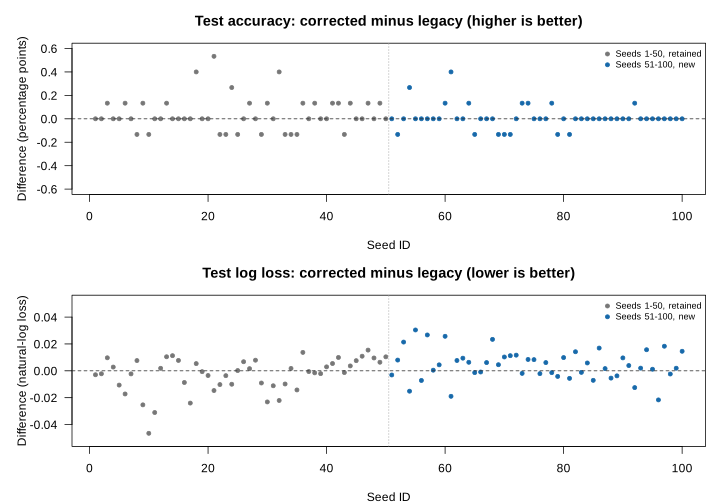

# Heart-failure AdaGrad historical comparison: seeds 1–100

Research documentation for **7.3.1**. All current training used the unchanged **7.3.0** implementation at `a95bc8dda84c4eb35633ee5a5bb456169c1c54b8`. This report is a research record, not a release publication or an algorithm change.

## Observed results

Across all 100 seeds, mean test accuracy is 99.968000% corrected versus 99.942667% legacy (+0.025333 percentage points). Corrected log loss is higher overall (0.02100163 versus 0.02008249), while Brier score is lower overall (0.00317881 versus 0.00358520). In the new 51–100 batch, corrected log loss is higher and Brier score is higher. The findings are mixed across metrics; the accuracy difference does not establish a uniform predictive improvement or better performance on new cases.

## Classification counts

Across the 100 benchmark runs, standard AdaGrad had higher accuracy in 25 seeds,
equal accuracy in 58 and lower accuracy in 17. Aggregate classification errors
fell from 43 to 24: **19 fewer errors**, or 0.19 fewer per run on average.
These counts sum errors over runs on the fixed test split; they do not count
additional distinct patients. Equal accuracy need not mean identical predictions.

## Release decision and possible extension

The project is satisfied with the completed 100-seed follow-up for this release
and will continue with standard AdaGrad. The observed accuracy improvement is
encouraging; adopting the standard recurrence also removes the verified legacy
multilayer double-update behavior. This is a maintenance decision supported by
arithmetic verification, not a claim that every predictive metric improved.

A possible future extension would evaluate seeds 101–1,000, adding the remaining
900 seed IDs from the historical study. It is deferred. The historical Keras
comparison has not been rerun under the corrected implementation, so improved
full-study results remain a possibility rather than an established finding.

## Scope and interpretation

Compare archived legacy AdaGrad observations with corrected standard AdaGrad under the fixed reconstruction described in the full bundle’s PROTOCOL.md. Seeds 1–50 were reused after checksum and checkpoint validation; seeds 51–100 ran sequentially at 360 epochs each. No tuning or model/seed selection used test results. The extension was requested after inspecting the first 50 seeds, so it is not a preregistered confirmatory experiment.

Matching seed IDs does not establish identical original initialization or execution conditions. Original historical initial tensors and RNG state are unavailable. Archived initializer reconstructions under shared current RNG/settings are checked separately and cannot recover what the historical jobs actually initialized. Differences cannot be attributed solely to the AdaGrad correction.

## Separate and combined summaries

Each value is a fraction, not a percentage. SD is the sample SD across seed-level metrics (n−1). Paired differences are corrected minus legacy. Higher classification metrics/AUC and lower log loss/Brier are better. The combined SD is calculated from all 100 seed records, not from batch averages.

### Seeds 1-50

| Metric | Legacy mean ± sample SD | Corrected mean ± sample SD | Paired difference mean ± sample SD |
| --- | --- | --- | --- |
| accuracy | 0.99925333 ± 0.00120949 | 0.99965333 ± 0.00059078 | 0.00040000 ± 0.00143174 |
| precision | 0.99861130 ± 0.00282606 | 0.99904348 ± 0.00181936 | 0.00043218 ± 0.00363813 |
| recall | 0.99895197 ± 0.00286691 | 0.99982533 ± 0.00086440 | 0.00087336 ± 0.00305613 |
| f1 | 0.99877746 ± 0.00198230 | 0.99943317 ± 0.00096598 | 0.00065571 ± 0.00234526 |
| log_loss | 0.02236730 ± 0.01095260 | 0.01960186 ± 0.00876286 | -0.00276544 ± 0.01282050 |
| brier | 0.00419719 ± 0.00266312 | 0.00294602 ± 0.00156278 | -0.00125117 ± 0.00277319 |
| roc_auc | 0.99997729 ± 0.00007593 | 0.99999514 ± 0.00002778 | 0.00001785 ± 0.00008223 |

### Seeds 51-100

| Metric | Legacy mean ± sample SD | Corrected mean ± sample SD | Paired difference mean ± sample SD |
| --- | --- | --- | --- |
| accuracy | 0.99960000 ± 0.00090351 | 0.99970667 ± 0.00055794 | 0.00010667 ± 0.00096525 |
| precision | 0.99913268 ± 0.00247325 | 0.99904348 ± 0.00181936 | -0.00008921 ± 0.00269855 |
| recall | 0.99956332 ± 0.00132334 | 1.00000000 ± 0.00000000 | 0.00043668 ± 0.00132334 |
| f1 | 0.99934621 ± 0.00147483 | 0.99952070 ± 0.00091166 | 0.00017449 ± 0.00157639 |
| log_loss | 0.01779768 ± 0.00855843 | 0.02240141 ± 0.00808494 | 0.00460373 ± 0.01114823 |
| brier | 0.00297321 ± 0.00189628 | 0.00341160 ± 0.00154253 | 0.00043838 ± 0.00237172 |
| roc_auc | 0.99999681 ± 0.00001220 | 0.99999950 ± 0.00000356 | 0.00000268 ± 0.00001283 |

### Seeds 1-100

| Metric | Legacy mean ± sample SD | Corrected mean ± sample SD | Paired difference mean ± sample SD |
| --- | --- | --- | --- |
| accuracy | 0.99942667 ± 0.00107630 | 0.99968000 ± 0.00057231 | 0.00025333 ± 0.00122371 |
| precision | 0.99887199 ± 0.00265504 | 0.99904348 ± 0.00181014 | 0.00017149 ± 0.00319751 |
| recall | 0.99925764 ± 0.00224259 | 0.99991266 ± 0.00061443 | 0.00065502 ± 0.00235324 |
| f1 | 0.99906184 ± 0.00176158 | 0.99947693 ± 0.00093549 | 0.00041510 ± 0.00200269 |
| log_loss | 0.02008249 ± 0.01004492 | 0.02100163 ± 0.00850519 | 0.00091914 ± 0.01251318 |
| brier | 0.00358520 ± 0.00238084 | 0.00317881 ± 0.00156244 | -0.00040640 ± 0.00270396 |
| roc_auc | 0.99998705 ± 0.00005498 | 0.99999732 ± 0.00001982 | 0.00001027 ± 0.00005905 |

## Data overlap limits generalization

The 5,000-row CSV has **1,319 distinct feature rows**. **734/750 validation rows and 738/750 test rows match training inputs**. Only 12 test rows have feature vectors absent from training. The historical split remains rows 1–3500 train, 3501–4250 validation, 4251–5000 test. Scores on this split provide limited evidence about new cases. No patient identity or cause of duplication is inferred.

The same 750 test rows are reused across all seeds. Seed-level SD describes variability under this fixed dataset/split and reconstruction; it is not a patient-population confidence interval. The 75,000 seed-by-test-row predictions are not 75,000 independent clinical cases.

## Fixed workflow and evidence

- All 12 predictors; training feature means/sample SDs, then the training standardized matrix maximum-absolute-value divisor for every split.
- One 12→64→32→1 network, ReLU/ReLU/sigmoid, He initialization, custom_scale=1.04349.
- Corrected standard AdaGrad, lr=0.125 fixed, 360 epochs, L1 lambda=0.00028, dropout list(.1,NULL,NULL), epsilon=1e-7. Native positive/negative class weights remain 2/1.
- Native full-batch trainer loaded with pkgload::load_all(); OPENBLAS_NUM_THREADS=1 and OMP_NUM_THREADS=1. No additional input normalization or batch normalization.
- First strictly best validation accuracy at threshold 0.5; both best weights and biases explicitly restored before fixed-threshold test evaluation.
- Legacy data selected by seed ID, probabilities ordered by unique obs_index and matched to labels. Saved best checkpoints reproduce archived probabilities. Archived six-decimal classifications metrics and native eight-decimal validation accuracies are checked at their stored precision.
- Historical metadata threshold values are retained; every archived test classification in this comparison also matches the fixed 0.5 rule.
- Arithmetic verification is separate: 802 optimizer assertions and 11,360 independent-reference assertions. Final current-run outcomes are saved in arithmetic-tests.csv.
- Source hashes, software versions, configurations, RNG state, initialization/checkpoints, full predictions, timing/status and historical evidence manifests are retained in the full artifact bundle.

## Reproducibility and release placement

The compact report, cohort-summary.csv and paired-test-metrics.csv can be reviewed under dev/research and are excluded from the distributed R package by the existing `^dev$` Rbuildignore rule. Raw models, metadata, images and prediction/checkpoint archives stay outside the package payload. The full bundle contains the tested sequential harness and run-next-50.sh; its manifest records immutable historical commits and SHA256 hashes.

Benchmark source version: 7.3.0. Documentation package version: 7.3.1. The version change adds this research record without changing an optimizer implementation. Release publication remains separate; these results do not establish performance on unseen patients.

For every seed, paired-test-metrics.csv retains the unselected test values and differences. The full bundle’s REPORT.md contains the full per-seed table, checkpoint timing, initialization audit and arithmetic-test outcomes. cohort-summary.csv is the authoritative full-precision cohort summary.

## Paired results figure

The full artifact bundle and its SHA256 are identified in ARTIFACTS.json. Its REPORT.md contains every seed, checkpoint audit and initialization result. The package DESCRIPTION now identifies version 7.3.1, and NEWS includes the research documentation note. RELEASE-NOTE-7.3.1.md preserves the proposed wording; no release has been published.
