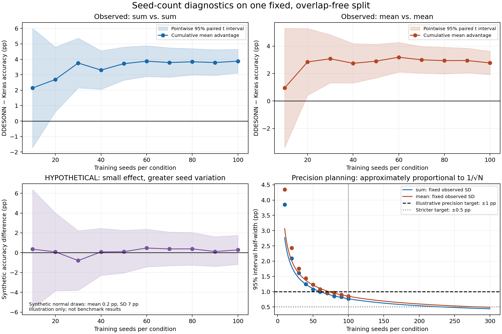

# Why this study retains 100 seeds per condition

We retain the completed 100 seeds for each of four conditions (400 fits). This is a resource-conscious reporting decision made after reviewing the completed cohort, not a prospectively specified or statistically calibrated sequential stopping rule. Earlier 1,000-seed reports with overlapping data are not evidence for this clean-split comparison.

The objective is to estimate the average matched-protocol accuracy difference across training randomness on this particular split. The experimental native DDESONN adapter exceeds Keras by 3.877 percentage points for sum and 2.769 for mean. Ordinary pointwise 95% paired-t intervals are [3.108, 4.646] and [1.919, 3.620] pp. Each of the ten disjoint seed blocks has a positive average difference in both comparisons; this supports consistency across the sampled runs but is not a formal stopping criterion. Individual seed losses remain (15 for sum, 25 for mean).

The present interval half-widths are 0.769 and 0.851 pp. Those are adequate for describing the several-percentage-point differences observed here, provided the uncertainty is reported. There is no universal acceptable half-width. A target of ±1 pp is an illustrative precision standard, chosen retrospectively here; it was not prespecified and is not claimed as an established standard. A stricter ±0.5 pp target would justify additional computation: holding the observed SDs fixed, estimated totals are 234 seeds for sum and 285 for mean. At 250 seeds the projected half-widths are 0.483 and 0.534 pp. Increasing from 100 to 250 would require 600 additional fits, approximately three hours at the measured original throughput, and would mainly refine precision conditional on this split.

## What should the threshold be in a future experiment?

Choose a scientifically useful precision margin h before collecting the final cohort. For independent training seeds, a conventional fixed-sample planning approximation is:

    half-width(N) = t_(0.975, N−1) × SD(paired differences) / sqrt(N)

Use a pilot estimate of the SD to select a fixed final N that achieves the chosen margin; allow for uncertainty in that estimate. The projected uncertainty falls approximately as 1/sqrt(N). The cumulative mean itself is random and need not follow a smooth function or monotonic trend. A flat curve alone can conceal substantial uncertainty.

Whether the interval lies above zero addresses direction. Whether its lower bound exceeds a prespecified practical advantage addresses practical superiority. Whether it is sufficiently narrow addresses precision. These are different questions. An interval crossing zero can reflect either insufficient precision or an effect near zero: additional seeds need not establish a winner. A narrow interval near zero can already be an informative result. Formal equivalence requires a specified equivalence margin and suitable analysis; a nonsignificant difference does not establish equivalence.

If results will be checked repeatedly and sampling stopped based on those checks, use a suitable confidence sequence or a prespecified group-sequential procedure. The pointwise intervals plotted here do not provide that guarantee, and their repeated exclusion of zero must not be treated as a prospective stopping boundary.

## Figures and reproducibility

Top panels: actual cumulative paired differences with pointwise 95% intervals. Bottom left: explicitly synthetic draws (normal distribution, generating mean 0.2 pp and SD 7 pp, RNG seed 20261117), illustrating a near-zero effect with broad uncertainty. It is not a failed or omitted benchmark result. Bottom right: observed interval half-widths as points and fixed-SD planning curves through 300 seeds; horizontal lines are illustrative targets, not validated boundaries.

Regenerate tables with `python analyze_deciles.py` (SciPy), and figures with `python plot_seed_precision.py` (NumPy, SciPy, Matplotlib), from any directory. See [decile tables](SEED_DECILES.md), [machine-readable values](seed-deciles.csv), and [vector figure](seed-precision.svg).

A useful methods study could evaluate precision-based designs across many independent synthetic experiments with known effects and across multiple real datasets/splits. It should compare fixed seed budgets with valid sequential designs using interval coverage, estimation error, decision errors, and compute cost. This single cohort is an illustrative case study, not validation of a universal seed-count rule. More training seeds cannot remove uncertainty from reusing one fixed set of test cases or establish generalization to new datasets.
